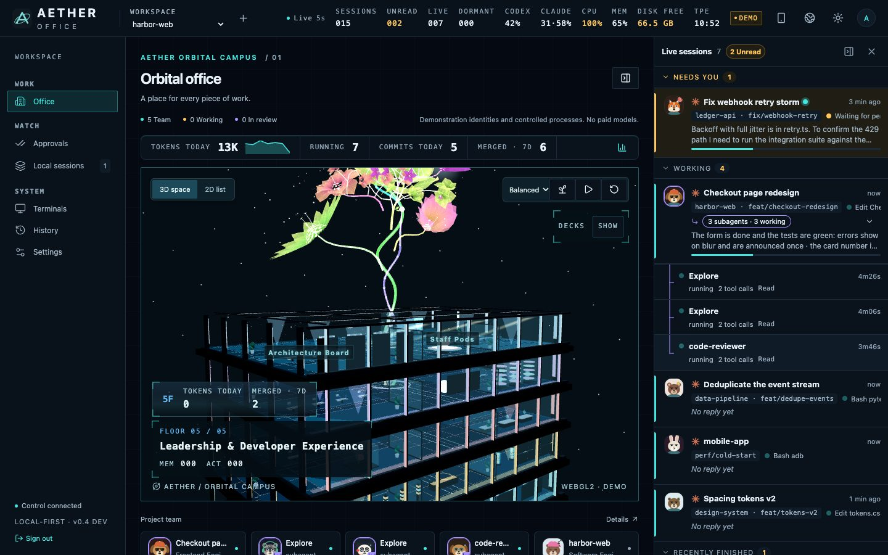
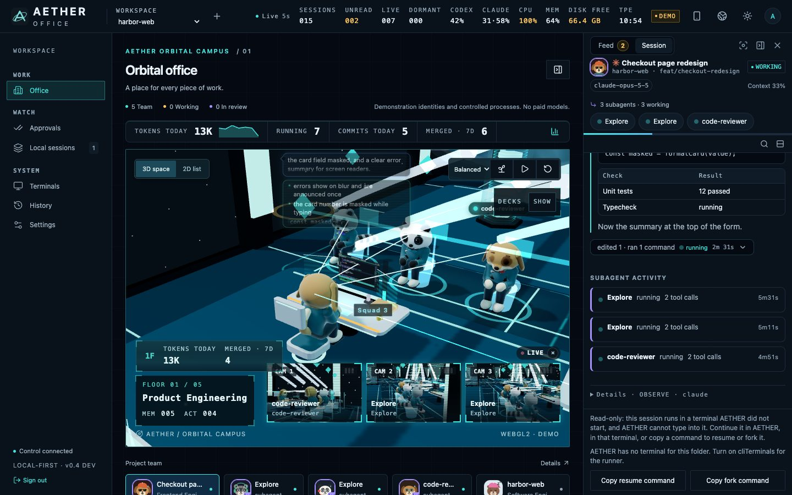
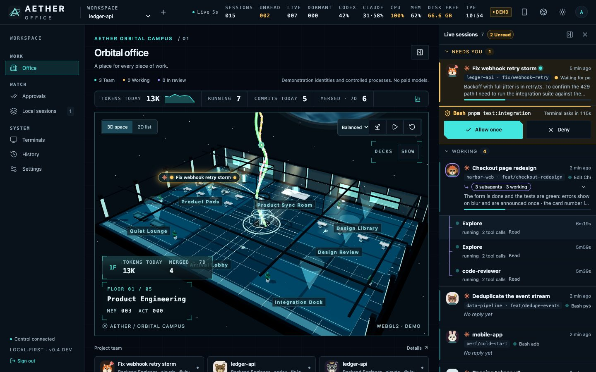
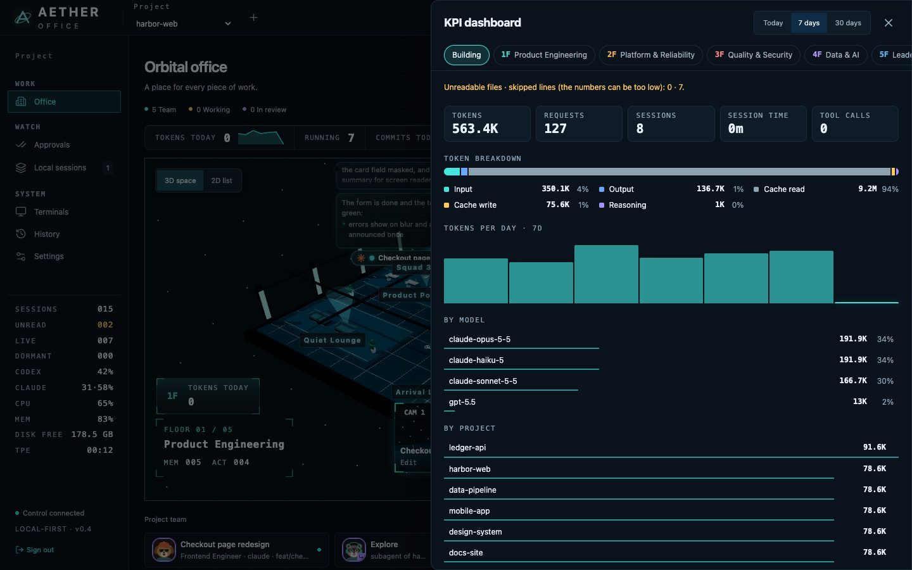
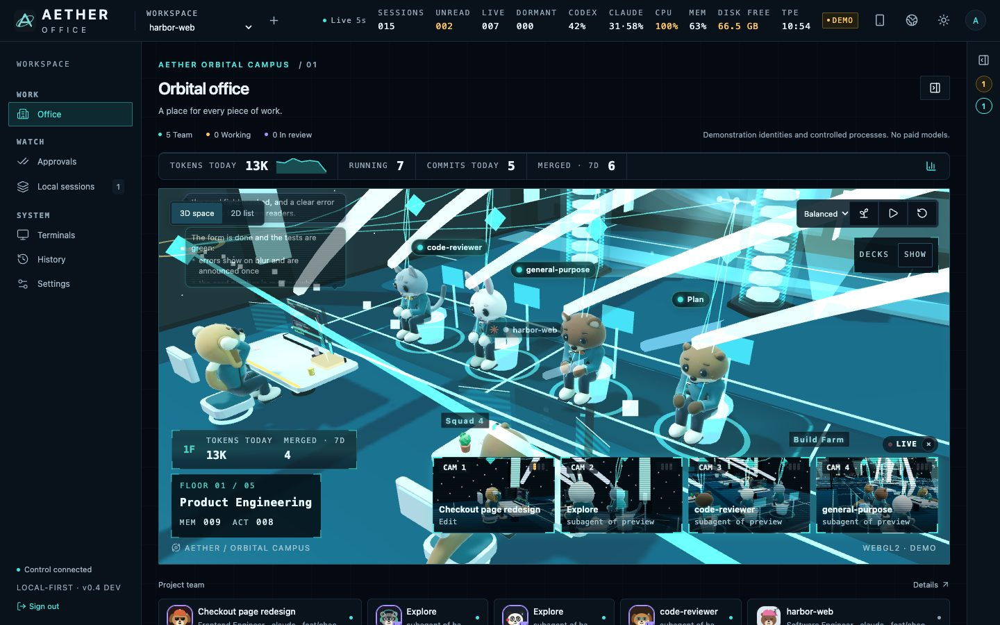
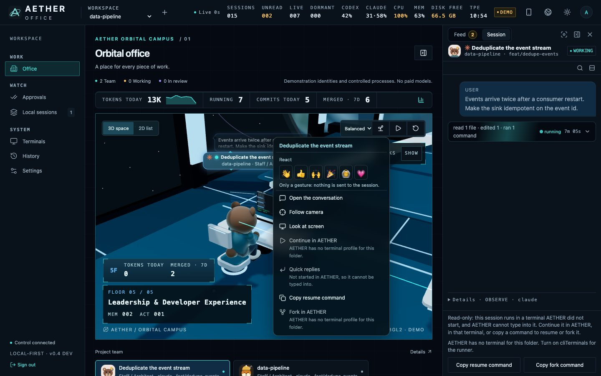
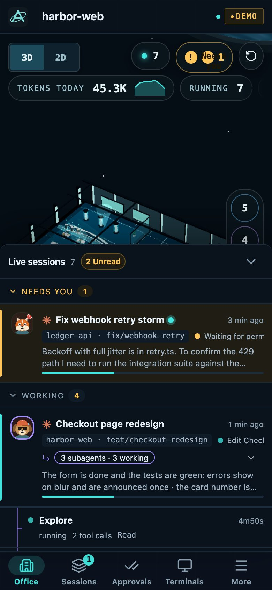

# AETHER OFFICE

[](https://github.com/haotool/aether-office/actions/workflows/ci.yml)
[](LICENSE)

**See and steer the Claude Code and Codex sessions running on your machine.** AETHER OFFICE finds the CLI sessions you
already have open, draws each one as an animal at a desk in a 3D office, and gives you one panel to read their
conversations, answer their permission prompts, check their token use and tidy up the ones you forgot, from a browser or
from a phone on the same network. It is local-first: one process on your computer, no account, no cloud.

English · [繁體中文](README.zh-TW.md)

> **Status: pre-release (`0.4.x`).** It has a large automated test suite, but it is not a production release. The
> [verification ledger](docs/verification/report.md) states which capabilities are verified and which are not.

It is for people who run several `claude` or `codex` terminals at once and want to know which one is working, which one is
waiting for them and what each one did, without switching windows.

<p align="center">
  
</p>

_All screenshots come from synthetic demo data (invented repositories, authors and conversations); see
[docs/images](docs/images/README.md)._

## What you see

- **The office.** Each session is a character on a floor chosen by the engineering role its work belongs to. The
  repository's branches rise through the building as a beanstalk; its history grows a flower garden on top, one flower per
  twelve commits ([the crown](docs/images/office-crown-desktop.jpg)).
- **The session panel.** A live feed of every session grouped into needs you, working, recently finished and idle, and the
  conversation of the one you pick: Markdown replies, tool calls folded into one line, search, copy.

<p align="center">
  
</p>

- **Permission prompts, answered from the panel or a phone** (opt-in, Claude Code).

<p align="center">
  
</p>

- **Token and Git KPIs** for the building and for each floor, counted from the local transcripts.

<p align="center">
  
</p>

- **Subagents as a squad.** A supervisor's subagents sit together beside its desk; strings of light tighten on every tool
  call and a finished result is handed over to the supervisor's desk.

<p align="center">
  
</p>

- **Actions on a character**, only the ones that can really be done, each saying why when it cannot.

<p align="center">
  
</p>

- **On a phone**, the same office and a bottom sheet with the feed, the conversation and the approval card.

<p align="center">
  
  
</p>

## Quick start

Requires Node.js **24.21.0** (`>=24.21.0 <25`) and pnpm **12.8.1** (the `packageManager` field; Corepack installs it).
macOS or Linux.

```sh
pnpm install --frozen-lockfile
pnpm build
pnpm start
```

Open `http://127.0.0.1:4310` (use that exact address; `localhost` is refused on purpose) and sign in with the owner token
whose **file location** the terminal prints. The first start creates `.data/live`, the token and the database. Your recent
Claude Code and Codex sessions appear as observed characters. To try it with fixture data and no sessions of your own, skip the build and
run `pnpm demo`, then open `http://127.0.0.1:4311`.

**From a phone on the same Wi-Fi:**

```sh
AETHER_HOST=0.0.0.0 pnpm start
pnpm run pair     # in a second terminal: a one-time QR code for the phone's camera
```

The server prints the same QR code when it starts with `AETHER_HOST` set. A code works once and expires in five minutes.
The connection is plain HTTP; read [the limits](#honest-limits) first.

Optional: `pnpm hooks install --project /path/to/repo` adds exact activity, and with
`--remote-approvals` the approval cards. What it changes is listed in
[Getting started](docs/getting-started.md#exact-activity-with-hooks-optional).

## What it does, by job

| Job            | What you get                                                                                                                                                                              |
| -------------- | ----------------------------------------------------------------------------------------------------------------------------------------------------------------------------------------- |
| **Watch**      | Local Claude Code and Codex sessions found read-only; active, idle, dormant, orphaned and zombie states; a camera director; a control-room wall; context use and compaction at each desk. |
| **Talk**       | A conversation view with notices, Markdown, code and search; a composer for sessions that run in an AETHER terminal (`/` commands, `@` files, Stop); quick replies.                       |
| **Approve**    | Claude Code permission prompts as cards in the panel and on a phone: Allow once, Allow for this session (only a rule Claude offered), Deny with a reason. Opt-in, off by default.         |
| **Understand** | Role and floor classification with its evidence; token KPIs and rate-limit windows; commits, merges and open branches; a Git beanstalk; the model catalog each CLI offers.                |
| **Tidy up**    | Clock out sessions idle for days in one action (`SIGTERM`, then `SIGKILL` after 5 s; transcripts are never deleted); stop one session; reap zombie processes; Git health and worktrees.   |
| **Have fun**   | Small decorative moments from real signals (a rubber duck, a test lamp, a rocket on `git push`), meme effects, a first-visit tour. Calm mode turns them all off.                          |

Beyond the CLI view, **Settings → Advanced features** opens an orchestration workbench: tasks, reviews, schedules, a runner
that starts Codex or Claude in isolated Git worktrees with per-call approvals, MCP tools, an A2A gateway and an ACP client.
That part is secondary to the above; see [Native execution](docs/native-execution.md).

## Honest limits

- **Observed sessions are read-only.** A session you started in your own terminal can be watched, read, stopped (owner
  only) and cleaned up. It cannot be typed into. Only a session that runs inside an **AETHER terminal** has the composer;
  any other one can be **continued or forked** there (`claude --resume`, `codex resume`). That needs a runner with
  `cliTerminals` enabled ([native execution](docs/native-execution.md)); the buttons say so while it is off.
- **Hooks add detail; they are not required to see a session.** Without them you still get sessions, conversations, tokens
  and Claude subagents read from their transcript files. Exact "working / waiting for approval" states, tool outcomes
  (passed or failed), command labels for the office effects, and **all** remote approvals need the hooks.
  Remote approvals are Claude Code only; Codex has no equivalent.
- **Plain HTTP on a LAN.** The token and the session cookie are not encrypted on the network. Answering a permission prompt
  over plain HTTP from a phone is refused unless you use HTTPS (for example a Tailscale tunnel) or set
  `AETHER_REMOTE_APPROVALS_LAN=1`. Over plain HTTP the page is not an installable app and has no offline shell
  (service workers need a secure context). See [Getting started](docs/getting-started.md#install-it-on-a-phone).
- **Not a sandbox.** An agent keeps the file permissions of the user who started it. AETHER OFFICE does not isolate agents
  and does not defend against code that already runs as you ([security](docs/security.md)).
- **One trusted operator.** There is no multi-user or multi-tenant mode.
- **Platforms.** macOS and Linux. The terminal supervisor does not support native Windows.
- **Token counts, not money.** No price table exists on the machine, so no cost is shown.
- **Pre-release.** Many capabilities are verified only in part; the ledger says which.

## Privacy and security

- **No cloud, no telemetry.** The control plane listens on `127.0.0.1` unless you set `AETHER_HOST`. The only outbound
  connections in the code are the opt-in connectors (GitHub, Linear) and the opt-in A2A gateway; the web app loads nothing
  from a CDN. Nothing is uploaded, and no paid model is called unless you assign work to a runner.
- **Read-only discovery.** Session files and the process table are read; nothing is written under `~/.claude` or `~/.codex`.
  Transcript text is read only for the session you open and is redacted for known secret formats before it reaches the page.
- **Yours to remove.** Everything AETHER writes is one data directory, a private `~/.aether` directory and the hook
  entries you chose to install; [how to remove all of it](docs/how-to.md#run-it).
- **Hooks record labels, not content:** session ids, event names, tool names and short targets such as a file's base name
  or a command's first word, in `~/.aether/hook-events.jsonl`. Never prompts, full commands, arguments or paths.
- **Hardened by default:** exact Host and Origin checks (DNS-rebinding guard), HttpOnly session cookies with CSRF tokens,
  an authorization matrix pinned by tests, text from agents is never rendered as HTML, and approvals are signed so a process
  squatting on the loopback port cannot answer for you.

The threat model, every endpoint's audience and the LAN checklist are in [docs/security.md](docs/security.md). Report
vulnerabilities through [SECURITY.md](.github/SECURITY.md), not public issues.

## How it works

```
 Claude Code / Codex CLIs                       your machine                         your browser / phone
 ┌───────────────────────┐   files, process   ┌──────────────────────────┐  HTTP    ┌─────────────────────────┐
 │ sessions you started  │ ─────────────────► │ scanner (read-only)      │ ◄──────► │ web app (React)         │
 │ transcripts, hooks    │   hook records     │        │                 │  + SSE   │  panel, KPIs, settings  │
 └───────────────────────┘ ─────────────────► │        ▼                 │ change   │          │              │
                                              │ control plane            │ stream   │          ▼              │
 ┌───────────────────────┐   claim / report   │ Fastify + SQLite, auth,  │          │ 3D office scene         │
 │ runner (optional)     │ ◄────────────────► │ commands, events         │          │ (Three.js, lazy loaded) │
 │ worktrees, terminals  │                    └──────────────────────────┘          └─────────────────────────┘
 └───────────────────────┘
```

A scanner reads sessions every two seconds while someone is connected; one shared watcher turns differences into
content-free change events that the page follows over server-sent events and answers by refetching. The runner is a separate
process that never writes the database. Details: [Architecture](docs/architecture.md).

## Supported providers

| Provider    | Verified releases                          | Notes                                                                                                              |
| ----------- | ------------------------------------------ | ------------------------------------------------------------------------------------------------------------------ |
| Claude Code | the 2.1.x series (checked against 2.1.289) | Hooks, remote approvals, subagents, model catalog.                                                                 |
| Codex CLI   | 0.159.2, 0.160.0, 0.160.1 (exact releases) | Observation, hooks, models, rate-limit windows. No remote approvals. A release not listed is refused, not assumed. |

ACP agents and the A2A 1.0 gateway are optional. The full matrix and how to add a release:
[docs/provider-compatibility.md](docs/provider-compatibility.md).

## Documentation

Start at [docs/README.md](docs/README.md). The most used:
[Getting started](docs/getting-started.md) · [Features](docs/features.md) · [Configuration](docs/configuration.md) ·
[Architecture](docs/architecture.md) · [Security](docs/security.md) · [Development](docs/development.md) ·
[Changelog](CHANGELOG.md).

## Contributing

Contributions are welcome. Read [CONTRIBUTING.md](.github/CONTRIBUTING.md) and the [Code of Conduct](.github/CODE_OF_CONDUCT.md).

Most of this project was written with AI coding agents (Claude Code, Codex and Cursor) under the maintainer's direction.
[AGENTS.md](AGENTS.md) is the rule file they follow, and their changes pass the same checks as any other. AI-assisted
contributions are welcome under the same rules ([licence policy](docs/legal/licence-policy.md#ai-assisted-contributions)).

## License

[MIT](LICENSE). Copyright (c) 2026 haotool; portions copyright (c) 2026 AgentSystemLabs, from which this project
started ([agent-office](https://github.com/AgentSystemLabs/agent-office)). Third-party software and its terms are listed
in [THIRD_PARTY_NOTICES.md](docs/legal/THIRD_PARTY_NOTICES.md) and [NOTICE](NOTICE); the licence inventory, policy and provenance are in
[docs/legal](docs/legal/README.md).

AETHER OFFICE is an independent project. It is not affiliated with, endorsed by or sponsored by Anthropic or OpenAI.
AETHER neither stores nor forwards your Claude credentials: it runs your own Claude Code in your environment.
Claude and Claude Code are trademarks of Anthropic, PBC; Codex and OpenAI are trademarks of OpenAI. All other marks belong
to their owners.
