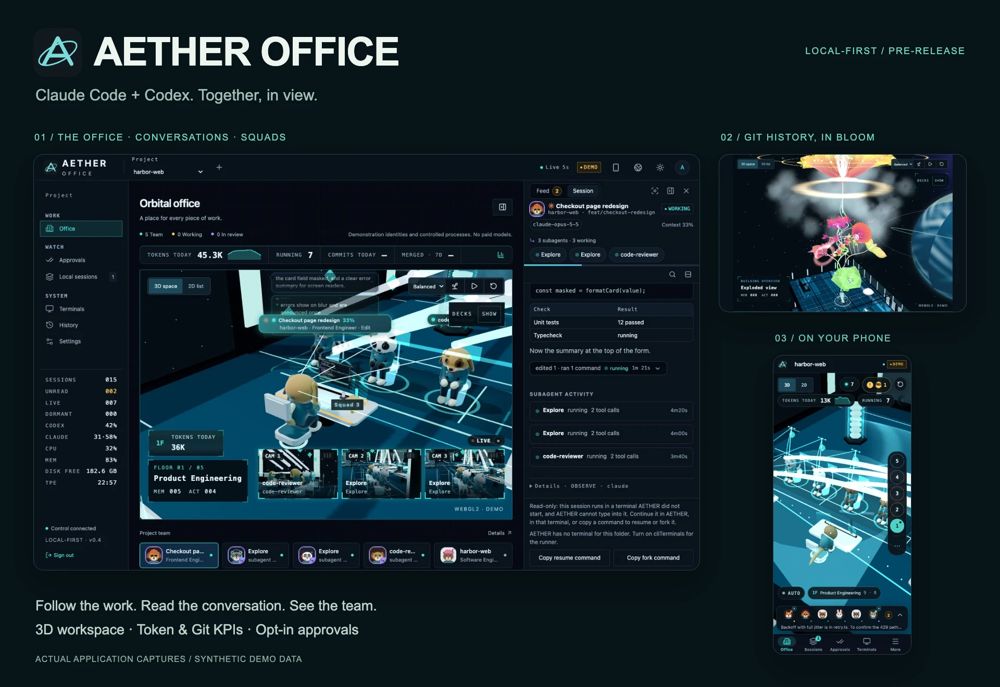
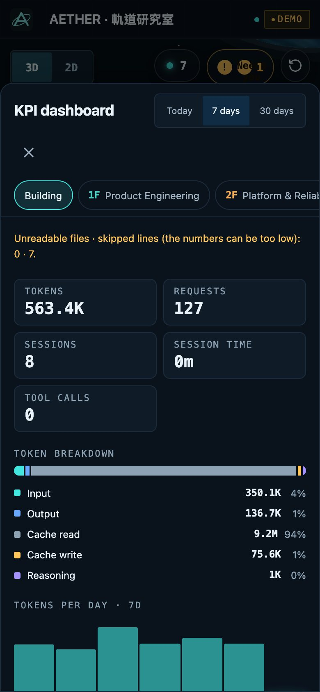
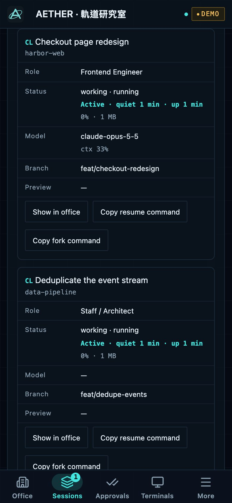
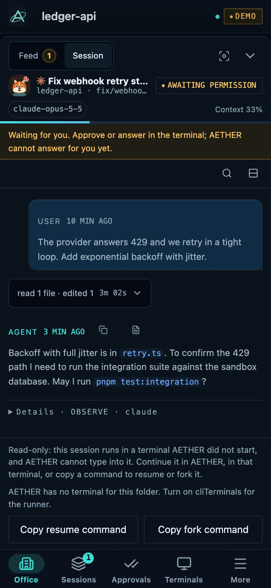

<h1 align="center">One office for your coding agents.</h1>

<p align="center">
  <a href="https://github.com/haotool/aether-office/actions/workflows/ci.yml"></a>
  <a href="https://github.com/haotool/aether-office/releases"></a>
  <a href="LICENSE"></a>
</p>

<p align="center">
  <a href="#quick-start">Quick start</a> ·
  <a href="docs/README.md">Documentation</a> ·
  <a href=".github/CONTRIBUTING.md">Contributing</a> ·
  <a href="README.zh-TW.md">繁體中文</a>
</p>

_Actual application UI with synthetic demo data. The Git flower visualizes repository history.
[Image source and reproduction](docs/images/README.md#hero-provenance)._

AETHER OFFICE brings your **Claude Code and Codex sessions into one local 3D office**. See who is working, read
conversations and tool calls, and follow subagent squads without switching between terminals. The central Git flower
grows from repository history; token and Git KPIs show the activity behind the scene.

Open the same office on your phone over trusted Wi-Fi to follow the work away from your desk.

It runs locally: no AETHER account or cloud service is required. Your existing CLI credentials and provider subscriptions
remain with Claude Code or Codex.

> [!IMPORTANT]
> **Pre-release (`0.4.x`).** Some capabilities remain partly verified. Read the
> [verification ledger](docs/verification/report.md) and [support limits](#support-and-limits) before relying on it for a
> critical workflow.

## What you can do

| Workflow               | Capabilities                                                                                 | Guide                                                                                                       |
| ---------------------- | -------------------------------------------------------------------------------------------- | ----------------------------------------------------------------------------------------------------------- |
| Follow sessions        | Work state, conversation history, Markdown, folded tool calls and subagent squads            | [Features](docs/features.md)                                                                                |
| Respond to Claude Code | Opt-in permission prompts and an owned session's composer; external sessions start read-only | [Remote approvals](docs/getting-started.md#answer-claude-code-permission-prompts-from-the-browser-optional) |
| Understand activity    | Token and Git KPIs, session roles and activity signals across office floors                  | [Session roles](docs/roles.md)                                                                              |
| Use a phone            | Pair with a one-time QR code; open the feed and conversation in a bottom sheet               | [Phone access](docs/getting-started.md#open-it-from-a-phone-or-tablet)                                      |
| Manage execution       | Optional worktrees, terminals, bounded tasks, review and commit-bound verification           | [Native execution](docs/native-execution.md)                                                                |

## Quick start

**Requirements:** Node.js **24.21.0** (`>=24.21.0 <25`), pnpm **12.8.1**, and macOS or Linux. Versions are pinned in
`.nvmrc` and `package.json`. See [environment setup](docs/getting-started.md#requirements) if pnpm is not installed.

```sh
git clone https://github.com/haotool/aether-office.git
cd aether-office
pnpm install --frozen-lockfile
pnpm build
pnpm start
```

Open **<http://127.0.0.1:4310>** and sign in with the owner token. The terminal prints its **file location**; keep the
token private. Use this exact address: the host guard intentionally refuses `localhost`.

The first start creates `.data/live` with the database and local credentials. Recent Claude Code and Codex sessions
appear automatically as observed sessions. [First-run guide](docs/getting-started.md).

### Try the demo

After installing dependencies, run:

```sh
pnpm demo
```

Open **<http://127.0.0.1:4311>**. The demo uses fixture data and calls no paid model.

### Connect a phone

On a trusted local network:

```sh
AETHER_HOST=0.0.0.0 pnpm start
pnpm run pair
```

Scan the QR code on the same Wi-Fi. Pairing codes work once and expire after five minutes.

> [!WARNING]
> LAN access uses plain HTTP unless you configure HTTPS. Tokens and cookies cross that network unencrypted. Remote
> approvals require HTTPS or an explicit LAN opt-in; an installable app with its offline shell also needs a secure
> context. Follow the [phone and HTTPS guide](docs/getting-started.md#install-it-on-a-phone).

### Add exact activity and approvals

Hooks provide tool outcomes, subagent activity and permission prompts beyond the information available in transcripts.

```sh
pnpm hooks install --project /path/to/repo
pnpm hooks install --project /path/to/repo --remote-approvals
```

Review [what the installer changes](docs/getting-started.md#exact-activity-with-hooks-optional). Remote approvals apply to
Claude Code; Codex has no equivalent hook contract.

<details>
<summary><strong>Explore the office, Git flower, conversations and mobile views</strong></summary>

- [Multi-floor office](#multi-floor-office)
- [Git flower crown](#git-flower-crown)
- [Conversations and squads](#conversations-and-squads)
- [Token and Git dashboard](#token-and-git-dashboard)
- [Four views on your phone](#four-views-on-your-phone)

### Multi-floor office

The original wide shots show the building and its central Git flower in dark and light themes. These retain the earlier application chrome; the feature views below show the current interface.

**Dark theme**


**Light theme**


### Git flower crown

Repository history becomes a branching flower above the office. The original crown close-up includes the exploded building view.


### Conversations and squads

Read conversations and folded tool results alongside the 3D office, then follow a supervisor's subagents and camera views.

**Conversation panel**


**Subagent squad**


### Token and Git dashboard


### Four views on your phone

**01 · The 3D office — 02 · Token use and charts**

<p align="center">
  
  
</p>

**03 · The full session list — 04 · A conversation**

<p align="center">
  
  
</p>

All workspace examples use synthetic data. Images illustrate the interface; they are not live-provider verification evidence. [Complete image index](docs/images/README.md).

</details>

## Support and limits

| Area              | Current support                                                                                                           |
| ----------------- | ------------------------------------------------------------------------------------------------------------------------- |
| Claude Code       | 2.1.x, checked against 2.1.289; hooks, subagents, model catalog and optional remote approvals                             |
| Codex CLI         | Exact verified releases 0.159.2, 0.160.0 and 0.160.1; unlisted releases are refused                                       |
| macOS             | Tested browser platform; native Windows terminals are unsupported                                                         |
| Linux             | Installation and unit tests run in CI; browser coverage is stated in the [development guide](docs/development.md#testing) |
| External sessions | Read-only until an eligible session is continued under AETHER's control                                                   |
| Permissions       | One trusted local operator; no multi-user isolation or sandbox for code running as that operator                          |
| Usage             | Token counts and recorded limit readings; no provider price table or monetary cost estimate                               |

ACP agents and the A2A gateway are optional. The complete contracts and upgrade procedure are in
[provider compatibility](docs/provider-compatibility.md).

## Architecture

The control plane owns the SQLite database and enforces authentication and commands. A read-only scanner discovers
sessions; server-sent events notify the web app of changes. The optional runner claims work and reports results through
the API, and the browser loads the Three.js scene when it is needed.

| Directory                                                   | Responsibility                                                         |
| ----------------------------------------------------------- | ---------------------------------------------------------------------- |
| `apps/control`                                              | Fastify API, authentication, database, session discovery and events    |
| `apps/runner`                                               | Provider processes, worktrees and terminals; no direct database writes |
| `apps/web`                                                  | React interface, session panel and app shell                           |
| `packages/contracts`, `kernel`, `providers`, `office-scene` | Shared contracts, domain rules, CLI adapters and scene assets          |

Read the [architecture](docs/architecture.md) and [security model](docs/security.md) for data flow and trust boundaries.

## Documentation

| Start here                                                       | Reference                                                | Project                                      |
| ---------------------------------------------------------------- | -------------------------------------------------------- | -------------------------------------------- |
| [Getting started](docs/getting-started.md)                       | [Configuration](docs/configuration.md)                   | [Contributing](.github/CONTRIBUTING.md)      |
| [How-to guides](docs/how-to.md)                                  | [Provider compatibility](docs/provider-compatibility.md) | [Development](docs/development.md)           |
| [Features](docs/features.md)                                     | [Security](docs/security.md)                             | [Changelog](CHANGELOG.md)                    |
| [Phone and HTTPS](docs/getting-started.md#install-it-on-a-phone) | [Verification ledger](docs/verification/report.md)       | [Architecture decisions](docs/adr/README.md) |

The [documentation index](docs/README.md) also covers design records, performance measurement, release procedures and
licensing. [繁體中文介紹](README.zh-TW.md).

## Contributing

Bug reports and focused pull requests are welcome. Start with [CONTRIBUTING.md](.github/CONTRIBUTING.md), the
[Code of Conduct](.github/CODE_OF_CONDUCT.md) and the [development guide](docs/development.md). AI-assisted contributions
follow the same review, verification and licensing rules; [AGENTS.md](AGENTS.md) records the repository boundaries.

Report vulnerabilities privately through [SECURITY.md](.github/SECURITY.md). Use [Support](.github/SUPPORT.md) for setup
questions and reproducible bug reports.

## License and attribution

[MIT](LICENSE). Copyright (c) 2026 haotool. Portions originate from
[AgentSystemLabs/agent-office](https://github.com/AgentSystemLabs/agent-office), copyright (c) 2026 AgentSystemLabs.
Attribution is retained in [NOTICE](NOTICE), [provenance](docs/legal/provenance.md) and the
[third-party notices](docs/legal/THIRD_PARTY_NOTICES.md).

AETHER OFFICE is an independent project and is not affiliated with, endorsed by or sponsored by Anthropic or OpenAI.
Claude and Claude Code are trademarks of Anthropic, PBC; Codex and OpenAI are trademarks of OpenAI. Other marks belong to
their owners.
