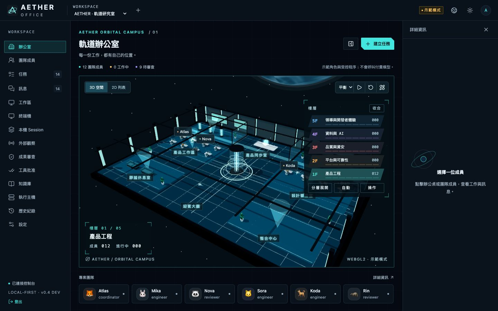
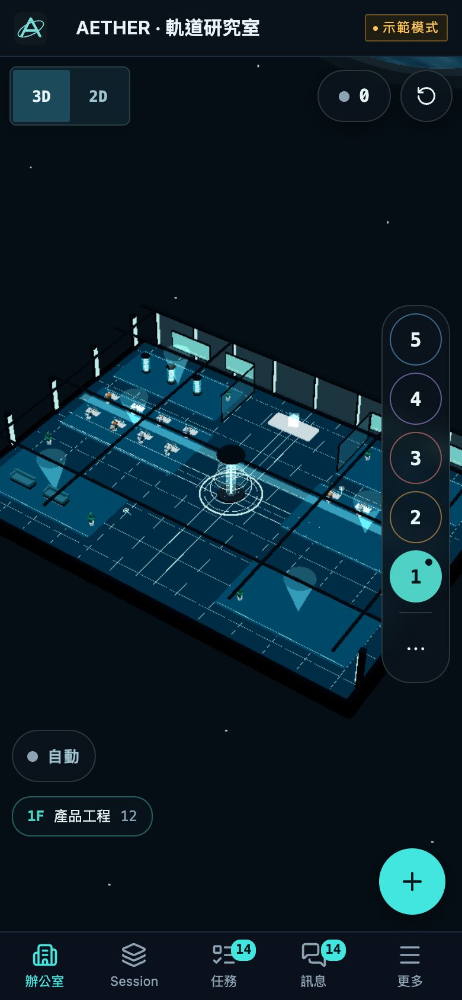

# AETHER OFFICE

[](https://github.com/haotool/aether-office/actions/workflows/ci.yml)
[](LICENSE)

**本機優先的程式代理工作空間。** AETHER OFFICE 把你電腦上執行中的 Claude Code 與 Codex session 畫成 3D 辦公室裡的動物角色，
依專案與工程職位分組，並讓你在瀏覽器（包含同一個區網內的手機）派工、審查與驗證。

[English](README.md) · 繁體中文

> **狀態：開發中（`0.4.0-dev`）。** 可用且經過大量測試，但不是正式發行版。[驗收台帳](docs/verification/report.md)
> 明確列出哪些功能已驗證、哪些尚未。

<p align="center">
  
  
</p>

## 功能

- **免設定就看見你的代理。** 以唯讀方式發現本機 Claude Code 與 Codex session，依工作所屬的工程職位放到對應樓層與座位。可選擇安裝
  hooks 取得精確的活動狀態（執行中、等待批准）與子代理歸屬。
- **會自己說明的 3D 辦公室。** 導演鏡頭自動切到正在對話、等待、出錯或工作中的成員；訊息與子代理的往來畫在桌子之間；
  睡覺的兔子、孤魂與殭屍分別標示休眠、孤兒與殭屍 session，並提供一鍵停止或清理。
- **完整的 2D 工作台。** 任務（列表、看板、依賴圖）、訊息與討論室、審查與批准、Git 圖與健康檢查、終端機、知識庫、排程等，
  並適應手機、平板與桌面。
- **有安全護欄的受管執行。** 獨立的 runner 在隔離的 Git worktree 中啟動 Codex 或 Claude，逐次工具批准、固定 SHA 的審查與驗證、
  可持久的日誌，沒有任何權限繞過。
- **可互通。** 提供代理使用的 MCP 工具、ACP 與 A2A 端點、hooks 與有型別的 HTTP API。
- **誠實。** 觀察到的 session 一律唯讀，示範與 fixture 資料有標示，除非你明確啟用，否則不會呼叫付費模型。

## 快速開始

需要 Node.js **24.21.0** 與 `package.json` 指定的 pnpm 版本。

```sh
pnpm install --frozen-lockfile
pnpm build
pnpm demo
```

開啟 `http://127.0.0.1:4311`，用終端機印出位置的 owner token 登入。示範模式使用 fixture 資料，不呼叫付費模型。
live 模式、區網手機存取、hooks 與原生執行請見[開始使用](docs/getting-started.md)（英文）。

## 文件

文件以英文撰寫，索引見 [docs/README.md](docs/README.md)。貢獻方式見 [CONTRIBUTING.md](CONTRIBUTING.md)，
安全通報見 [SECURITY.md](SECURITY.md)。

## 授權

[MIT](LICENSE)。Copyright (c) 2026 haotool；部分程式 Copyright (c) 2026 AgentSystemLabs（本專案的起點
[agent-office](https://github.com/AgentSystemLabs/agent-office)）。第三方軟體與其條款見 [THIRD_PARTY_NOTICES.md](THIRD_PARTY_NOTICES.md)。
