<h1 align="center">讓你的程式代理，在同一間辦公室協作。</h1>

<p align="center">
  <a href="https://github.com/haotool/aether-office/actions/workflows/ci.yml"></a>
  <a href="https://github.com/haotool/aether-office/releases"></a>
  <a href="LICENSE"></a>
</p>

<p align="center">
  <a href="#快速開始">快速開始</a> ·
  <a href="docs/README.md">文件索引</a> ·
  <a href=".github/CONTRIBUTING.md">參與開發</a> ·
  <a href="README.md">English</a>
</p>

_首圖使用繁體中文實際介面與合成示範資料；中央 Git 花呈現儲存庫歷史。
[圖片來源與重製方式](docs/images/README.md#hero-provenance)。_

AETHER OFFICE 把 **Claude Code 與 Codex 的工作階段，帶進同一間本機 3D 辦公室**。不用切換多個終端機，就能查看誰正在工作、閱讀對話與工具呼叫，並追蹤子代理小隊。中央 Git 花隨儲存庫歷史生長，Token 與 Git 指標則呈現場景背後的活動。

手機連上可信任的 Wi-Fi，也能開啟同一間辦公室，離開桌面後繼續掌握進度。

服務在本機執行，不需要 AETHER 帳號或雲端服務。Claude Code、Codex 的登入憑證與訂閱仍由原本的 CLI 管理。

> [!IMPORTANT]
> **目前為預發行版（`0.4.x`）。** 部分能力仍只有部分驗證。用於重要工作前，請先閱讀
> [功能驗證台帳](docs/verification/report.md)與[支援範圍](#支援範圍與限制)。

## 可以做什麼

| 工作             | 能力                                                                             | 指南                                                                              |
| ---------------- | -------------------------------------------------------------------------------- | --------------------------------------------------------------------------------- |
| 追蹤 session     | 工作狀態、對話歷史、Markdown、可展開的工具呼叫與子代理小隊                       | [功能說明](docs/features.md)                                                      |
| 回應 Claude Code | 明確啟用後的權限批准，以及受 AETHER 控制的 session 輸入；外部 session 起初為唯讀 | [遠端批准](docs/getting-started.zh-TW.md#在瀏覽器回答-claude-code-的權限提示選用) |
| 理解工作量       | Token 與 Git 指標、角色分層、辦公室裡的活動訊號                                  | [Session 角色](docs/roles.md)                                                     |
| 使用手機         | 一次性 QR 配對、底部抽屜裡的 session 列表與對話                                  | [手機連線](docs/getting-started.zh-TW.md#從手機或平板開啟)                        |
| 管理執行         | 選用的 worktree、終端機、有限額任務、審查與固定 commit 驗證                      | [原生執行](docs/native-execution.md)                                              |

## 快速開始

**需求：** Node.js **24.21.0**（`>=24.21.0 <25`）、pnpm **12.8.1**，以及 macOS 或 Linux。
版本固定在 `.nvmrc` 與 `package.json`；尚未安裝 pnpm 時，請先看[環境設定](docs/getting-started.zh-TW.md#環境需求)。

```sh
git clone https://github.com/haotool/aether-office.git
cd aether-office
pnpm go
```

`pnpm go` 會自動安裝、建置、啟動控制台，並以一次性連結直接在瀏覽器登入（不會印出 owner token）。想自己一步一步來：

```sh
pnpm install --frozen-lockfile
pnpm build
pnpm start
```

開啟 **<http://127.0.0.1:4310>**，使用 owner token 登入。終端機會印出 token 的**檔案位置**，請妥善保管；輸入 `localhost:4310` 會自動導向此網址，其他主機名稱一律拒絕。

第一次啟動會在 `.data/live` 建立資料庫與本機憑證。最近的 Claude Code、Codex session 會自動以觀察模式出現。[首次使用指南](docs/getting-started.zh-TW.md)。

### 試用示範模式

安裝依賴後執行：

```sh
pnpm demo
```

開啟 **<http://127.0.0.1:4311>**。示範模式使用 fixture 資料，不呼叫付費模型。

### 連接手機

在可信任的區域網路中執行：

```sh
AETHER_HOST=0.0.0.0 pnpm start
pnpm run pair
```

手機連上相同 Wi-Fi 後掃描 QR code。每個配對碼只能使用一次，五分鐘後失效。

> [!WARNING]
> 區域網路連線預設使用明文 HTTP，token 與 cookie 未加密傳送。遠端批准需要 HTTPS，或明確啟用區域網路選項；完整可安裝 App 與離線功能也需要安全來源。
> 請依照[手機與 HTTPS 指南](docs/getting-started.zh-TW.md#安裝到手機)設定。

### 加入工具活動與權限批准

Hooks 可補上 transcript 以外的工具結果、子代理活動與權限提示。

```sh
pnpm hooks install --project /path/to/repo
pnpm hooks install --project /path/to/repo --remote-approvals
```

安裝前請閱讀[會修改哪些檔案](docs/getting-started.zh-TW.md#以-hooks-取得精確活動選用)。遠端批准適用於 Claude Code；Codex 沒有相同的 hook 合約。

## 產品畫面導覽

即時對話列表（Feed）顯示工作狀態、最新回覆與子代理；Session 管理頁顯示提供者、分支與程序資料。Git 提交圖與事件歷史也分開呈現。下表每一項都附有桌面及手機的實際截圖。

| 功能               | 電腦                                                       | 手機                                                  |
| ------------------ | ---------------------------------------------------------- | ----------------------------------------------------- |
| 3D 辦公室與小隊    | [查看](docs/images/squad-strings-desktop.zh-TW.jpg)        | [查看](docs/images/office-phone.zh-TW.jpg)            |
| 即時對話列表 Feed  | [查看](docs/images/conversation-feed-desktop.zh-TW.jpg)    | [查看](docs/images/conversation-feed-phone.zh-TW.jpg) |
| 對話與工具結果     | [查看](docs/images/session-conversation-desktop.zh-TW.jpg) | [查看](docs/images/conversation-phone.zh-TW.jpg)      |
| Session 管理資料   | [查看](docs/images/sessions-desktop.zh-TW.jpg)             | [查看](docs/images/sessions-list-phone.zh-TW.jpg)     |
| Token 與 Git 指標  | [查看](docs/images/kpi-dashboard-desktop.zh-TW.jpg)        | [查看](docs/images/kpi-phone.zh-TW.jpg)               |
| Git 提交與分支歷史 | [查看](docs/images/git-history-desktop.zh-TW.jpg)          | [查看](docs/images/git-history-phone.zh-TW.jpg)       |
| 權限請求與批准     | [查看](docs/images/approvals-desktop.zh-TW.jpg)            | [查看](docs/images/approvals-phone.zh-TW.jpg)         |
| 互動式終端機       | [查看](docs/images/terminals-desktop.zh-TW.jpg)            | [查看](docs/images/terminals-phone.zh-TW.jpg)         |
| 事件歷史與回放     | [查看](docs/images/event-history-desktop.zh-TW.jpg)        | [查看](docs/images/event-history-phone.zh-TW.jpg)     |

Git 提交圖位於選用的進階工作區。權限畫面使用尚未決定的合成請求；終端機使用專案既有的隔離 PTY fixture，畫面中的「live」指本機連線模式，不代表真實模型呼叫。

<details>
<summary><strong>電腦：對話列表、Git 歷史與重要功能</strong></summary>

### 即時對話列表 Feed

即時對話列表依「需要你、工作中、剛完成」分組，呈現每個對話的摘要與小隊狀態。

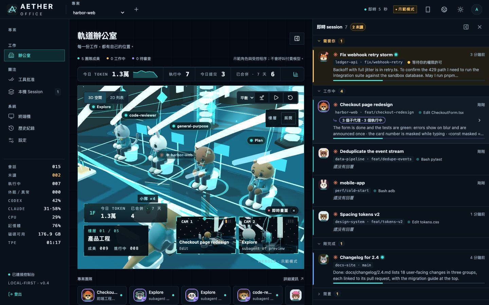

### Git 提交與分支歷史

使用合成 Git 儲存庫呈現真實提交線、分支標籤、merge 與 SHA；下方也可查看 worktree 與 Git 健康狀態。

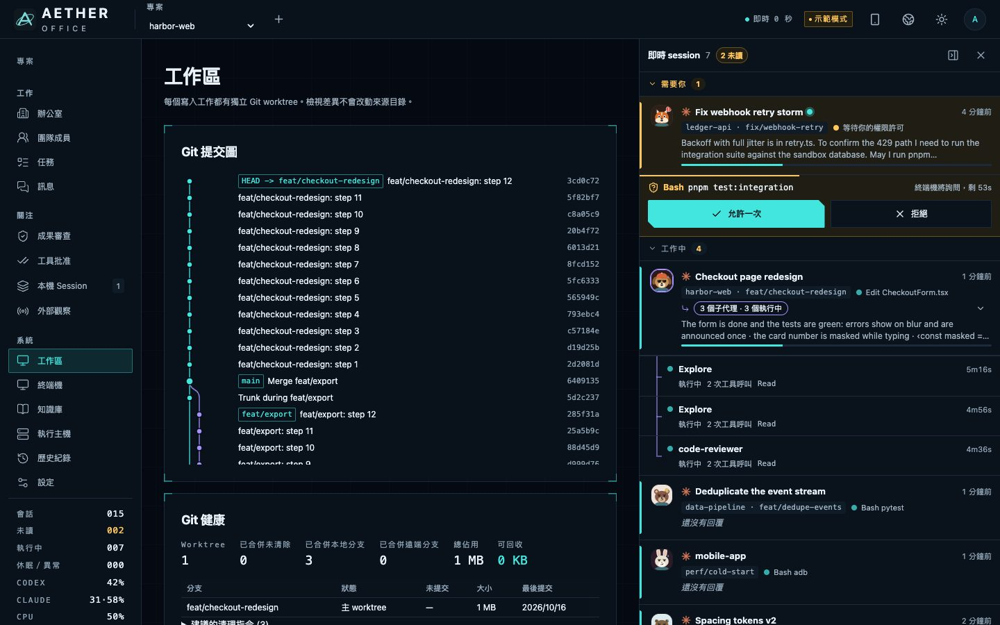

### 對話與工具結果


### 3D 辦公室與小隊


### Session 管理資料

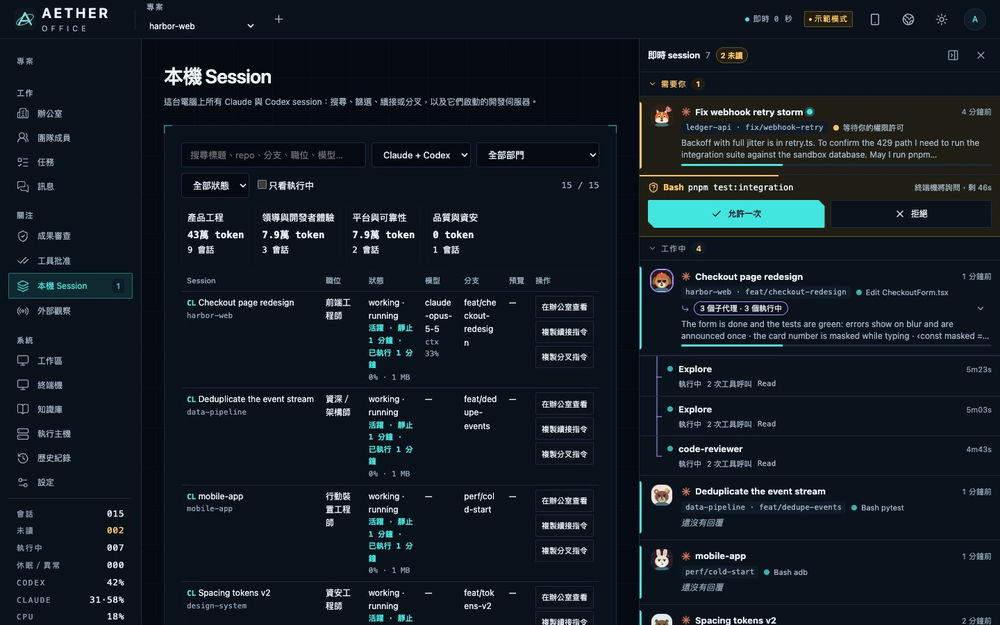

### Token 與 Git 指標


### 權限請求與批准

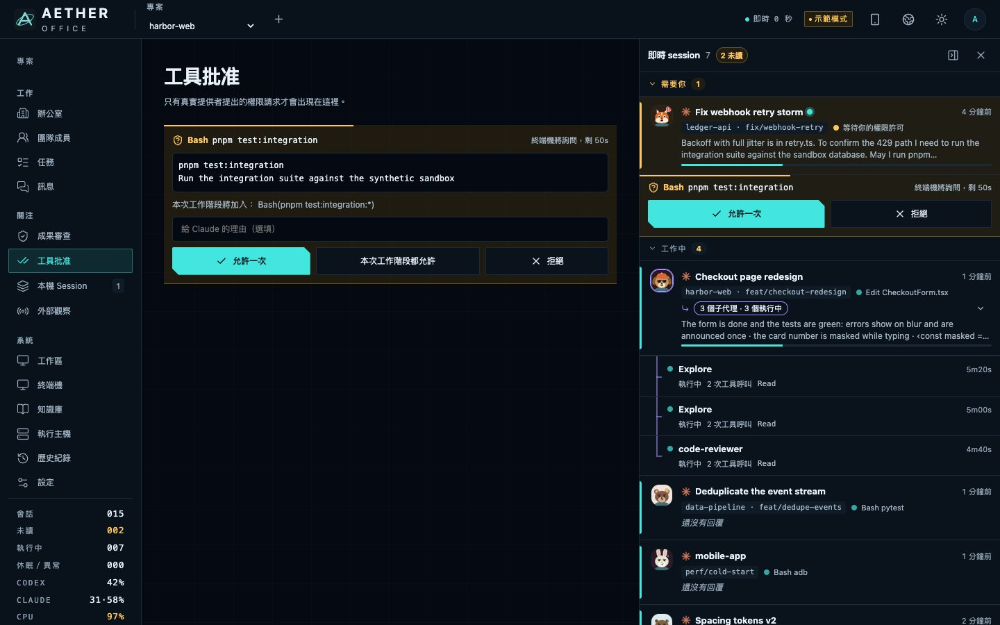

### 互動式終端機

合成 PTY fixture 已啟動並顯示控制權與輸出；沒有啟動付費模型或連接使用者原本的終端機。

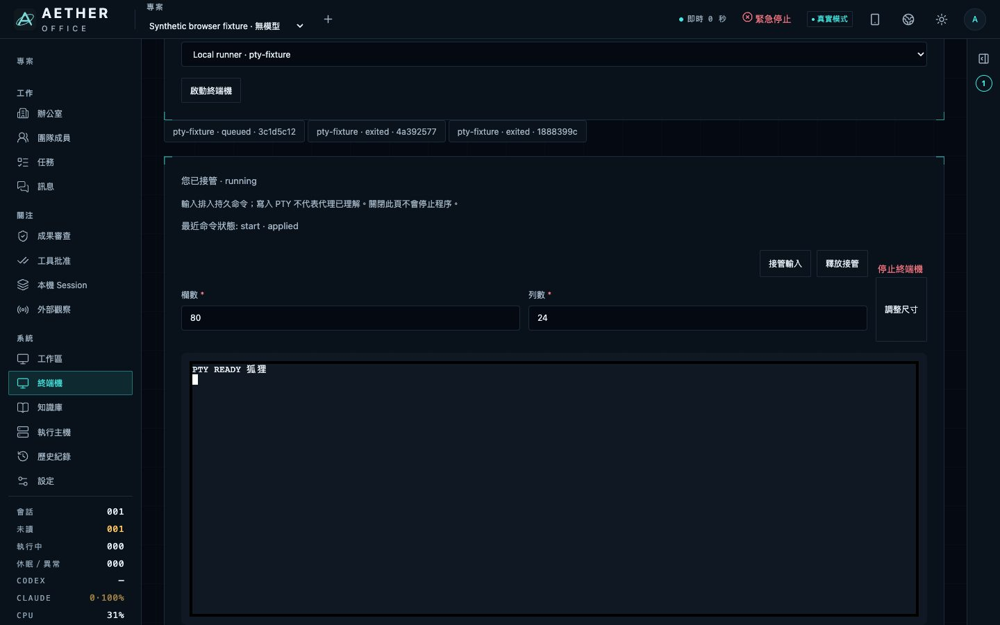

### 事件歷史與回放

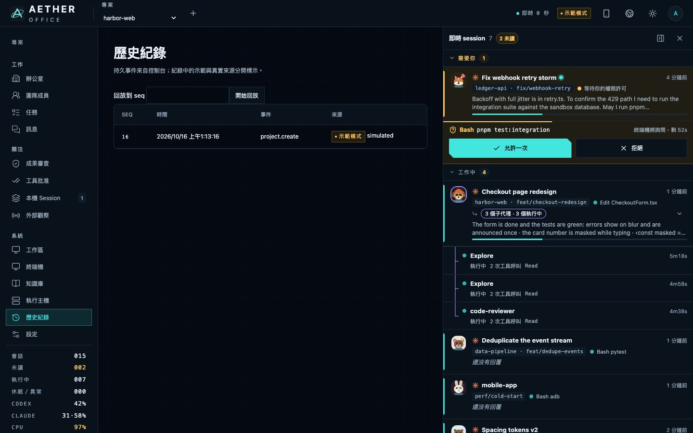

### 多層樓遠景與 Git 花冠

保留先前的深色、淺色遠景與花冠特寫；這三張是較早拍攝的英語介面，與上方現行介面分開標示。

**深色多層樓遠景**


**淺色多層樓遠景**


**Git 花冠特寫**


</details>

<details>
<summary><strong>手機：10 張實際功能畫面</strong></summary>

**01 · 對話列表：待處理與執行中 — 02 · 對話列表：其他工作與剛完成**

<p align="center">
  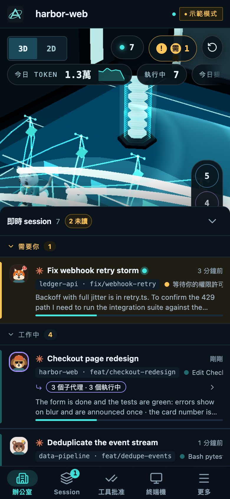
  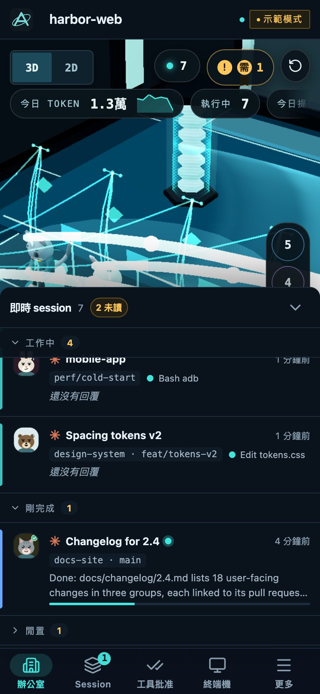
</p>

**03 · 對話與工具結果 — 04 · Git 提交與分支歷史**

<p align="center">
  
  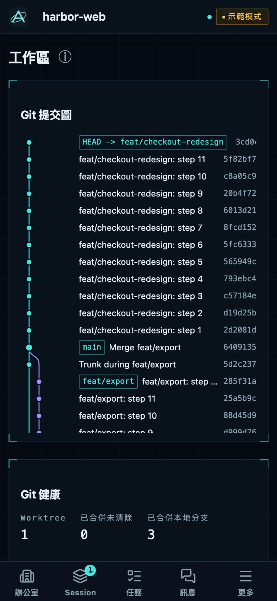
</p>

**05 · 3D 辦公室與小隊 — 06 · Token 與 Git 指標**

<p align="center">
  
  
</p>

**07 · 權限請求與批准 — 08 · 互動式終端機**

<p align="center">
  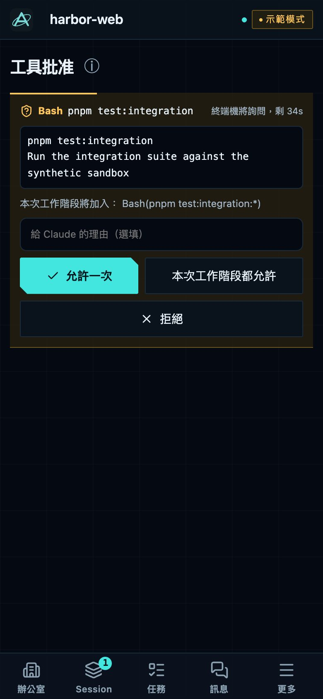
  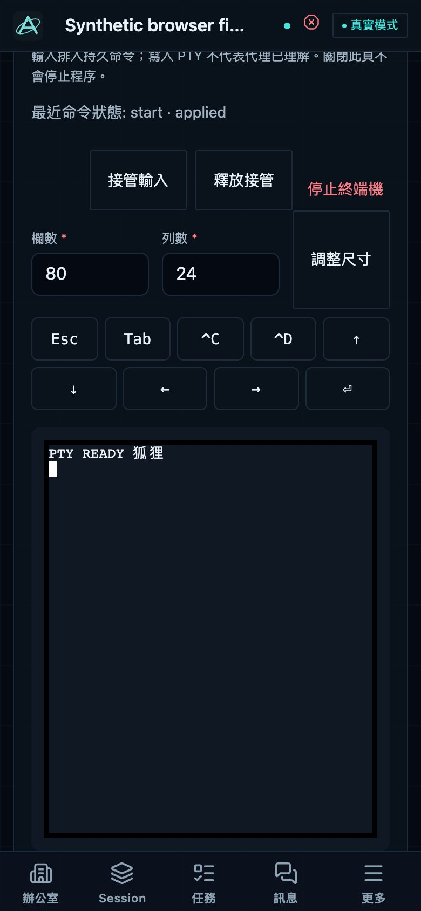
</p>

**09 · Session 管理資料 — 10 · 事件歷史與回放**

<p align="center">
  
  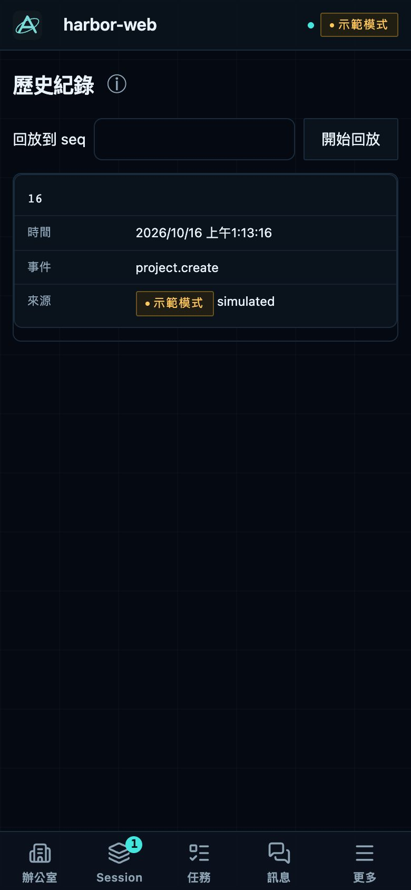
</p>

列表抽屜保留產品原本的半屏高度，前兩張分別呈現頂部與捲動後的對話，不把管理資料卡冒充對話列表。

</details>

工作範例均為合成資料，對話保留原始內容語言；這些介面截圖不代表真實提供者或發布驗證。[完整圖片索引與來源](docs/images/README.md)。

## 支援範圍與限制

| 項目         | 目前支援                                                                       |
| ------------ | ------------------------------------------------------------------------------ |
| Claude Code  | 不限版本清單；以 SDK 初始化與必要欄位判斷相容性                                |
| Codex CLI    | 不限版本清單；以穩定 App Server 握手與必要欄位判斷相容性                       |
| macOS        | 已測試的瀏覽器平台；原生 Windows 終端機不受支援                                |
| Linux        | CI 執行安裝與單元測試；瀏覽器驗證範圍見[開發指南](docs/development.md#testing) |
| 外部 session | 起初為唯讀；符合條件的 session 可接續到 AETHER 的控制範圍                      |
| 權限         | 一位可信任的本機操作者；不提供多使用者隔離，也不隔離同帳號執行的程式           |
| 用量         | Token 數與已記錄的額度資訊；不提供模型價格表或金額估算                         |

ACP 代理與 A2A gateway 為選用能力。完整合約與升級方式見[提供者相容性](docs/provider-compatibility.md)。

## 架構

控制平面擁有 SQLite 資料庫，驗證身分並處理命令。唯讀 scanner 發現本機 session，再透過 server-sent events 通知網頁。選用 runner 從 API 領取工作、回報結果；瀏覽器在需要時載入 Three.js 場景。

| 目錄                                                        | 職責                                              |
| ----------------------------------------------------------- | ------------------------------------------------- |
| `apps/control`                                              | Fastify API、身分驗證、資料庫、session 發現與事件 |
| `apps/runner`                                               | 提供者程序、worktree 與終端機；不直接寫入資料庫   |
| `apps/web`                                                  | React 介面、session 面板與 App shell              |
| `packages/contracts`、`kernel`、`providers`、`office-scene` | 共用合約、領域規則、CLI adapter 與場景資產        |

[架構文件](docs/architecture.md)與[安全模型](docs/security.md)說明資料流及信任邊界。

## 文件

| 入門                                                     | 參考                                           | 專案                                |
| -------------------------------------------------------- | ---------------------------------------------- | ----------------------------------- |
| [開始使用](docs/getting-started.zh-TW.md)                | [設定](docs/configuration.md)                  | [貢獻指南](.github/CONTRIBUTING.md) |
| [操作指南](docs/how-to.md)                               | [提供者相容性](docs/provider-compatibility.md) | [開發指南](docs/development.md)     |
| [功能說明](docs/features.md)                             | [安全](docs/security.md)                       | [更新紀錄](CHANGELOG.md)            |
| [手機與 HTTPS](docs/getting-started.zh-TW.md#安裝到手機) | [功能驗證台帳](docs/verification/report.md)    | [架構決策](docs/adr/README.md)      |

[完整文件索引](docs/README.md)另涵蓋設計紀錄、效能量測、發布流程與授權。[English introduction](README.md)。

## 參與開發

歡迎可重現的錯誤回報與範圍明確的 pull request。請先閱讀[貢獻指南](.github/CONTRIBUTING.md)、
[行為準則](.github/CODE_OF_CONDUCT.md)與[開發指南](docs/development.md)。AI 輔助貢獻遵守相同的審查、驗證與授權規則；[AGENTS.md](AGENTS.md)記錄代理的專案邊界。

安全問題請依[SECURITY.md](.github/SECURITY.md)私下回報。設定問題與錯誤回報格式見[支援指南](.github/SUPPORT.md)。

## 授權與來源

[MIT](LICENSE)。Copyright (c) 2026 haotool。部分內容源自
[AgentSystemLabs/agent-office](https://github.com/AgentSystemLabs/agent-office)，copyright (c) 2026 AgentSystemLabs。
來源保留於 [NOTICE](NOTICE)、[provenance](docs/legal/provenance.md)與[第三方授權公告](docs/legal/THIRD_PARTY_NOTICES.md)。

AETHER OFFICE 是獨立專案，未與 Anthropic 或 OpenAI 建立隸屬、背書或贊助關係。Claude、Claude Code 為 Anthropic, PBC 的商標；Codex、OpenAI 為 OpenAI 的商標。其他商標屬於各自所有者。
