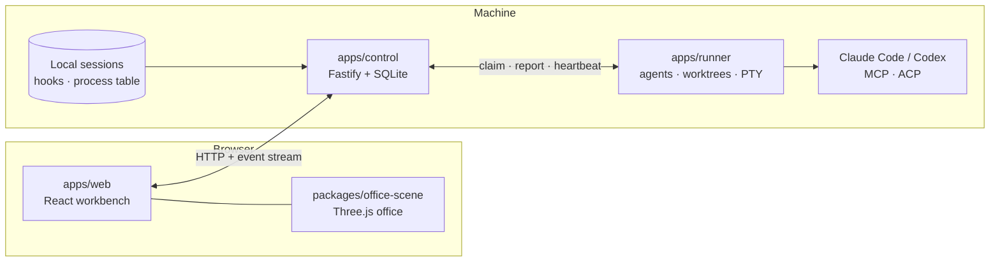

# Architecture

AETHER OFFICE is a small set of cooperating processes around one durable control plane, with a browser UI and a shared
3D scene package.

## Components

| Path                      | Role                                                                                                                                                                    |
| ------------------------- | ----------------------------------------------------------------------------------------------------------------------------------------------------------------------- |
| `apps/control`            | The control plane: authentication, roles, commands, events, tasks, messages, reviews, approvals, local-session discovery, the HTTP API and the built web app. Owns the only SQLite database. |
| `apps/runner`             | A separate process that does the work the control plane must not: starts and supervises agents in isolated Git worktrees, runs PTYs, observes transcripts, runs verifiers. It never writes the control database; it claims jobs and reports results over HTTP. |
| `apps/web`                | The React app: 2D workbench pages, the phone layout, the design system (`src/styles`), i18n (zh-TW and English).                                                          |
| `packages/office-scene`   | The 3D office: building, characters, camera director, communication links. Loaded lazily so the main bundle contains no Three.js.                                        |
| `packages/contracts`      | Zod schemas and types shared by every process: commands, events, records, runner protocol, sessions.                                                                    |
| `packages/kernel`         | Pure domain logic with no transport, database or UI imports: the authorization matrix, task transitions, dependency graphs, schedules, workflows, terminal-state detection. |
| `packages/providers`      | Adapters for Claude Code (Agent SDK), Codex (app-server) and ACP agents; hook installation; generated Codex protocol types.                                              |
| `tools/blender`           | The pipeline that builds, audits and renders the eight animal characters.                                                                                                |
| `scripts`                 | Build, setup, doctor, hook CLI and the checks CI runs.                                                                                                                   |

### Module boundaries

Enforced by `pnpm lint` (`scripts/check-boundaries.mjs`):

- `packages/kernel` imports nothing that does I/O (no `node:`, React, Three.js, Fastify, SQLite or providers).
- `apps/web` and `packages/office-scene` import no Node, Fastify, SQLite or provider modules.
- `apps/runner` does not import the control database; `packages/providers` does not import the control app.
- Untrusted text never reaches the DOM as HTML; terminal output gains no clipboard or link-opening abilities.

## Data and consistency

- **One database.** The control plane keeps state in SQLite (`better-sqlite3`, WAL, `synchronous=FULL`) with numbered
  migrations in `apps/control/src/db/migrations`.
- **Commands, not mutations.** The browser and agents send typed commands (`POST /api/commands`). A command's actor comes
  from authentication, never from its payload. A command, its resulting events, the outbox row and its receipt commit in
  one transaction, so a repeated command with the same idempotency key returns the stored receipt instead of acting twice.
- **Events.** State changes append to an event log that clients follow over a server-sent event stream. Message
  persistence and acknowledgement are separate steps.
- **Uncertainty is a state.** When a runner is lost, work in flight becomes `indeterminate`. It is never executed again
  automatically; a person decides.
- **Runner durability.** The runner records intent in a local journal before any side effect and does not blindly retry
  after a restart. Files that must exist whole (workspace registry, harnesses) are created atomically.

## Observing sessions

Claude Code and Codex sessions that you start yourself are discovered read-only (`apps/control/src/services/session-*.ts`):
session files and the process table give identity, project, role, liveness and resource use; optional hooks add exact
activity. Liveness answers two separate questions, whether a process exists and whether anything is happening in it, and
classifies a session as active, idle, dormant, orphaned, ended or unknown. Observed sessions are never given control
authority.

## Managed execution

A project owner opts in, a runner is enrolled with a local configuration file, and an assignment starts an agent in its own
worktree. Tool use is approved per call; review and verification are bound to a fixed commit; acceptance is a human
decision. Details: [native execution](native-execution.md).

## The web app and the scene

The web app is a single-page React application (React Router, TanStack Query, Zustand for preferences). Pages are
feature modules in `src/features`. The 3D scene is a separate package whose public surface is a model entry
(`@aether/office-scene/model`, no Three.js) and the lazily loaded scene component. A camera director chooses shots from
the same activity, message and attention data the 2D pages use, so the two views never disagree. UI rules and the design
system: [design system](design-system.md).

## Security posture in one paragraph

Loopback binding by default, private-network Host/Origin allow-list when opened to the LAN, HttpOnly session cookies with
CSRF tokens, role × action authorization, per-run scoped MCP credentials that expire with the run, no permission bypass,
and a runner that holds no database access. See [security](security.md).
