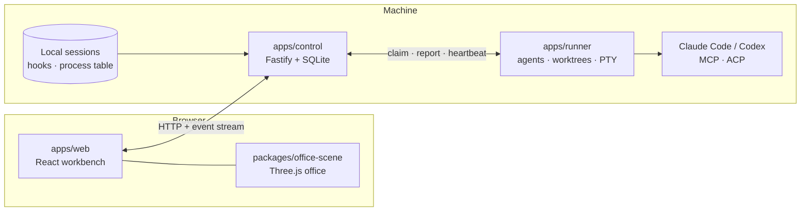

# Architecture

AETHER OFFICE is a small set of cooperating processes around one durable control plane, with a browser UI and a shared
3D scene package.

## Components

| Path                      | Role                                                                                                                                                                    |
| ------------------------- | ----------------------------------------------------------------------------------------------------------------------------------------------------------------------- |
| `apps/control`            | The control plane: authentication, roles, commands, events, tasks, messages, reviews, approvals, local-session discovery and its change stream, permission requests, the HTTP API and the built web app. Owns the only SQLite database. |
| `apps/runner`             | A separate process that does the work the control plane must not: starts and supervises agents in isolated Git worktrees, runs PTYs, observes transcripts, runs verifiers. It never writes the control database; it claims jobs and reports results over HTTP. |
| `apps/web`                | The React app: 2D workbench pages, the phone layout, the design system (`src/styles`), i18n (zh-TW and English).                                                          |
| `packages/office-scene`   | The 3D office: building, characters, camera director, communication links. Loaded lazily so the main bundle contains no Three.js.                                        |
| `packages/contracts`      | Zod schemas and types shared by every process: commands, events, records, runner protocol, sessions.                                                                    |
| `packages/kernel`         | Pure domain logic with no transport, database or UI imports: the authorization matrix, task transitions, dependency graphs, schedules, workflows, terminal-state detection. |
| `packages/providers`      | Adapters for Claude Code (Agent SDK), Codex (app-server) and ACP agents; hook installation; generated Codex protocol types.                                              |
| `tools/blender`           | The pipeline that builds, audits and renders the eight animal characters.                                                                                                |
| `scripts`                 | Build, setup, doctor, hook CLI and the checks CI runs.                                                                                                                   |

### Module boundaries

Enforced by `pnpm lint` (`scripts/check-boundaries.mjs`):

- `packages/kernel` imports nothing that does I/O (no `node:`, React, Three.js, Fastify, SQLite or providers).
- `apps/web` and `packages/office-scene` import no Node, Fastify, SQLite or provider modules.
- `apps/runner` does not import the control database; `packages/providers` does not import the control app.
- Untrusted text never reaches the DOM as HTML; terminal output gains no clipboard or link-opening abilities.

## Data and consistency

- **One database.** The control plane keeps state in SQLite (`better-sqlite3`, WAL, `synchronous=FULL`) with numbered
  migrations in `apps/control/src/db/migrations`.
- **Commands, not mutations.** The browser and agents send typed commands (`POST /api/commands`). A command's actor comes
  from authentication, never from its payload. A command, its resulting events, the outbox row and its receipt commit in
  one transaction, so a repeated command with the same idempotency key returns the stored receipt instead of acting twice.
- **Events.** State changes append to an event log that clients follow over a server-sent event stream. Message
  persistence and acknowledgement are separate steps.
- **Uncertainty is a state.** When a runner is lost, work in flight becomes `indeterminate`. It is never executed again
  automatically; a person decides.
- **Runner durability.** The runner records intent in a local journal before any side effect and does not blindly retry
  after a restart. Files that must exist whole (workspace registry, harnesses) are created atomically.

## The HTTP surface

Routes are registered per area in `apps/control/src/routes`; every `/api/` route needs an authenticated actor except
the few listed in `PUBLIC_ROUTES` (`server.ts`, pinned by `tests/aether/route-auth.test.ts`): login, pairing redemption,
runner enrollment, the GitHub webhook, the A2A card and endpoint, and the approval hook, each of which carries its own
credential.

| Area                    | Routes                                                                                                                                         |
| ----------------------- | ---------------------------------------------------------------------------------------------------------------------------------------------- |
| Sign-in                 | `POST /api/login`, `POST /api/logout`, `GET /api/session`, `/api/pairings` (create, status, redeem)                                            |
| Commands and project    | `POST /api/commands`; `GET /api/projects`; per project: `snapshot`, `events`, `stream` (the project's event log as server-sent events), `inbox`, `messages/:id`, `knowledge`, `approvals`, `execution` |
| Work and lists          | `work/:workId/{comments,integrations,post-result,diagnostics,reviews}`, `workspaces`, and the read lists (`terminals`, `reservations`, `schedules`, `skills`, `integrations`, `rooms`, `workflows`, `meetings`, `observations`) |
| Local sessions          | `GET /api/local-sessions` and `/speech` (last prompt and reply), `GET /api/local-sessions/stream` (change stream), `/:key/transcript`, `/:key/stop`, `/:key/reap-zombies`, `POST /api/local-sessions/clock-out` |
| Composer                | `GET /api/local-sessions/:key/terminal` (the AETHER terminal the session runs in, if any), `/:key/commands`, `/:key/files`                    |
| Usage KPIs              | `GET /api/usage?range=today\|7d\|30d` (tokens per day, office, project, model and session, plus Claude's and Codex's limit windows) and `GET /api/usage/git` (commits, merges, merged and open branches per project, office and for the building). Owner and operator only; ETag-revalidated. Transcripts are read incrementally (`services/usage-parse.ts`, `usage-stats.ts`): per file an offset, mtime, size and first-bytes signature, appended bytes only, one shared 1 MiB buffer, a turn of the event loop between chunks, at most 4000 files; a request waits 400 ms at most for a scan still reading history and says `scan.complete: false`. A numbers-only rollup (`usage-rollup.json`, mode 0600, keyed by path hash) lives in the data directory and is ignored when its version or time zone differs. |
| Machine and models      | `GET /api/models` (the models each CLI offers), `/api/claude-limits`, `/api/system`, and per project `git-graph` and `git-health` (`/sizes`, `/clean`) |
| Permission requests     | Hook side (loopback, its own token): `POST /api/hook/permission-requests`, `GET .../:id` (long poll), `POST .../:id/fallback`. Person side (cookie session): `GET /api/permission-requests`, `POST .../:id/decision`, `GET`/`PUT /api/remote-approvals` |
| Runner                  | `POST /api/machines`, `/api/runner/{enroll,heartbeat,claim,report,session-credential,jobs/*,terminals/*,observations,approvals/*}`             |
| Interoperability        | `POST /a2a` and `/.well-known/agent-card.json` (when `AETHER_A2A=on`), `POST /api/webhooks/github/:integrationId`, integration sync          |
| Operations              | `POST /api/identities/:id/revoke`, `GET /api/metrics`, `GET /health`                                                                           |

## Observing sessions

Claude Code and Codex sessions that you start yourself are discovered read-only (`apps/control/src/services/session-*.ts`):
session files and the process table give identity, project, role, liveness and resource use; optional hooks add exact
activity. Liveness answers two separate questions, whether a process exists and whether anything is happening in it, and
classifies a session as active, idle, dormant, orphaned, ended or unknown. Observed sessions are never given control
authority.

**Live updates.** `GET /api/local-sessions/stream` is a server-sent event channel for the session panel
(`routes/session-stream.ts`, `services/session-changes.ts`). One watcher, shared by every client, scans the sessions every
two seconds while anyone is connected (the scan the polling endpoints already use) and diffs each session's state, tool,
newest reply and transcript mtime against the previous scan; there is no per-client polling. A change is one event
(`event: session`, `{seq, key, kinds}`: the session key and what kind of thing changed, never content), at most one per
session per scan, so at most 0.5 events a second per session. `seq` starts at the clock and only rises; a client resumes with
`Last-Event-ID` (or `?after=`) and gets what the hub remembers (256 events), or an `event: resync` telling it to refetch.
A heartbeat comment goes out after 20 s of silence, at most 16 streams are open (429 beyond), a client whose socket holds more
than 64 KB unsent is dropped (it resumes), and each stream re-checks its credential every two seconds, so a logout, a
revocation or a role change ends it with `event: fault`. The web app (`features/use-session-stream.ts`, pure parts in
`features/live-link.ts`) turns events into react-query invalidations, batched for 120 ms; the queries poll only as a 30 s
safety net while the stream is live and at their old intervals while it is not. It reconnects with exponential backoff and
jitter (1 s doubling to 30 s), closes while the tab is hidden and, on becoming visible, regaining the network or restoring
from the back-forward cache, reconnects and refetches at once. The top bar shows live, connecting, reconnecting or offline
with the age of the last update. The heavy reads (`/api/local-sessions`, `/speech`, one transcript) carry a weak `ETag` and
answer `If-None-Match` with `304`, on top of gzip.

**Driving a session from the browser.** When the process behind a session runs inside an AETHER terminal
(`services/terminal-link.ts`), `GET /api/local-sessions/:key/terminal` says which one, and the panel's composer types into it
through the ordinary `terminal.input` command under the terminal lease. A session started elsewhere is never typed into; it
can be continued or forked in a new AETHER terminal (`terminal.start` with `resume`). **Clock out**
(`POST /api/local-sessions/clock-out`, `services/clock-out.ts`) ends idle processes in bulk with the same checks as a single
stop. The model catalog (`GET /api/models`) is read from the CLIs' own caches and never written.

**Permission requests.** With Remote approvals on, a Claude Code hook posts each permission prompt to the control plane,
which keeps it in memory (`services/permission-requests.ts`, bounded, never persisted) until a person decides in the browser
or the hook's wait ends. The server signs every decision so the hook can tell it from an impostor. Details:
[security](security.md#safety-properties).

## Managed execution

A project owner opts in, a runner is enrolled with a local configuration file, and an assignment starts an agent in its own
worktree. Tool use is approved per call; review and verification are bound to a fixed commit; acceptance is a human
decision. Details: [native execution](native-execution.md).

## The web app and the scene

The web app is a single-page React application (React Router, TanStack Query, Zustand for preferences). Pages are
feature modules in `src/features`. The 3D scene is a separate package whose public surface is a model entry
(`@aether/office-scene/model`, no Three.js) and the lazily loaded scene component. A camera director chooses shots from
the same activity, message and attention data the 2D pages use, so the two views never disagree. UI rules and the design
system: [design system](design-system.md).

### The office layout

A saved layout is a list of objects on the building's floors (`layoutSchema` in `packages/contracts`, validated by
`validateLayout` in `packages/kernel` for the editor, an import and `layout.save` alike). Objects are furniture (desk, plant,
sofa, rack, table) or a **squad zone**: floor space beside a supervisor's desk (`anchor`, a desk of the same floor) where its
subagents sit, with a `span` in half metres and `seats` (0 = grows and shrinks with the squad). A squad zone is floor, not
furniture: it is walkable, drawn by the squad layer and never by the building. Its rules are the other objects' (bounds, the
two aisles, no overlap) plus `LAYOUT_SQUAD_ANCHOR` (the anchor is missing, not a desk or on another floor),
`LAYOUT_SQUAD_DUPLICATE` (two zones on one desk) and `LAYOUT_SQUAD_CAPACITY` (`seats` above `floor((w-0.4)/1.6) *
floor((d-0.4)/1.6)`).

`schemaVersion` is 1 until a layout holds a squad zone and 2 from then on (`layoutVersionOf`), so a layout without squads
stays readable by an older server or client; every saved version-1 layout is a valid version-2 layout and no object is ever
moved by the version change. Squads that are not saved are placed on the fly by `squadLayout` (`office-scene/src/squad`):
the side of the desk that faces the central aisle first, then the most open floor; when nothing fits (a full floor) the
subagents keep sitting at desks of their own. The editor can add a zone, edit its anchor, size and seats, and pin the live
squad.

## Security posture in one paragraph

Loopback binding by default, private-network Host/Origin allow-list when opened to the LAN, HttpOnly session cookies with
CSRF tokens, role × action authorization, per-run scoped MCP credentials that expire with the run, no permission bypass,
and a runner that holds no database access. See [security](security.md).
