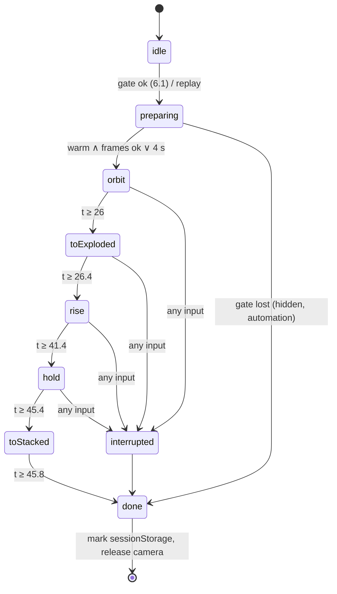

# Office Life: squads, signals and the first visit

[Documentation](../README.md) · [Project](../../README.md)

> [!NOTE]
> Design and research record. Proposals, benchmarks and implementation observations describe the revision recorded here.
> Use the current operational guides and verification ledger for supported behavior.

<details>
<summary>Contents</summary>

- [0. Ground rules (non-negotiable)](#0-ground-rules-non-negotiable)
- [1. What exists today (read from the code)](#1-what-exists-today-read-from-the-code)
- [2. Concept: the supervisor desk and its squad](#2-concept-the-supervisor-desk-and-its-squad)
- [3. Architecture overview](#3-architecture-overview)
- [4. Squad: technical design](#4-squad-technical-design)
- [5. Office life: the signals → effects registry](#5-office-life-the-signals--effects-registry)
- [6. Intro tour (first visit)](#6-intro-tour-first-visit)
- [7. Data: what exists, what to add](#7-data-what-exists-what-to-add)
- [8. Layout model: the squad zone as a layout object](#8-layout-model-the-squad-zone-as-a-layout-object)
- [9. Module structure and collision map](#9-module-structure-and-collision-map)
- [10. Tests and gates](#10-tests-and-gates)
- [11. Risks](#11-risks)
- [12. Iteration plan and 2D information design](#12-iteration-plan-and-2d-information-design)
- [13. Open questions for the maintainer (with recommended defaults)](#13-open-questions-for-the-maintainer-with-recommended-defaults)

</details>

- Status: partly implemented
- Date: 2026-10-08

> **Design record.** This is the specification the office-life work was built from, kept for the reasoning and the budgets. It
> was written before the code and some details moved while building; for how the features behave today read
> [features](../features.md) and the [design system](../design-system.md), and for what is verified the verification ledger.

What is built is tracked in the verification ledger (`OFFICE-LIFE-*` in `docs/verification/features.json`). Squads in the scene (§2, §4.1 to §4.4, §4.6, §4.10), the puppet strings (§4.5) and the hand-over with its stamp (§4.6 to §4.8) are built (I4, I5); the registry and the signals are tracked per iteration. Owner: the 3D office (`packages/office-scene`) with server work in `apps/control`.
Work plan: [office-life-work-plan.md](office-life-work-plan.md).

This spec covers three things that each make the office easier to read:

1. **Squads.** A main session and its subagents are drawn as a supervisor desk with a squad zone beside it, a beam of light
   into the core, puppet strings and a hand-over when a subagent returns.
2. **Office life.** Small, recognizable programmer-culture animations, each triggered by a real signal.
3. **First visit.** An intro camera tour: a 360° orbit, the exploded view, a rise up the stalk to the crown, then the
   director takes over.

It also covers how all of this shows up in the 2D panel, in Settings and in accessibility, the data the server must
expose, the layout model, the module boundaries, the budgets and the tests.

---

## 0. Ground rules (non-negotiable)

| Rule                                 | Consequence in this design                                                                                                                                                                                               |
| ------------------------------------ | ------------------------------------------------------------------------------------------------------------------------------------------------------------------------------------------------------------------------ |
| **Decoration never claims a fact.**  | Every effect in §5 is labelled _decorative_ in the registry and in the docs. A "tests passed" visual needs a real exit status (`ok === true` on a test-tagged call). A hand-over seal says "received", never "approved". |
| **Only real signals.**               | Each effect names its source field (§5.3) and the trigger rule that reads it. Where the server has no such field today, §7 says what to add, or the effect waits.                                                        |
| **Calm by default, rare by design.** | Global and per-member cooldowns, seeded chance, at most one meme per member and two per floor at once (§5.2). There is a _Calm mode_ switch.                                                                             |
| **Accessibility.**                   | Every effect has an aria text (§5.3). Reduced motion swaps each effect for its static fallback. Nothing flashes more than 3 times a second.                                                                              |
| **Cheap.**                           | Shared pools (one sprite atlas, one particle pool, instanced props). Per-effect budgets are in §4.9. Performance gates run on a real GPU (§10).                                                                          |
| **No collisions.**                   | The new code lives in three new folders with small public APIs. Edits to existing files are listed per iteration, along with the merge order against the concurrent work (§9).                                           |

---

## 1. What exists today (read from the code)

| Piece                                                                                                                                                                                                                                   | Where                                                                              | Relevance                                                                                                                                                                                                            |
| --------------------------------------------------------------------------------------------------------------------------------------------------------------------------------------------------------------------------------------- | ---------------------------------------------------------------------------------- | -------------------------------------------------------------------------------------------------------------------------------------------------------------------------------------------------------------------- |
| Subagents as observed members `local:<key>:sub:<id>`, always `working`, labelled by type                                                                                                                                                | `apps/web/src/lib/sessions/localSessions.ts` `sessionsToAgents`                    | They get **ordinary desks in the first free slot of the floor** (`mergeLayout`, `desk-obs-*`). A subagent can end up across the room from its parent, so the relationship is hard to read. This is the core problem. |
| Tethers parent→child (violet fat lines, one draw)                                                                                                                                                                                       | `office-model.ts` `tethersOf`, `interplay.ts` `relationEdges`, `RelationLines.tsx` | Too faint to read as a relationship; full strength only when hovered.                                                                                                                                                |
| `sub` pulses (a light stream on a Bezier, the camera's `-15` score)                                                                                                                                                                     | `office-model.ts` `pulsesOf`, `CommLinks.tsx`, `director.ts`                       | Reused as the director's "squad" shot input.                                                                                                                                                                         |
| Branch beams desk→core (Tube + packets)                                                                                                                                                                                                 | `BranchBeams.tsx`, `scene-markers.ts`                                              | Same visual language as the squad beam, but the squad beam must not be confused with it (§4.4).                                                                                                                      |
| Departure: stand_up → wave → walk the nav-grid path into the core → sink                                                                                                                                                                | `departure.ts`, `Departing.tsx`, kernel `navigation.ts`                            | The template for arrival, delivery and dismissal walks (§4.6).                                                                                                                                                       |
| Clips: idle, walk, turn, sit_down, stand_up, seated_idle, typing, reading, thinking, scratch_head, reviewing, testing, waiting_permission, waiting_peer, error, cheer, celebrate, sleeping, stretch, sip, wave, shrug, look_around, nod | `animal-states.ts` `CLIPS`, `tools/blender/animal_clips.py`                        | Enough for every storyboard frame (§4.8). Sockets `head_socket`, `hand_socket_L/R` already exist in the rig (`animal_rig.py` L65-66, validated by `validate-assets.mjs`). They anchor the strings.                   |
| Director, shot camera, comfort rules (one slow dolly per shot, level horizon, no zoom, cut instead of long flights, `MIN_DISTANCE` 4, `FLY_MAX` 6)                                                                                      | `director.ts`, `shot-camera.ts`, `SceneCamera.tsx`, `scene-navigation.ts`          | The intro tour obeys the same rules (§6).                                                                                                                                                                            |
| Zone tour (8 stops, 4 s each, pause/skip/stop)                                                                                                                                                                                          | `apps/web/src/lib/navigation/tour.ts`, `e2e/office-life/tour.spec.ts`              | Kept. The new intro is a different feature and is not a replacement (§6.7).                                                                                                                                          |
| Compaction paper→cube effect, attention ring, Zzz rabbit, ghost, jiangshi                                                                                                                                                               | `CompactionEffect.tsx`, `DeskGlow.tsx`, `animal-states.ts`                         | Already "office life". The registry adopts them as rows, so they get the toggles too.                                                                                                                                |
| Exploded view switch                                                                                                                                                                                                                    | `scene-navigation.ts` `toggleExploded`, `scene-geometry.ts` `floorY`               | Instant, with no morph. `spreadStalk` rebuilds the tubes. The intro hides the switch under a dip (§6).                                                                                                               |

Building constants used throughout (`building.ts`, `layout.ts`, `crown-layout.ts`, `garden-geometry.ts`):
`FLOOR_HEIGHT = 7`, `EXPLODED_GAP = 11`, `FLOORS = 5`, shell 54.4 × 38.4 m (half-diagonal ≈ 33.3 m), core glass radius 1.5,
stacked roof `R_s = 35`, exploded floor bases `0, 18, 36, 54, 72`, exploded roof `R_e = spread(35) = 79`, crown base
`roof + 6`, tier pitch 3.4, spire 14, great bloom `top + 6` where `top = roof + 6 + 3.4·T + 14` and `T ≤ 12` tiers. Clouds
sit at radius 3–25 around the tip, from `top − 12` to `top + 10`. Desk footprint 2.2 × 1.8. Layout bounds ±25 × ±17.
Aisles at |x| < 1 and |z| < 1.

---

## 2. Concept: the supervisor desk and its squad

### 2.1 Vocabulary

- **Supervisor**: a session member with at least one live or recently returned subagent. The role is automatic and not
  stored. The user can pin a squad zone to a desk (§8), and that makes the desk a supervisor desk permanently.
- **Squad zone**: a rectangle on the floor next to the supervisor desk, holding **pods**. A pod is a light hover stool
  with a small holo pane; a subagent sits there. Subagents no longer get full desks.
- **Squad beam**: one wide light funnel from the zone into the building's core axis. A thin return filament runs from the
  core to the supervisor's **halo**, the "absorbing energy" ring over the supervisor's head.
- **Strings**: light-strings from each subagent's control cross down to its head and hands, and master threads from every
  cross to the supervisor's halo.

### 2.2 Top view (one floor, metres, north = −z)

```
  z=-6 ─────────────────────────────────────────────────────────────────────────────
        x=-22        -18        -14          -10      ┊ core ┊
                                                      ┊ (0,0)┊
        ┌──────┐   ┌──────┐   ╔════════╗              ┊  ◎   ┊
        │ desk │   │ desk │   ║SUPERVSR║  halo ◯      ┊  ║   ┊
        └──────┘   └──────┘   ║ desk  ▣║←in-tray      ┊  ║   ┊
  z=-2.2                      ╚═══╤════╝  stamp ▪     ┊  ║   ┊
                         master threads ╲│╱           ┊  ║   ┊
                     ┌ ─ ─ ─ ─ ─ SQUAD ZONE ─ ─ ─ ─ ┐ ┊  ║   ┊
                     ┊  ✚      ✚      ✚      ✚      ┊ ┊  ║   ┊   ✚ = control cross (1.2 m over a head)
                     ┊  ◍ pod  ◍ pod  ◍ pod  ◍ pod  ┊═╪══╝   ┊   ◍ = pod with a seated subagent
                     ┊  ◌ free ◌ free               ┊ ┊  beam ┊   ◌ = free seat (grows/shrinks)
                     └ ─ ─ ─ ─ ─ ─ ─ ─ ─ ─ ─ ─ ─ ─ ─ ┘ ┊ funnel ┊
  z=+3.6                     w = 1.6·cols + 0.4, d = 1.6·rows + 0.4
```

Placement rule (§8.3): the zone touches the supervisor desk on the side with the most free room, preferring the aisle
side (towards x = 0) so the beam is short and does not cross other desks. The pods face the supervisor desk, so a seated
subagent "looks to its boss".

### 2.3 Side view (section through the zone and the core)

```
 y=6.0 ┄┄┄┄┄┄┄┄┄┄┄┄┄┄┄┄┄┄┄┄┄┄┄┄┄┄┄┄┄┄┄┄┄┄┄┄┄┄┄┄┄┄┄┄┄┄┄┄ ceiling rails ┄┄┄┄┄┄┄┄┄┄┄┄┄┄┄┄┄
                             ╭────────── beam (funnel, additive) ───────────╮
 y=4.6       halo ◯━━━━━━━━━━┿━━━━━━ return filament (core → halo) ━━━━━━━━━━┿━━▶ │core│
          master ╱ ╲ threads ╲                                              ╲   │ ║  │
 y=2.8   ✚━━━━━━✚━━━━━━✚    (crosses sway, jerk on tool start)               ╲  │ ║  │
         ┃╲  ╱┃ ┃╲ ╱┃ ┃╲╱┃   head + 2 hand strings, fading towards the body   ╲ │ ║  │
 y=1.4   ●     ●      ●     ← subagents seated (head_socket ≈ 1.40 in model space)╲│ ║  │
 y=0.5  ▭▭▭  ▭▭▭   ▭▭▭    ← pods (stool 0.45 high, pane 0.9 high)                ╲║  │
 y=0.0 ━━━━━━━━━━━━━━━━━━━━━━━━━━━━━━━━━━━━━━━━━━━━━━━━━━━━━━━━━━━━━━━━━━━━━━━━━━━━━━━━━━━━
        zone floor decal: outline + seat rings          supervisor desk (L-shaped dressing)
```

The funnel's base is the zone's footprint at y ≈ 2.6 (above the crosses). It narrows to the core glass (radius 1.5)
at y = 4.6, which keeps it under the ceiling rails at 5.78–5.9. The return filament is a thin bright line from the core
at y = 4.6 to the halo at the supervisor's head + 1.0.

### 2.4 Storyboard

| #             | Frame | What happens (timings at high tier)                                                                                                                                                                                                                                                                                                                                                                                                                                                                                           | Signal                                                      |
| ------------- | ----- | ----------------------------------------------------------------------------------------------------------------------------------------------------------------------------------------------------------------------------------------------------------------------------------------------------------------------------------------------------------------------------------------------------------------------------------------------------------------------------------------------------------------------------- | ----------------------------------------------------------- |
| **Spawn**     | 1     | A seed of light leaves the core and runs down the beam into a free pod (0.8 s). The pod unfolds: ring and pane scale 0→1 (0.6 s).                                                                                                                                                                                                                                                                                                                                                                                             | new subagent id in `subagents[]` (`status: running`)        |
|               | 2     | **Arrival.** If the walk from the core to the pod is ≤ 14 m and the tier is balanced or high, the subagent walks out of the core (the reverse of departure: `walk`, `turn`, then `sit_down` 1.0 s). Otherwise it materializes in the seat (scale + sparkle, 0.8 s).                                                                                                                                                                                                                                                           | same                                                        |
| **Gather**    | 3     | When the squad outgrows its seats, the zone grows by one row or column (0.8 s ease). Seats are appended and never reordered under a seated subagent. A new cross fades in over the head, and its master thread draws from the halo to the cross (0.5 s).                                                                                                                                                                                                                                                                      | count of live subagents > seats                             |
| **Work**      | 4     | The strings stay taut while the subagent works. Each tool start jerks the cross (a 4 cm dip, a critically damped spring, 250 ms) and the matching hand string. Between tools the strings sway gently (0.25 Hz). The beam's brightness and band speed follow the squad's real rate, and the halo glows with a 0.6 s lag.                                                                                                                                                                                                       | `tools.count` increments; rate from §7                      |
|               | 4b    | A subagent waiting for permission freezes its strings, the cross turns amber and its pod shows the existing amber attention ring.                                                                                                                                                                                                                                                                                                                                                                                             | subagent `status: waiting_permission`                       |
| **Hand-over** | 5     | The strings go slack (rest length ×1.15 over 1 s) and the cross dims. The subagent plays `stand_up` (1.25 s). A **folder** appears floating at chest height and it walks to the supervisor's desk side (`walk`, at most 8 s, 1.2 m/s on the nav grid).                                                                                                                                                                                                                                                                        | `status: finished` (SubagentStop, or the Codex child ended) |
|               | 6     | Presentation. The subagent turns to the supervisor, and the folder glides into the in-tray (0.6 s). The supervisor plays `reading` (1.5 s) then `nod`. The desk stamp presses down (0.25 s) and a **received seal** decal blooms on the folder (an inbox arrow glyph, never "approved"). With a real `result.error === true` (or `ok === false`) the stamp is a neutral grey RETURNED and the folder has a grey tab (never red: no colour that reads as a verdict), and the supervisor plays `scratch_head` instead of `nod`. | `result` (§7)                                               |
| **Return**    | 7     | When the same subagent id becomes active again (a resumed Codex child, a re-run agent id), it walks back to its pod and sits. Otherwise frame 8 follows.                                                                                                                                                                                                                                                                                                                                                                      | `status` back to `running`                                  |
| **Dismiss**   | 8     | `wave`, then a walk into the core and the existing sink (`departure.ts` timings). The pod folds 1.5 s after the subagent leaves it. The zone shrinks only after **10 s** with no change (hysteresis), and never while a walk is in flight. The beam dims to idle when no subagent remains, and the halo fades after 20 s.                                                                                                                                                                                                     | removed or stale                                            |

Reduced motion: frames 1–8 become state changes. The pod lights up, the subagent appears seated and the strings are
static straight lines. The folder icon appears in the in-tray at once, and the pod clears. Each change has an aria
announcement (§5.3, rows R1–R6).

---

## 3. Architecture overview

```mermaid
flowchart LR
  subgraph control[apps/control]
    HS[hook-spool.ts\nsubagent lifecycle + tool counts]
    SD[session-discovery.ts\nClaude subagents/*.jsonl, Codex child rollouts]
    CT[command-tags (providers)\nclosed vocabulary, no args stored]
    API[/GET /api/local-sessions/]
  end
  subgraph web[apps/web]
    OM[office-model.ts\nsquads, tethers, pulses]
    LS[life-signals.ts\nsnapshot diff → LifeSignal[]]
    PREF[state.ts prefs\nlife.*, intro]
    PANEL[SessionFeed / squad rows]
  end
  subgraph scene[packages/office-scene]
    SQ[squad/\nlayout, errands, beam, strings, hand-over]
    LIFE[life/\nregistry, scheduler, pools, effects]
    INTRO[intro/\ntimeline, machine, caption]
    OS[OfficeScene.tsx\nmounts the three layers]
  end
  HS --> API; SD --> API; CT --> HS
  API --> OM --> SQ
  API --> LS --> LIFE
  PREF --> LIFE & INTRO & SQ
  OM --> PANEL
  OS --- SQ & LIFE & INTRO
```

Scene layers are siblings mounted by `OfficeScene.tsx`: `<SquadLayer/>`, `<LifeLayer/>` and the intro's camera source.
None of them edits `Member.tsx`, `Animal.tsx`, `Poser.tsx`, `animal-states.ts`, `MemberScreen.tsx` or `screen-*.ts`,
which other engineers are changing now (§9).

---

## 4. Squad: technical design

### 4.1 Squad state (pure, `squad/squad-model.ts`)

```ts
type SquadPhase = 'arriving' | 'seated' | 'delivering' | 'returning' | 'leaving' | 'gone';
type SquadMemberState = {
  id: string; // local:<key>:sub:<id>
  supervisor: string; // local:<key>
  seat: number; // index into the zone's pods, stable for the member's life
  phase: SquadPhase;
  since: number; // ms, wall clock: phase start (plans are pure functions of (plan, now - since))
  working: boolean; // tool events in the last 20 s (as today's SUBAGENT_LIVE_MS)
  waiting: boolean;
  lastToolAt: number | null;
  error: boolean | null; // from result.error, null = not known
};
export function stepSquad(prev: SquadState, input: SquadInput, now: number): SquadState; // deterministic
```

The rules: seats are assigned lowest-free-first and never reassigned while occupied. `finished` moves the member to
`delivering`. A subagent that disappears without `finished` (hook-less, or stale) goes straight to `leaving`. The phase
machine is unit-tested with a fake clock. The renderers only read it.

### 4.2 Supervisor desk dressing (`squad/SupervisorDesk.tsx`)

This is not a new furniture type. The ordinary desk geometry is merged into the floor's static mesh (`buildFloor`), and
rebuilding a floor whenever a squad appears would be a hitch. Instead, an **overlay** is drawn on any desk whose member
is a supervisor:

| Prop                                                                     | Geometry                                   | Draw calls (all supervisors together) | Triangles per instance |
| ------------------------------------------------------------------------ | ------------------------------------------ | ------------------------------------- | ---------------------- |
| In-tray (two stacked trays)                                              | merged boxes                               | 1 `InstancedMesh`                     | 60                     |
| Stamp (handle + base)                                                    | merged lathe + box                         | 1 `InstancedMesh`                     | 120                    |
| Nameplate ("Lead" in the viewer's language)                              | box + one quad with the shared label atlas | 1 (atlas sprite pool, §5.4)           | 2                      |
| Halo over the head                                                       | ring, additive                             | 1 `InstancedMesh`                     | 96                     |
| Desk-edge accent strip (gold, `#ffc65c`, the existing group-ring colour) | thin box                                   | merged into the in-tray instance      | —                      |

Desk-local positions avoid the desk-items slots the behavior branch uses (`SLOTS` in its `desk-items.ts`: (±0.66, ~0.13)
and (0.52, −0.12)). The in-tray sits at (−0.55, −0.18) and the stamp at (−0.25, −0.22). If that branch later exports its
slots, we read them instead (§9).

### 4.3 Pods and zone decal (`squad/SquadLayer.tsx`)

- **Pod**: a stool (cylinder + cushion, 0.45 m) plus a 0.5 × 0.32 holo pane on a stalk. There is one `InstancedMesh` for
  the stools and one for the panes. The panes reuse the department hologram material (`building-materials.ts`
  `hologram`), so no new shader program. Pod footprint is 1.3 × 1.3 and the seat pitch 1.6 m.
- **Zone decal**: one quad per zone with a small shader: a dashed outline, seat rings and a soft fill, all in one
  `InstancedMesh` with per-instance size and seat count. The free/occupied state of up to 12 seats is a 12-bit mask
  attribute.
- **Subagent characters**: `squad/SquadMember.tsx` composes the existing `Animal` (with `Poser` for the turn towards the
  supervisor) at the pod's seat. It is a sibling of `Member`, not an edit of it. Squad members have no `MemberScreen` and
  no `DeskEffects`; the pod pane shows a small activity glyph from the sprite pool.
- **Overflow**: more than 8 subagents in one squad (the character budget, §4.9) are drawn as instanced holo silhouettes
  (one draw), with a "+N" chip on the zone label.

### 4.4 Squad beam (`squad/SquadBeam.tsx`, `squad/beam-shader.ts`)

- Geometry: one shared tapered tube along a quadratic Bezier. It goes from the zone centroid at y = 2.6, with radius
  `r0 = 0.42·min(w, d)`, to the core at y = 4.6, with radius 1.2. It uses 48 segments × 16 sides, about 1.5k triangles,
  and is built once and **instanced** across squads: per-instance start, end and r0 are uniforms in an instanced
  attribute, and the curve is evaluated in the vertex shader. That is one draw call for all squads.
- Fragment shader (additive, `depthWrite: false`, `toneMapped: false`):
  - **Edge glow**: `pow(1 − |dot(N, V)|, 2.2)`, so it reads as a volume.
  - **Bands**: `fract(uv.y·6 − time·speed)` shaped by smoothstep, flowing from the zone into the core.
  - **Fades**: `smoothstep(0, 0.12, uv.y) · smoothstep(1, 0.88, uv.y)` at both ends. A camera-distance fade uses the
    same curve as `distanceFade`.
  - **No depth-texture soft particles.** The renderer has no depth prepass, and adding a render target would cost a
    pass. The end fades are analytic instead (the floor at y = 2.6 and the core glass), which hides the intersections.
- Inputs: `intensity ∈ [0, 1]` drives the alpha (0.12 to 0.55) and the band speed (0.2 to 1.4).
  `tint = mix(accent, white, intensity·0.5)`. When any squad member waits, an amber pulse mixes in at 0.8 Hz (the
  attention-ring rate).
  - Rate source (`squad/beam-rate.ts`): the squad's **tokens per minute** when its working members have a measured,
    non-zero `subagents[].tokens.perMinute` (Claude's transcript files; summed over the members that have a sample),
    else its **tool calls per minute** (tool starts in the last 60 s). A token rate of 0 falls back too, because it is also
    what "no second sample yet" looks like. Codex and hook-only squads have no tokens, so they stay on tool calls.
  - Curve: `intensity = tanh(1.5 · ln(1 + rate) / ln(1 + ref))`, with a `ref` per source (calibrated below). A log first (1 and
    12 calls, 1k and 12k tokens all read), then a smooth saturation: 0 for no work, about 0.9 at the reference, approaching 1
    without ever clipping, monotonic and with no kink. (Wave 1's `min(1, log1p(rate)/log1p(30))` hit a flat 1 at 30 calls.)
  - **Calibration (measured, not chosen).** The first reference rates (20,000 tokens, 30 tool calls a minute) were guesses. They
    are now set from this machine's real transcripts by `scripts/beam-calibration.ts` (read-only, bounded, numbers only: it
    reads 767 Claude subagent files of 30 parent sessions and the newest 300 Codex rollouts once through the KPI parser's own
    counters, buckets them by minute and never prints or keeps a line of text). Tokens are fresh tokens (input, output and
    cache writes, never cache reads), as everywhere else in the app. An active minute is one with any tokens or any tool calls;
    the squad rate is what the beam shows: the subagents of one parent session summed per minute.

    | Per active minute             | active minutes | p25   | p50    | p75    | p90    | p95     | p99     |
    | ----------------------------- | -------------- | ----- | ------ | ------ | ------ | ------- | ------- |
    | Squad, tokens                 | 5,741          | 4,133 | 10,662 | 30,149 | 92,604 | 167,582 | 427,167 |
    | Squad, tool calls             | 5,418          | 2     | 5      | 9      | 17     | 24      | 39      |
    | One subagent, tokens          | 8,970          | 3,542 | 8,201  | 17,314 | 58,630 | 96,058  | 263,685 |
    | One subagent, tool calls      | 8,405          | 2     | 4      | 7      | 10     | 12      | 18      |
    | One Codex session, tokens     | 2,032          | 6,079 | 12,796 | 31,764 | 47,837 | 58,137  | 83,432  |
    | One Codex session, tool calls | 1,824          | 2     | 3      | 4      | 5      | 6       | 7       |

    Reference rates (pinned by `tests/aether/beam-calibration.test.ts`): 8,000,000 tokens/min and 24 tool calls/min.

    | Squad, intensity at                | p25  | p50  | p75  | p90  | p95  | p99  |
    | ---------------------------------- | ---- | ---- | ---- | ---- | ---- | ---- |
    | Tool calls, ref 24 (was 30)        | 0.47 | 0.68 | 0.79 | 0.87 | 0.91 | 0.94 |
    | Tokens, ref 8,000,000 (was 20,000) | 0.66 | 0.70 | 0.75 | 0.79 | 0.81 | 0.84 |
    | Tokens at the old ref 20,000       | 0.85 | 0.89 | 0.92 | 0.94 | 0.95 | 0.96 |

    Tool calls meet the goal (typical working 0.5-0.7, p99 about 0.95; the old 30 gave 0.65 and 0.92, close already). Tokens
    cannot meet both, whatever the reference: the curve is logarithmic, token rates are heavy-tailed but only 1.4 times apart
    between the median and the p99 _in log space_ (ln 10,663 = 9.3, ln 427,168 = 13.0), and a curve through zero that puts the
    median at 0.6-0.7 puts the p99 at 0.75-0.85; a p99 of 0.95 would make the median 0.86. The reference therefore anchors the
    median at 0.70 (the top of the typical band) and the p99 reads 0.84, which is why the token reference is far above any rate
    ever seen: it places the median, it is not a "busy" rate. With the old 20,000 every active minute, even the p25, read 0.85
    or more and the beam was a constant glow. A curve with an offset (a floor that is subtracted first) could spread the tokens,
    but the brief was to keep the curve. Codex squads have no tokens and read tool calls; their sessions run 3 calls a minute at
    the median and 7 at the p99 (0.57 to 0.75), so a Codex squad glows less than a Claude one, which is what it is doing.
    Re-run the script and change `BEAM_REFERENCE` (the test names the constants) if the way people work changes.

  - The caption says which rate is shown: the zone label button's tooltip and accessible name read "~12K tokens/min (based
    on tokens)" or "~8 tool calls/min (based on tool calls)" (`Intl.NumberFormat` compact: a ten-thousand unit in zh-TW), and nothing
    while the squad is idle. A tool-call rate is never worded as tokens. `?squad=N&tokens=12000` makes the stand-in
    subagents report a token rate, to look at it.
- **Return filament and "absorption"**: one shared `LineSegments2` (the `RelationLines` technique) from the core at
  y = 4.6 to the halo. Up to 48 particles flow core→halo in one shared `Points` (count ∝ intensity). The halo's emissive
  value follows intensity with a 0.6 s exponential lag.
- **Not a branch beam**: branch beams are thin tubes from the desk at desk height. The squad beam is a wide, soft funnel
  from above the zone, so the two read differently.

### 4.5 Puppet strings (`squad/PuppetStrings.tsx`, `squad/verlet.ts`)

- **Rig per subagent.** A control cross (a "constellation" bar with three glowing nodes) floats 1.25 m over the head.
  Three strings run from it to the head, the left hand and the right hand. A master thread runs from the cross to the
  supervisor's halo. Feet are skipped: seated feet are hidden, and fewer lines read as less creepy.
- **Anchors.**
  - v1 needs no change to `Animal`: fixed seated offsets in the pod frame (head (0, 1.40, 0.86), hands (±0.30, 0.62,
    0.62)), plus the Poser yaw read back from a shared ref.
  - v2 reads the rig's real sockets (`head_socket`, `hand_socket_L/R`) through a tiny registry, `anchors.ts`
    (`registerAnchors(id, sceneRoot)`, two lines in `Animal.tsx` after the behavior branch merges, §9).
  - The hand strings then follow the typing clip, so the "working them like puppets" reading comes free from the
    existing animation.
- **Simulation.** Each string has 6 points (2 pinned: the cross attachment and the anchor), so there are 4 strings × 6
  points × 12 subagents = 288 points. They live in one pooled `Float32Array` (current + previous positions).
  - Verlet at a fixed **30 Hz** with an accumulator, 3 constraint iterations, damping 0.965 and gravity −9.8 × 0.15
    (light strings).
  - Tension is the rest length. Taut means `dist·0.98` (working), slack means `dist·1.15` (finished or idle), and the
    change eases over 1 s.
  - A jerk is an impulse: the cross's spring target dips 4 cm and the hand string's anchor gets +0.06 m/s upward,
    critically damped at ω = 18 rad/s.
  - CPU cost: 288 points × 3 iterations at 30 Hz is under 0.05 ms. It is measured in the perf rig, not assumed.
- **Rendering.** All strings and master threads for the whole floor go into one `LineSegments2`, 1.4 CSS px, additive,
  with vertex colours: the department accent at the cross fading to 25% at the body (the "light-string" look). The
  positions buffer is rewritten only on simulation ticks (`needsUpdate` at 30 Hz). The crosses are one `InstancedMesh`
  (about 80 triangles each).
- **As built (I5).** `squad/puppet/`. Anchors: the character's own `head_socket` and `hand_socket_L/R` (the rig exports them in every
  LOD; `Animal.tsx` registers them with `registerAnchors`, two lines) read from their world matrices as of the previous frame, with
  the fixed offsets as the fallback for a model without them; the cross stays at a fixed 1.25 m over the chair. The head string ties
  8 cm over the head socket. The simulation (`verlet.ts`) is as above, plus a clamp on `dt` and on the steps per frame, a straighten
  on a pin that jumped more than 2.5 m and a reset on a non-finite point; it is paced by the layer (frames between two steps cost
  nothing). The jerk and the slack are `string-motion.ts` (pure). Strings are none on the low tier (not static lines); Calm and
  reduced motion draw them straight and still, redrawn at most every 0.2 s. The pref is `strings` (a top-level preference, not
  `life.strings`, because `life/` belongs to the registry).
- **Not creepy.** The strings are light, thin, and fade towards the body. Nothing pulls the character: the strings follow
  it, never the reverse. There are no face or neck strings, no dangling limbs and no dark colours. When no subagent
  works, the strings fade to 0 after the slack.
- **Low tier and reduced motion**: straight static lines, updated at 5 Hz when anchors move, with no simulation.

### 4.6 Errands: arrival, delivery, return, dismissal (`squad/errand.ts`)

`errand.ts` generalizes `departure.ts`. It does not edit that file. Shared helpers (`positionAt`, kernel
`findPath`) are imported.

```ts
type Errand =
  | { kind: 'arrive'; from: 'core'; to: Point } // core → pod: walk, turn, sit_down
  | { kind: 'deliver'; from: Point; to: HandoverSpot } // pod → supervisor desk side: stand_up, walk(folder), present
  | { kind: 'return'; from: HandoverSpot; to: Point } // back to the pod: walk, sit_down
  | { kind: 'leave'; from: Point | HandoverSpot }; // wave, walk into the core, sink (departure timings)
export function planErrand(grid: NavGrid, e: Errand): ErrandPlan; // pure
export function errandAt(plan: ErrandPlan, elapsedMs: number, reduced: boolean): ErrandPose; // pure, like departureAt
```

- `HandoverSpot` is the supervisor desk's local (1.25, 0, 0.55), on the side nearest the zone, facing −x towards the
  sitter.
- The nav grid comes from the floor's objects. The squad zone is walkable and the pods are 0.6 m blocked discs.
  `navigation.ts` adds the `squad` type with that rule (§8).
- With no path, the walk is a straight line. It is only a picture, exactly as `planDeparture` does.
- Concurrency: at most 2 deliveries walking per squad at once. Others queue in their seats with the folder already
  shown, the "waiting in line" look.
- **As built (I4).** Arrive and leave run in the seat's own frame (the chair is the origin, the member sits looking along -z),
  so a pod that faces any of four ways uses the same plan; a leave is a `departureAt` plan from the pod. An arrival is sped up
  so that the walk, the turn (0.4 s) and the sit (1.0 s) fit in 6 s whatever the distance. The walk limit is 14 m on high and
  10 m on balanced; beyond it, on low and with reduced motion the subagent appears in its seat. A leaver gives its pod up 3.25 s
  in (once it has stood and waved), and the zone shrinks only when no walk is in flight. The first look at a page seats everyone
  where they are, with no walk and no announcement.

- **As built (I5).** The carrier's walk is its own timeline (`handover/plan.ts`: stand 1.25 s, walk of at most 8 s, turn 0.4 s, glide
  0.6 s, read 1.5 s, then the usual wave, walk into the core and sink), not an `Errand` of kind `deliver`/`return`: it ends in the
  core, so a leave is part of it, and the `return` leg (a subagent that becomes active again) is not built. The carrier stands at
  the end of the supervisor's desk nearest the zone (the dressing is mirrored to that end); a floor allows two carriers at once,
  a desk one stamp at a time, and the rest are shown as a pop (see below). The mode steps down and never out: **walk**, **pop** (the
  subagent leaves as usual and the folder pops into the tray: low tier, a desk not in view, a busy floor) and **tray** (Calm and
  reduced motion: the folder and the seal appear, no press and no cues).

### 4.7 Hand-over props (`squad/handover/`)

- **As built (I5).** Everything solid is one unit box (12 triangles) in one `InstancedMesh`: a folder is two boxes (body and tab, 24
  triangles) and the stamp two more, so folders, stamps and the in-tray stack are one draw call. The in-tray's stack shows up to 5
  folders and clears after 5 minutes without a new one. The stamp's word is drawn on a small canvas texture (RECEIVED and RETURNED, each in en and
  zh-TW: one material per word, an extra draw call only while that word is on show), tinted slate blue or grey. The stamp has
  its own instances (the dressing no longer holds it): it moves over the tray, presses for 250 ms (100 down, 80 hold, 70 up) and
  returns. No "approved" glyph or word exists; a test greps the sources for it. The seal is placed on the top folder from the moment
  the stamp touches it, with a 150 ms pop; the ink-ring flash of the first draft is not built.
- **Folder**: a merged box plus tab, 24 triangles, one `InstancedMesh` for every folder in the scene. Per-instance colour:
  manila, or with a red tab when `error`. It floats 0.35 m in front of the chest at y = 1.0 with a ±1.5 cm bob at
  1.6 Hz. It is not attached to the hands in v1 (§4.8).
- **Stamp press**: the supervisor overlay's stamp instance animates its y over 250 ms (down 6 cm, ease-in, 80 ms hold,
  ease-out). One ink-ring decal quad from the sprite atlas blooms on the folder (scale 0.6→1, alpha 1→0 over 1.2 s).
  The glyph is an inbox arrow ("received"), never a check mark that could read as "approved".
- **In-tray stack**: a counter of delivered folders. It shows 1–5 stacked instances and caps at 5. It clears when the
  supervisor goes idle for 5 min, or at session end.

### 4.8 Clips: reuse first, new Blender clips only if earned

| Moment                        | Who        | Clip (existing)                                          | Procedural layer                                     | Worth a new Blender clip?                                                                                                           |
| ----------------------------- | ---------- | -------------------------------------------------------- | ---------------------------------------------------- | ----------------------------------------------------------------------------------------------------------------------------------- |
| Seated, working               | subagent   | `typing` / `reading` (the behavior director's work mode) | strings                                              | no                                                                                                                                  |
| Waiting for permission        | subagent   | `waiting_permission`                                     | amber cross                                          | no                                                                                                                                  |
| Arrival                       | subagent   | `walk` → `turn` → `sit_down`                             | path from `errand.ts`                                | no                                                                                                                                  |
| Stand to deliver              | subagent   | `stand_up`                                               | —                                                    | no                                                                                                                                  |
| Carry                         | subagent   | `walk`                                                   | folder floats at the chest                           | **maybe, `carry`** (arms forward, about 1 day incl. audit). Only if the contact-sheet review says the floating folder reads poorly. |
| Present                       | subagent   | `idle`                                                   | Poser-style yaw towards the supervisor, folder glide | maybe, `hand_over` (one-shot)                                                                                                       |
| Receive / read                | supervisor | `reading` → `nod`                                        | stamp prop                                           | no                                                                                                                                  |
| Stamp                         | supervisor | `nod`                                                    | stamp press (§4.7)                                   | maybe, `stamp` (one-shot); the prop motion alone may be enough                                                                      |
| Conduct while the squad works | supervisor | `reviewing` / `thinking` (whatever its activity says)    | halo glow, master threads sway with the typing hands | **maybe, `conduct`**, the best value of the four                                                                                    |
| Error return                  | supervisor | `scratch_head`                                           | red tab                                              | no                                                                                                                                  |
| Leave                         | subagent   | `wave` → `walk` → sink                                   | `errand.ts` leave = departure timings                | no                                                                                                                                  |

Blender pipeline cost per new clip:

1. Author the keyed poses in `animal_clips.py` (40–80 lines).
2. `build_animals.py --species all` (several minutes).
3. `audit_animals.py` (must report no clipping; standing clips are cheaper to audit than seated ones).
4. `optimize-animals.mjs`, then `validate-assets.mjs`.

The download grows a little for every species × 3 LODs; measure it with `validate-assets` before and after, never
estimate. **Decision (I5): shipped procedural; no clip was added and the Blender pipeline was not run.** The contact sheet
(`scripts/contact-sheet.mjs --category squad`, the `handover-*` frames) shows the floating folder at chest height reading as a
carry, so `carry` waits for a maintainer review that says otherwise; `conduct` and `hand_over` likewise. **Recommendation:** ship v1 procedural. After the I5 contact-sheet review, decide on `conduct` and `carry`
only (a batch of two clips costs one pipeline run).

Procedural pose alternative, before any clip: an **additive layer** on the same mixer. Build a synthetic clip at runtime
from the `arms_forward` constants (upper −0.6, fore −1.0 rad, as in the Blender source), convert it with
`AnimationUtils.makeClipAdditive` and play it at weight 0–1. This needs mixer access, so it waits for one extension prop
on `Animal` (`layers?: AdditiveLayer[]`), merged after the behavior branch (§9).

### 4.9 Budgets (increment over today's scene; measured by `PerfProbe` on a real GPU, §10)

| Effect                                    | Draw calls | Triangles (high)        | CPU per frame      | Notes                                                                |
| ----------------------------------------- | ---------- | ----------------------- | ------------------ | -------------------------------------------------------------------- |
| Supervisor dressing (all)                 | 4          | ≤ 300 / desk            | ~0                 | instanced                                                            |
| Pods + zone decal                         | 3          | ≤ 250 / pod             | ~0                 | instanced                                                            |
| Squad beam + filament + absorption points | 3          | ≤ 1.6k / squad          | ~0.02 ms           | shader-animated                                                      |
| Strings + crosses                         | 2          | ≤ 100 / cross           | ≤ 0.05 ms at 30 Hz | one `LineSegments2`                                                  |
| Folders + seal decals                     | 2          | 24 / folder             | ~0                 | instanced                                                            |
| **Squad total**                           | **≤ 14**   | **≤ 12k** (1 squad × 8) | **≤ 0.15 ms**      | the subagent characters already exist today, so they are not counted |
| Office-life layer (§5.4)                  | ≤ 5        | ≤ 4k                    | ≤ 0.2 ms           | atlas sprites, props, particles, decals                              |
| Intro tour                                | 0          | 0                       | ≤ 0.05 ms          | camera only                                                          |
| **Grand total**                           | **≤ 19**   | **≤ 16k**               | **≤ 0.4 ms**       |                                                                      |

The shader-program budget is ≤ 4 new programs (beam, zone decal, sprite billboard, life particles). Everything else
reuses `MeshBasicMaterial`, `LineMaterial` and the hologram material. GPU memory is ≤ 4 MB: one 1024² sprite atlas plus
small buffers.

**Measured on the real GPU (follow-up to I4, I5 and I8).** Renderer for every number below: `ANGLE (Apple, ANGLE Metal Renderer:
Apple M4)`, Chrome, headless, built production bundle, on a machine that was loaded by other work (load average 27 to 37), so the
cases are interleaved (round after round, in turn) and each figure is the median of 3 to 5 rounds. A frame time is capped by the
display's 60 Hz (16.7 ms) on this GPU for every case, so the cost shows in the **CPU time per frame (`jsMs`)** and in the profile,
not in the frame time. Tool: `scripts/perf-matrix.mjs` (cases, device profiles, CPU throttle, motion and first-appearance
modes, see the file's header); `?perf=N` and `window.__aetherPerfRig.sample(n)` are the probe.

The busy building: the demo's 12 members all at intensity 2 (stand-in screens, so the control-room wall and the busy desks are
on), a squad of 8 subagents with strings, the beam on tokens and tool starts, the hand-over of all 8 results at 9 s, a 150-commit
synthetic beanstalk with its crown, and (`busy`) six life effects looping (`?preview=life&effect=a,b,c,d,e,f&loop=1`).
`base` is the same building without squad or effects. Medians, first sample (a still scene's first 300 frames) / motion sample
(300 frames starting 1.5 s later, the hand-overs running):

| Profile                                                                  | Case           | median / p95 frame         | `jsMs` (before to after) | draws | triangles | programs |
| ------------------------------------------------------------------------ | -------------- | -------------------------- | ------------------------ | ----- | --------- | -------- |
| high, 1440x900, dpr 2                                                    | base           | 16.6 / 18.3 ms             | 3.5 to 3.7               | 225   | 368k      | 30       |
|                                                                          | squad          | 16.6 / 18.5 ms             | 4.3 to 4.6 (motion)      | 261   | 535k      | 36       |
|                                                                          | busy           | 16.6 / 18.5 ms             | 4.4 to 4.6 (motion)      | 262   | 535k      | 36       |
| high, 1920x1080, dpr 2                                                   | base           | 16.7 / 18.2 ms             | 3.3 to 3.6               | 225   | 368k      | 30       |
|                                                                          | squad          | 16.6 / 18.5 ms             | 4.9 to 4.5 (motion)      | 261   | 535k      | 36       |
|                                                                          | busy           | 16.6 / 18.5 ms             | 5.0 to 4.4 (motion)      | 262   | 535k      | 36       |
| balanced, 1440x900, dpr 2                                                | base           | 16.6 / 18.3 ms             | 3.4 to 3.5               | 225   | 368k      | 30       |
|                                                                          | squad          | 16.7 / 18.5 ms             | 4.2 to 4.3 (motion)      | 258   | 496k      | 36       |
|                                                                          | busy           | 16.6 / 18.4 ms             | 4.3 to 5.0 (motion)      | 259   | 496k      | 36       |
| balanced, 1920x1080, dpr 2                                               | base           | 16.7 / 18.1 ms             | 3.4 to 3.3               | 225   | 368k      | 30       |
|                                                                          | squad          | 16.6 / 18.5 ms             | 4.5 to 4.2 (motion)      | 258   | 496k      | 36       |
|                                                                          | busy           | 16.6 / 18.5 ms             | 4.4 to 4.5 (motion)      | 259   | 496k      | 36       |
| phone: 390x844, dpr 3, 4x CPU throttle, compact, beanstalk off, balanced | base           | 16.7 / 18.3 ms             | 5.8 to 5.2               | 183   | 86k       | 19       |
|                                                                          | squad (static) | 16.7 / 18.4 ms             | 6.5                      | 208   | 104k      | 25       |
|                                                                          | busy           | 16.7 / 30.5 ms (see below) | 7.0 to 6.5               | 209   | 104k      | 25       |

Reading the table: the `jsMs` of `squad` over `base` includes the 8 subagent _characters_ (their animation mixers), which the
legacy desk seating draws too. The squad layer itself is the difference to `legacy=1` (the same 8 characters at desks of their own):
the squad is cheaper there, 261 against 281 draws, 535k against 553k triangles, and on the phone profile 208 against 223 draws
and 6.5 against 7.2 ms of `jsMs` at 4x throttle. The `jsMs` differences between before and after are within the noise of a loaded
machine (a few tenths of a millisecond, either way); what the numbers support is that no case misses 60 Hz on the real GPU, on
desktop at either size and tier, and that the phone profile at 4x CPU throttle holds 16.7 ms with the squad on, steady.
The phone's p95 of 30 ms in the `busy` rows is the preview harness, not the layers: `&tools=700` makes the preview re-render the whole
page every 500 ms, which at 4x throttle costs one slow frame each; the same preview with the squad as desks (`legacy=1`) shows the
same p95 (28 to 29 ms), and the same squad without the tick (static) shows 18.4 ms.

**Where the CPU goes (CDP profile, 3 rounds of 8.6 s, unminified bundle, the busy building, 200 µs samples, inclusive time in
the layer's components).** Before: Handover 14.9 ms, LifeLayer (six looping effects) 12.4, SquadZones 10.4, SquadBeam 9.3, Handing
5.3, PuppetStrings 4.4, SquadMember 3.0, SupervisorDesk 0.8 (the squad layers together 48.7 ms over 480 frames, about 0.10 ms a
frame, under the 0.15 ms budget; the earlier +0.3 ms read was the whole-scene `jsMs`, which carries the characters). After: Handover
15.2 (the eight hand-overs themselves; at rest the layer now skips its writes), SquadZones 8.5, SquadBeam 5.4 (-42%), Handing 3.7,
PuppetStrings 3.6, SquadMember 1.7, LifeLayer 13.8 (unchanged), the squad layers together 39.5 ms, about 0.08 ms a frame (-19%).
Six life effects looping cost about 0.03 ms a frame; the puppet strings about 0.008; a hand-over of all 8 at once about 0.03.
What changed: the layers write their instance matrices and colours only when they differ from what the mesh holds (one comparison
of 16 floats against an upload every frame), a shared scratch replaces the per-instance `Vector3`, `Quaternion` and `Color`
allocations (the beam allocated about a dozen objects per squad per frame), colours are parsed once, and an idle hand-over layer
looks again once a second instead of building its lists every frame.

**First appearance.** With the squad showing 7 s after the scene opened: before, five programs (of the beam, the zone decal, the two
instanced materials, the strings, the points and the seal) linked inside the first frames of the squad, 17.6 ms of render calls on
desktop and a worst frame of 33 ms (16.8 ms for the same scene without a squad); `SquadWarm` now builds one hidden copy of each from
the layer's own factories, so the warm-up that already runs behind the loading cover links them (the strings and points only above
the low tier), and the first appearance links none (0 ms of linking, worst frame 16.8 ms on desktop; `e2e/office-life/office-life-scene-preview.spec.ts` fails
without it). The life layer needed nothing: its sprite pool is mounted from the start, so its one program is linked at warm-up, and
looping effects start without a linking render. On the phone profile (4x CPU throttle) the worst frame on first appearance is
still 100 to 117 ms, and it is not the squad's: the legacy seating of the same 8 characters shows 133 ms, and the 9 programs that
still link on that first appearance are the same 9 in both. They belong to the characters' models (loaded on demand, 8 species
variants), they cost about 110 to 125 ms of render calls at 4x throttle (about 30 ms unthrottled), and they are an open follow-up
(see the characters' own warm-up in `Animal.tsx`), not a squad or life layer.

Against the budgets above: squad CPU 0.08 ms a frame (0.15), life 0.03 (0.2), draws at most 14 by construction (zone 4 or 5, desk
1, hand-over 1 to 3, beam 3 or 4, strings 2) and 8 more than the same scene without relation effects (261 against 253),
triangles +2k for the relation effects, GPU memory +1.5 MB (4). **Over budget: shader programs.** The squad layer links 6 to 7
programs where this section budgets 4: the extra ones are the two instanced `MeshBasicMaterial` variants (glow and opaque), the fat-line
program of the strings, the points and the seal's textured basic material; each is a distinct program, and they are linked at
warm-up now, behind the loading cover, so the cost is a one-time compile and no longer a hitch. The low tier links neither the
strings nor the points.

Character budget: at most 8 animated subagent characters per squad and 16 per floor. Beyond that come the holo
silhouettes (§4.3). Far squads use the existing `animationInterval` rates, and the string simulation drops to 10 Hz past
45 m and freezes past 90 m.

### 4.10 Quality tiers

| Feature                    | high                       | balanced         | low / phone (`compact`)                     | reduced motion   |
| -------------------------- | -------------------------- | ---------------- | ------------------------------------------- | ---------------- |
| Zone, pods, dressing       | full                       | full             | full (no halo glow)                         | full, static     |
| Beam                       | bands + edge glow + points | bands, 24 points | static funnel, alpha by intensity           | static           |
| Strings                    | verlet 30 Hz, 1.4 px       | verlet 20 Hz     | straight lines 5 Hz                         | straight, static |
| Arrival                    | walk ≤ 14 m                | walk ≤ 10 m      | materialize                                 | appear           |
| Hand-over                  | full walk + stamp          | full             | folder pops into the tray, stamp press only | tray icon        |
| Overflow silhouettes after | 8                          | 6                | 4                                           | 4                |

---

## 5. Office life: the signals → effects registry

### 5.1 Model

```ts
// packages/office-scene/src/life/signals.ts — the scene's input; derived in apps/web from real data
export type LifeSignal = {
  kind: SignalKind; // e.g. 'tool.start', 'tool.end', 'activity', 'git.commit', 'subagent.finish', 'ui.konami'
  member: string | null; // null for building-wide (viewer) signals
  at: number; // when it happened (source timestamp, not render time)
  tags?: readonly CommandTag[]; // closed vocabulary from the server (§7.3)
  ok?: boolean | null; // real outcome when known, else null — effects that claim a result require ok !== null
  value?: number; // e.g. context %, duration ms, count
};
// packages/office-scene/src/life/registry.ts
export type LifeRule = {
  id: EffectId;
  category: LifeCategory;
  decorative: true;
  when: (s: LifeSignal, ctx: LifeContext) => boolean; // pure trigger rule
  effect: EffectKind;
  durationMs: number;
  cooldownMs: number;
  scope: 'member' | 'floor' | 'building';
  chance: number; // seeded per (member, rule, n): rarity without flicker between renders
  minTier: Quality;
  reduced: 'static' | 'icon' | 'none';
  aria: (s: LifeSignal, ctx: LifeContext, zh: boolean) => string;
};
export function schedule(
  state: LifeState,
  signals: readonly LifeSignal[],
  now: number,
  prefs: LifePrefs,
): {
  state: LifeState;
  cues: readonly LifeCue[]; // pure, deterministic for the same inputs and seeds
};
```

The derivation lives in `apps/web/src/features/office/life-signals.ts`. It diffs successive `LocalSessionsResponse` snapshots
(2 s scan) plus the beanstalk commits and UI events, in the same place where `office-model.ts` already derives pulses.
Scheduling and drawing live in the scene package. The web never decides on an animation, and the scene never parses a
session.

### 5.2 Rarity and budget arbiter

- **Per rule:** `cooldownMs` per scope key. A member key is `rule:member`, a floor key `rule:floor`.
- **Per member:** at most one meme effect at a time, and relation effects (§4) always win. A member that is on a director
  shot gets effects at full chance, and off-screen members get half chance, so effects land where people look.
- **Per floor:** at most 2 meme effects at once.
- **Building:** at most 3 meme effects start in any sliding 60 s (a sliding window, so "3 per minute" holds for every minute, not on average).
- **Chance:** `seeded(`${member}:${rule}:${n}`)() < chance`, with `n` the eligible-trigger count. This is deterministic
  (tests and replays), and two members with the same trigger do not both react.
- **Variety:** effects with variants (the duck's colour, the rocket or the squirrel) pick by the same seed.
- **Startup:** signals older than 30 s at first sight are dropped. A page load never replays history as a burst.
- **Calm mode:** every `category ≠ relation` rule is off, and relation effects use their reduced fallback for motion
  (static strings, static beam) but stay visible.

### 5.3 Registry

Legend:

- **Source.** `S` = `LocalSessionsResponse.sessions[]` (`apps/control`); `S.hook.recent[]` items carry `tool` and
  `target` today, with `tags`, `ok` and `agentId` from §7.3; `B` = beanstalk commits; `U` = UI events in this browser;
  `P` = pulses/messages.
- **Data.** ✅ available today, ◐ derivable with the §7 server change (named), ✕ not available. Rows marked ✕ are not
  built.
- **Tier.** H/B/L = minimum quality tier.
- **RM.** Reduced-motion fallback.
- **Duration and cooldown** are in seconds unless noted.

| #   | Signal                           | Source field                                                                                                        | Data                                                                                                             | Trigger rule                       | Effect (decorative)                                                                                                                              | Dur          | Cooldown           | Category  | Tier | RM             | Aria text (en)                                                     |
| --- | -------------------------------- | ------------------------------------------------------------------------------------------------------------------- | ---------------------------------------------------------------------------------------------------------------- | ---------------------------------- | ------------------------------------------------------------------------------------------------------------------------------------------------ | ------------ | ------------------ | --------- | ---- | -------------- | ------------------------------------------------------------------ |
| R1  | Subagent spawned                 | `S.subagents[]` new id                                                                                              | ✅ (◐ `startedAt`)                                                                                               | id first seen, `status ≠ finished` | Spawn + arrival (§2.4 1–2)                                                                                                                       | 1–6          | — (per id)         | relation  | L    | appear         | "{type} joined {supervisor}'s squad"                               |
| R2  | Subagent tool start              | `subagents[].tools.count` ↑                                                                                         | ✅ (I1)                                                                                                          | count increased                    | String jerk + cross dip                                                                                                                          | 0.25         | 1.5/member         | relation  | B    | none           | — (aggregated in squad label)                                      |
| R3  | Subagent waits for permission    | `subagents[].status`                                                                                                | ✅ (I1)                                                                                                          | `waiting_permission`               | Amber cross, frozen strings, beam amber pulse                                                                                                    | while        | —                  | relation  | L    | static         | "{type} is waiting for approval"                                   |
| R4  | Subagent finished                | `subagents[].status = finished`                                                                                     | ✅ (I1)                                                                                                          | transition to finished             | Hand-over + stamp (§2.4 5–6)                                                                                                                     | 8–14         | — (per id)         | relation  | B    | tray icon      | "{type} returned its result to {supervisor}"                       |
| R5  | Subagent returned an error       | `subagents[].result.error`                                                                                          | ✅ (I7), `error` is mostly `null`: only the parent's own tool result says                                        | `error === true`                   | Red-tab folder, supervisor `scratch_head`                                                                                                        | with R4      | —                  | relation  | B    | red icon       | "{type} returned with an error"                                    |
| R6  | Subagent left / stale            | id gone or `lastSeen` > 10 min                                                                                      | ✅                                                                                                               | removal                            | Dismiss (§2.4 8)                                                                                                                                 | 4–8          | —                  | relation  | L    | disappear      | "{type} left the squad"                                            |
| R7  | Squad activity rate              | Σ `tokens.perMinute` (Claude), else `tools.count` Δ/min                                                             | ✅ (I7 `tokens.perMinute`; tool calls/min from I1) · beam built on tokens in I8                                  | continuous EMA 60 s                | Beam brightness and band speed, halo glow                                                                                                        | cont.        | —                  | relation  | L    | static level   | in the squad label: "3 working, ~12K tokens/min (based on tokens)" |
| R8  | Long thinking                    | parent `working`, no `hook.recent` entry for ≥ 45 s, `hook.tool` null                                               | ✅                                                                                                               | condition holds 45 s               | **Rubber duck** pops onto the desk; the character turns to it (Poser engagement towards the duck point, `thinking`)                              | while (≥ 8)  | 10 min             | wellbeing | B    | duck icon      | "{name} is thinking it through with the rubber duck"               |
| R9  | Test command running             | `recent[].tags ∋ test` (today: target `pnpm test`/`npm test`/`vitest`/`pytest`/`go test`/`cargo test`)              | ✅ (I7 `tags`)                                                                                                   | PreToolUse with test tag           | Desk **CI lamp** amber blink; a **bug sprite** scurries on the desk                                                                              | while        | 300                | test      | B    | amber static   | "{name} is running tests"                                          |
| R10 | Tests passed                     | test-tagged call `ok === true`                                                                                      | ✅ §7.3 (I7) · built in I8                                                                                       | outcome known and ok               | Lamp green; character squashes the bug (`nod` + flatten sprite)                                                                                  | 2.5          | 5 min              | test      | B    | green static   | "The test command exited successfully"                             |
| R11 | Tests failed                     | test-tagged call `ok === false`                                                                                     | ✅ §7.3 (I7) · built in I8                                                                                       | outcome known and not ok           | Lamp red; bug escapes off the desk; `scratch_head`                                                                                               | 3            | 5 min              | test      | B    | red static     | "The test command failed"                                          |
| R12 | CI watched                       | `tags ∋ ci.watch` (`gh run watch`, `gh pr checks`) + ok                                                             | ✅ §7.3 (I7) · built in I8                                                                                       | outcome                            | The lamp turns into a 3-light CI stack, green or red                                                                                             | 3            | 10 min             | test      | B    | static         | "CI checks finished: {passed\|failed}"                             |
| R13 | Build / typecheck error          | `tags ∋ build\|typecheck` and `ok === false`                                                                        | ✅ (I7) · built in I8                                                                                            | outcome                            | Red squiggle sprite under the pane, `shrug`                                                                                                      | 2.5          | 5 min              | test      | B    | icon           | "The build command failed"                                         |
| R14 | Package install                  | `tags ∋ install` (target `pnpm install`/`npm i`/`yarn`/`pip install`/`cargo fetch`)                                 | ✅ target                                                                                                        | PreToolUse                         | **node_modules black hole**: a swirling disc on the desk pulling particles                                                                       | while (≤ 60) | 10 min             | test      | B    | icon           | "{name} is installing dependencies"                                |
| R15 | Heavy install                    | same call still running after 45 s                                                                                  | ✅ (`hook.tool` + `at`)                                                                                          | duration > 45 s                    | The black hole grows ×1.6; the desk mug drifts towards it and back                                                                               | while        | with R14           | test      | H    | none           | "The install is taking a while"                                    |
| R16 | Commit                           | `B` new HEAD commit, or `tags ∋ git.commit` with ok                                                                 | ✅ (B)                                                                                                           | new sha at the member's repo HEAD  | A burst of 5 packets along the member's branch beam into the core, plus a bead ping on the stalk                                                 | 1.5          | 30                 | git       | L    | bead flash     | "New commit on {branch}"                                           |
| R17 | Push                             | `tags ∋ git.push`, `ok === true` (today: target `git push`, outcome unknown)                                        | ✅ (I7 `git.push` + `ok`) · built in I8                                                                          | PostToolUse ok                     | **Ship it**: a squirrel (variant: rocket) rides up the branch beam into the core                                                                 | 2.5          | 10 min             | git       | B    | icon           | "{name} pushed {branch}"                                           |
| R18 | Force push                       | `tags ∋ git.push.force`                                                                                             | ✅ §7.3 (I7) (args are not stored today) · built in I8                                                           | PreToolUse                         | **Danger stripes**: a yellow-black hazard ring decal around the desk and a rotating amber beacon                                                 | 4            | 30 min             | git       | B    | static stripes | "A force push was started"                                         |
| R19 | Merge conflict                   | `git.conflicts > 0`                                                                                                 | ✅ (I7 `git.conflicts`) · built in I8                                                                            | rises from 0                       | **Tug-of-war**: two glyph blocks `<<<<<<<` and `>>>>>>>` pull a light rope over the desk                                                         | while (≥ 6)  | 10 min             | git       | B    | static glyphs  | "{repo} has {n} conflicted files"                                  |
| R20 | Conflict resolved / merge commit | `B` commit with 2 parents; conflicts → 0                                                                            | ✅ (B) / ✅ (I7 `git.conflicts`)                                                                                 | merge sha appears                  | The rope snaps into a heart-free knot of light; the merge flower on the stalk blooms (existing); `celebrate`                                     | 3            | 10 min             | git       | B    | icon           | "A merge commit landed"                                            |
| R21 | Hard reset                       | `tags ∋ git.reset.hard`                                                                                             | ✅ §7.3 (I7)                                                                                                     | PreToolUse                         | A small "time machine" swirl on the pane (no danger tone)                                                                                        | 2            | 30 min             | git       | H    | none           | "{name} reset the working tree"                                    |
| R22 | Deploy words                     | `tags ∋ deploy\|publish\|release`                                                                                   | ✅ §7.3 (I7) · built in I8                                                                                       | PreToolUse                         | **Launch pad**: a 3-2-1 countdown sprite, then a rocket lifts up the core                                                                        | 4            | 15 min             | ops       | B    | icon           | "{name} started a deploy"                                          |
| R23 | Friday deploy                    | R22, and the viewer's local day is Friday after 15:00 (from `currentDate`/the clock, computed)                      | ✅ · built in I8                                                                                                 | R22 ∧ day/time                     | **Friday deploy** sign: a calendar sprite with ⚠ and a sweating `shrug`                                                                          | 3            | 1 day              | meme      | B    | icon           | "Deploying on a Friday afternoon"                                  |
| R24 | Docker                           | `tags ∋ docker` (target `docker`, `docker compose`)                                                                 | ✅ target                                                                                                        | PreToolUse                         | A whale-container stack builds up beside the desk (3 instanced crates)                                                                           | while (≤ 30) | 10 min             | ops       | B    | icon           | "{name} is working with containers"                                |
| R25 | Destructive command (joke)       | `tags ∋ fs.rm.recursive` (`rm -rf` on `/`, `~`, `*` or `..`)                                                        | ✅ §7.3 (I7) · built in I8                                                                                       | PreToolUse                         | A cartoon **skull-with-bandage** "nope" balloon. It is **only a picture**: nothing is executed or blocked, and the permission flow is the CLI's. | 2            | 30 min             | meme      | B    | icon           | "A recursive delete command was started"                           |
| R26 | Permission asked                 | parent `activity = waiting_permission`                                                                              | ✅                                                                                                               | transition                         | Existing amber ring, plus a desk **bell** rings once                                                                                             | 1.5          | 2 min              | ops       | L    | ring only      | (existing) "{name} is waiting for approval"                        |
| R27 | Error state                      | `activity = error`                                                                                                  | ✅                                                                                                               | transition                         | **Pager / on-call bell** shakes over the desk                                                                                                    | 2            | 5 min              | ops       | B    | icon           | "{name} hit an error"                                              |
| R28 | Crash                            | `liveness` turns `orphaned` while it was `working`, or the process vanished                                         | ✅                                                                                                               | transition                         | **Kernel-panic** overlay quad in front of the pane (our own art: a blue panel with ":(" and a fake progress bar), then the existing ghost        | 3            | 30 min             | ops       | B    | icon           | "{name}'s process ended unexpectedly"                              |
| R29 | Context compaction               | `usage.compactedAt` changed (existing detector)                                                                     | ✅                                                                                                               | existing `compactions`             | Existing paper→cube effect, adopted by the registry so it can be toggled                                                                         | 2.3          | existing           | work      | B    | existing chip  | (existing) compaction label                                        |
| R30 | Context nearly full              | `usage.contextPct ≥ 85`                                                                                             | ✅                                                                                                               | crosses 85                         | A paper pile overflows the in-tray area; it shrinks after compaction                                                                             | cont.        | —                  | work      | B    | static pile    | "{name}'s context is {pct}% full"                                  |
| R31 | Rate limit hit                   | Codex `usage.limit.usedPercent ≥ 100`; Claude limits (`/api/claude-limits`) ≥ 100                                   | ✅                                                                                                               | crosses 100                        | **429 coffee break**: an hourglass sign, `sip` on loop                                                                                           | while        | 30 min             | ops       | B    | icon           | "{name} hit a usage limit"                                         |
| R32 | Long session, low energy         | working ≥ 2 h within a 3 h window (web-side activity history)                                                       | ✅ derivable in web                                                                                              | threshold                          | **Coffee refill**: a steam puff over the mug, then `sip`                                                                                         | 4            | 45 min             | wellbeing | B    | none           | "{name} refilled the coffee"                                       |
| R33 | Idle for hours                   | `liveness.quietMs ≥ 8 h` (dormant shows the rabbit at once)                                                         | ✅                                                                                                               | threshold                          | Cobweb decal between chair and desk (static)                                                                                                     | cont.        | —                  | wellbeing | L    | static         | "{name} has been quiet for {h} hours"                              |
| R34 | Session started                  | new session key / `lastEvent = SessionStart`                                                                        | ✅                                                                                                               | first sight < 30 s old             | Boot blink on the pane: three POST dots                                                                                                          | 1.5          | —                  | work      | B    | none           | "{name} started"                                                   |
| R35 | Turned off and on again          | a session ends and a new one starts in the same `cwd` within 2 min                                                  | ✅                                                                                                               | pair rule                          | "Have you tried turning it off and on again?" power-button sprite                                                                                | 3            | 30 min             | meme      | B    | icon           | "A session restarted in {repo}"                                    |
| R36 | Retry loop                       | the same `tool + target` ≥ 4 times in 2 min in `hook.recent`, outcomes not ok or unknown                            | ✅ (I7 `ok`)                                                                                                     | pattern                            | **Infinite-loop spinner** ring over the head                                                                                                     | while        | 10 min             | meme      | B    | icon           | "The same command ran {n} times in a row"                          |
| R37 | Print debugging                  | ≥ 3 cycles of Edit(X) → Bash(run) on the same file within 3 min                                                     | ✅                                                                                                               | pattern                            | Tiny "here", "here 2" paper slips pop off the pane                                                                                               | 2.5          | 30 min             | meme      | H    | none           | "{name} is in an edit-run loop"                                    |
| R38 | Stack Overflow visit             | `recent[].target` host `stackoverflow.com` / `superuser.com`                                                        | ✅                                                                                                               | WebFetch target                    | **Ctrl+C / Ctrl+V** keycap sprites hop from pane to keyboard                                                                                     | 2            | 30 min             | meme      | B    | icon           | "{name} looked something up on Stack Overflow"                     |
| R39 | 404                              | WebFetch with `ok === false` and result tag `http.404`                                                              | ✕ not built: no WebFetch error text was found on real files, so no `http.404` label (see provider-compatibility) | outcome tag                        | A small "404" road sign leans on the pane                                                                                                        | 2            | 30 min             | meme      | H    | icon           | "A fetched page was not found"                                     |
| R40 | 418 teapot (easter)              | result tag `http.418`                                                                                               | ✕ not built: as R39                                                                                              | outcome tag                        | A teapot pours a cup                                                                                                                             | 3            | 1 day              | easter    | H    | icon           | "I'm a teapot"                                                     |
| R41 | Vim trap                         | `target ∈ {vim, vi, nvim}`                                                                                          | ✅                                                                                                               | PreToolUse                         | A `:q!` sign; `look_around` (seeking the exit)                                                                                                   | 3            | 1 day              | meme      | B    | icon           | "{name} opened vim"                                                |
| R42 | Tabs vs spaces                   | Edit/Write target basename ∈ {`.editorconfig`, `.prettierrc*`, `biome.json`}                                        | ✅                                                                                                               | PreToolUse                         | "TAB" and "␣␣" signs duel on the desk, then one wins at random (seeded)                                                                          | 3            | 1 day              | meme      | H    | none           | "{name} is editing formatting rules"                               |
| R43 | TODO notes                       | Grep with `tags ∋ search.todo` (the pattern is never stored, only the tag)                                          | ✅ §7.3 (I7)                                                                                                     | PreToolUse                         | Sticky notes (max 3) appear on the pane's edge                                                                                                   | 3            | 30 min             | work      | B    | none           | "{name} is looking for TODOs"                                      |
| R44 | Tech-debt pile                   | `git.uncommitted ≥ 20` sustained 30 min                                                                             | ✅                                                                                                               | threshold                          | A pile of boxes beside the chair, height ∝ log(uncommitted), capped                                                                              | cont.        | —                  | work      | B    | static         | "{n} uncommitted files"                                            |
| R45 | Hot-fix                          | branch `^(hotfix\|fix)/` and R17 push                                                                               | ✅ + R17                                                                                                         | both                               | **Firefighter** helmet sprite and an extinguisher puff                                                                                           | 3            | 30 min             | git       | B    | icon           | "A fix was pushed on {branch}"                                     |
| R46 | Works on my machine              | test-tagged call `ok === false` while another session of the same repo had the same tag `ok === true` within 30 min | ✅ §7.3 (I7) · built in I8                                                                                       | pair rule                          | "Works on my machine" sticker on the laptop pane                                                                                                 | 3            | 1 day              | meme      | B    | icon           | "Tests pass in one session and fail in another"                    |
| R47 | Not a bug, a feature             | R11, then an edit to a `*.test.*`/`*.spec.*` file, then R10 within 20 min                                           | ✅ (I7) · built in I8                                                                                            | sequence                           | A sign flips from "BUG" to "FEATURE"                                                                                                             | 3            | 1 day              | meme      | H    | none           | "The tests were changed, then passed"                              |
| R48 | LGTM                             | `tags ∋ gh.pr.approve` (a real approve command)                                                                     | ✅ §7.3 (I7) · built in I8                                                                                       | PreToolUse ok                      | **LGTM stamp** thumps on the pane                                                                                                                | 2            | 10 min             | social    | B    | icon           | "{name} approved a pull request"                                   |
| R49 | Rubber-stamp approvals           | the viewer approves ≥ 3 permission prompts within 2 min, each answered < 3 s (`U`, this browser's remote approvals) | ✅ (U)                                                                                                           | pattern                            | A rubber stamp thumps three times on the viewer's side of the scene (no member)                                                                  | 2            | 30 min             | social    | B    | none           | "Approving quickly"                                                |
| R50 | Code-review ping-pong            | `P` messages alternating between the same two members ≥ 4 times in 5 min                                            | ✅                                                                                                               | pattern                            | A ping-pong ball arcs along the existing CommLinks curve                                                                                         | 3            | 10 min             | social    | B    | none           | "{a} and {b} are going back and forth"                             |
| R51 | Pair programming                 | two sessions with the same `worktree.root`, both working                                                            | ✅                                                                                                               | condition                          | A ghost second chair at the later one's desk; `Poser` glance to the partner                                                                      | cont.        | —                  | social    | B    | static         | "{a} and {b} work in the same worktree"                            |
| R52 | Mob programming                  | ≥ 3 sessions with the same repo and branch, all working                                                             | ✅                                                                                                               | condition                          | A faint huddle ring on the floor joining their desks (relation-lines draw)                                                                       | cont.        | —                  | social    | B    | static         | "{n} sessions work on {branch}"                                    |
| R53 | Stand-up circle                  | ≥ 3 members on one floor idle together ≥ 5 min                                                                      | ✅                                                                                                               | condition                          | A holographic stand-up circle on the nearest open zone pad; members `stretch` (nobody walks: they are idle, not meeting)                         | 10           | 1 h                | social    | B    | none           | "Several sessions are idle"                                        |
| R54 | Coffee-machine chat              | 2 idle members within 8 m on one floor                                                                              | ✅                                                                                                               | condition, chance 0.3              | Steam and "…" dots between them; both `sip`                                                                                                      | 4            | 30 min             | social    | B    | none           | — (pure ambience)                                                  |
| R55 | Ctrl+C                           | the viewer presses Stop in the composer (Esc / Ctrl+C really sent, `use-drive.ts`)                                  | ✅ (U)                                                                                                           | event                              | A "Ctrl+C" keycap pops over the member                                                                                                           | 1.5          | 30                 | easter    | B    | icon           | "Interrupt sent"                                                   |
| R56 | Konami code                      | `U` keydown sequence ↑↑↓↓←→←→BA while the scene has focus                                                           | ✅ (U)                                                                                                           | sequence                           | Everyone on screen plays `celebrate`, with confetti from the particle pool                                                                       | 4            | once per page load | easter    | B    | none           | "Konami code!"                                                     |
| R57 | `sudo make me a sandwich`        | `U` exact text typed into Quick Open (Ctrl/Cmd+K), never sent anywhere                                              | ✅ (U)                                                                                                           | exact match                        | A sandwich arrives on the selected member's desk; caption "okay." (a nod to xkcd 149; our own art)                                               | 3            | once per session   | easter    | B    | none           | "Okay."                                                            |
| R58 | Dark-mode flashbang              | `U` theme switched dark → light                                                                                     | ✅ (U)                                                                                                           | event                              | A soft "sunrise" glow on the scene, 600 ms, brightness change ≤ 20%, never a flash                                                               | 0.6          | 10 min             | easter    | B    | none           | —                                                                  |
| R59 | `sudo`                           | `recent[].tags ∋ sudo`                                                                                              | ✅ (I7) · built in I8                                                                                            | PreToolUse                         | A "root?" prompt chip hovers by the screen and pulses once; only a picture, it says the command started                                          | 2.8          | 20 min             | meme      | B    | icon           | "{name} started a command with sudo"                               |
| R60 | `curl \| sh`                     | `recent[].tags ∋ curl.pipe`                                                                                         | ✅ (I7) · built in I8                                                                                            | PreToolUse                         | A "curl \| sh" chip with an amber warning ring that pulses twice; a joke, not a verdict on the command                                           | 3            | 30 min             | meme      | B    | icon           | "{name} started a command that pipes a download into a shell"      |

**Implemented in I6 (wave 1, the rows whose data is ✅ today)**: R8, R9, R14, R17, R27, R32, R36, R38, R41, R44, R53, R56.

**Implemented in I8 (wave 2, the rows whose outcome or label data is real since I7)**: R10, R11, R12, R13, R17 (now on a real `ok`), R18, R19, R22, R23, R25, R46, R47, R48, R59, R60.

**Implemented in I8 follow-up (rows whose tag data was already real)**: R21, R43.

R29 is the existing compaction effect: it is not a registry rule, but the Work switch and Calm mode now govern it. `LIFE_RULES` in
`packages/office-scene/src/life/registry.ts` is the source; `tests/aether/life-registry.test.ts` checks that these ids and
the categories of this table match it. The category `build` of the table is the settings group "Tests and builds" (`test`).
How each shipped row differs from its table line, because the data is what the hook receiver keeps today (the first word of a
command, plus a plain subcommand):

| Row | As shipped                                                                                                                                                                                                                                                                                                          |
| --- | ------------------------------------------------------------------------------------------------------------------------------------------------------------------------------------------------------------------------------------------------------------------------------------------------------------------- |
| R9  | Amber blink only, while a test command is the target (`pnpm test`, `vitest`, `pytest`, `go test`, `cargo test`, ...); no green or red, because no exit status reaches the scene. It lasts a fixed 14 s, and its cooldown is 5 min (90 s was too busy in the simulated day of `life-distribution.test.ts`).          |
| R14 | The black hole lasts a fixed 20 s; the heavy-install growth (R15) is a slow 25% swell, not a read of the real duration.                                                                                                                                                                                             |
| R17 | A paper plane replaces the squirrel as the seeded variant. In wave 1 it meant "a push command started" ("started a git push"); since I8 it starts only from a `tool.end` with `tags ∋ git.push` and `ok === true` (a force push is R18's), and says "pushed". A push whose outcome is unknown (null) shows nothing. |
| R27 | Only for members whose own state is `error` (managed agents); an observed session never has that state today.                                                                                                                                                                                                       |
| R32 | Uses the process start time (`liveness.startedAt`) of a working session, 2 h or more, since there is no activity history.                                                                                                                                                                                           |
| R36 | Counts the same Bash target (`pnpm test`, `git status`, ...) in the last 8 own calls within 2 min.                                                                                                                                                                                                                  |
| R44 | Shows for 45 s at a time, again at most every 10 min while the files stay uncommitted, not continuously.                                                                                                                                                                                                            |
| R53 | The circle is centred on the idle members of the floor (not on a zone pad). Each member of the circle plays `stretch` 1.5 s in, through the pose registry (§5.6).                                                                                                                                                   |
| R56 | Confetti on every desk in view (at most 40 desks), and the members at the desks in view (at most 24, the same as the confetti dresses) play `celebrate` 0.4 s in, through the pose registry (§5.6).                                                                                                                 |

How the I8 rows differ from their table lines. An outcome row starts from a `tool.end` signal, which the web makes the first
time a call's `ok` is known (`apps/web/src/features/office/life-outcomes.ts`); a call whose `ok` stays null makes nothing, so no
outcome effect can start from a guess, and the scheduler drops such a signal for any rule marked `claimsOutcome` as a second
guard. A start rule reads the `tags` the hook receiver put on the call, never its arguments. Every effect is a joke or a mark
on the desk; none of them stops, blocks or reports anything.

| Row | As shipped                                                                                                                                                                                                                                                                                                                                                                                                                        |
| --- | --------------------------------------------------------------------------------------------------------------------------------------------------------------------------------------------------------------------------------------------------------------------------------------------------------------------------------------------------------------------------------------------------------------------------------- |
| R10 | `ok === true` on a call tagged `test`: a green lamp with a tick, and the bug running over the desk is squashed (a puff, then a flat decal that fades). 3.2 s, cooldown 10 min, chance 0.5 (5 min with a chance of 0.6 made the stress day of `life-distribution.test.ts` too busy: the lamp, the pass and the fail together). Words: "{name}'s test command exited successfully". The member nods 0.6 s in (pose registry, §5.6). |
| R11 | `ok === false` on a `test` call: a red lamp with a cross and a red bug that scurries off the desk's edge. 3.6 s, cooldown 8 min, chance 0.7. The member plays `shrug` 0.7 s in (the spec said `scratch_head`; the shrug is the clip the activity change to `error` already uses, so a red test reads the same as a red session).                                                                                                  |
| R12 | `ok` known on a `ci.watch` call: a three-light post beside the screen, green or red. The words are the command's own exit status ("exited successfully" or "exited with an error"), never "CI passed": `gh run watch` exits 0 without `--exit-status`, whatever the run did.                                                                                                                                                      |
| R13 | `ok === false` on a `build` or `typecheck` call: a red squiggle under the screen with a cross. 3 s, cooldown 10 min. The member shrugs 0.7 s in.                                                                                                                                                                                                                                                                                  |
| R17 | See the wave 1 line above: `ok === true` on `git.push` (not a force push).                                                                                                                                                                                                                                                                                                                                                        |
| R18 | `tags ∋ git.push.force` on a start: a yellow and black ring on the floor round the desk and two amber beacons circling at about 0.6 turns a second (no strobe). 4 s, cooldown 30 min. Says "started a force push", never that it went through.                                                                                                                                                                                    |
| R19 | Starts from `git.conflicts` going from 0 to some (the web's scan diff) or from a start tagged `git.conflict.marker` (a search for conflict markers; the words say "searching", not "has conflicts"). Two `<<<<<<<` blocks pull a rope of light; the seed picks who pulls first. 9 s, cooldown 10 min. The "resolved" snap (R20) is not built.                                                                                     |
| R22 | A start tagged `deploy`, `publish` or `release`: three lights count down, turn green, and a rocket climbs. 5.2 s, cooldown 15 min. Says "started a deploy", not that it worked.                                                                                                                                                                                                                                                   |
| R23 | R22's call on a Friday from 15:00 in the viewer's local time zone (`Date#getDay` and `getHours` of the call's own timestamp): a calendar with a warning triangle and sweat drops. It is listed before R22, so on a Friday afternoon it takes the call and R22 shows only when this one is held back by its cooldown or draw. Cooldown 1 day. The member shrugs 1.2 s in.                                                          |
| R21 | A start tagged `git.reset.hard`: a blue time-machine swirl turns backwards over the screen. 2 s, cooldown 30 min, chance 0.8, high tier only, nothing in reduced motion. It says "started a hard reset", never that it worked, and it has no danger tone.                                                                                                                                                                         |
| R43 | A start tagged `search.todo` (a Grep or a command whose pattern held a TODO word; the pattern itself is never stored): three sticky notes pop onto the screen's edge one after another. 3 s, cooldown 30 min, chance 0.8, nothing in reduced motion.                                                                                                                                                                              |
| R25 | `fs.rm.recursive` on a start: a bandaged cartoon skull with a small "!" balloon wobbles over the head. 2.6 s, cooldown 30 min. It is only a picture: nothing is executed, blocked or judged by it, and the words say "started a recursive delete command".                                                                                                                                                                        |
| R46 | The web derives `tests.machine` from two real test outcomes of the same repo in two sessions within 30 minutes, one failed and one passed; the sticker goes on the failing member. Cooldown 1 day. (The spec's trigger, not "a pass right after a failure" in one session: that is R47's ground.)                                                                                                                                 |
| R47 | The web derives `tests.edited` from a failed `test` call, then an Edit, Write or MultiEdit whose target base name matches `*.test.*` or `*.spec.*`, then a passed `test` call within 20 minutes of the failure. A BUG sign flips into a FEATURE sign. Cooldown 1 day.                                                                                                                                                             |
| R48 | `ok === true` on a `gh.pr.approve` call (a real `gh pr review --approve`): an LGTM stamp thumps onto the screen and a ring spreads. No review is invented: the viewer's own approvals (R49) are not in this wave.                                                                                                                                                                                                                 |
| R59 | New in I8: `tags ∋ sudo` on a start: a "root?" chip by the screen. 2.8 s, cooldown 20 min, chance 0.6.                                                                                                                                                                                                                                                                                                                            |
| R60 | New in I8: `tags ∋ curl.pipe` on a start: a `curl \| sh` chip with an amber ring that pulses twice. 3 s, cooldown 30 min. A joke, not a verdict on the command.                                                                                                                                                                                                                                                                   |

Pending, with the reason: R39 and R40 stay unbuilt (no WebFetch error text exists on real files, so there is no `http.404` or
`http.418` label; an effect that says "404" would be a guess). R2, R3 and R5 are relation rows that belong to the puppet strings
and the hand-over (I5). R20 and R45 have their data (✅) but are pending: R20 needs a commit signal from the beanstalk's graph (the life layer reads
sessions, not the graph) and R45 needs the member's branch on the signal and a helmet picture, which would grow the sprite atlas
by a fifth row (it is full at 32 cells since R21 and R43). The rows that need more plumbing than a signal stay as they were: R16 (commit beads), R26, R28, R30, R31,
R33-R35, R37, R42, R49-R52, R54, R55, R57, R58.

There are 60 rows (R59 and R60 were added in I8). I7 shipped the server side of every ◐ row except R39 and R40 (the Data column says
where). ✕ rows were left out on purpose: an "API overloaded" effect needs transcript API-error parsing, and nothing parses that
today. It can be added after §7.3 if wanted.

Cultural safety review: the skull is cartoonish and bandaged, an "oops", with no gore. There is no religious or national
iconography, no alcohol (the "beer" variant of the coffee break is rejected) and no gendered jokes. The "flashbang" is a
soft glow, which keeps it safe for photosensitive viewers. Text on sprites is code-culture English (`LGTM`, `404`,
`:q!`) or a pictogram, with a zh-TW aria text for every row.

### 5.4 Rendering: shared pools (`life/pools/*`)

| Pool                                                                                                                                                                                                       | What                                                                                                                   | Draws                                                                         | Notes                                                                           |
| ---------------------------------------------------------------------------------------------------------------------------------------------------------------------------------------------------------- | ---------------------------------------------------------------------------------------------------------------------- | ----------------------------------------------------------------------------- | ------------------------------------------------------------------------------- |
| Sprite atlas (as shipped: 1024 × 512 with 30 of 32 cells drawn, about 2.8 MB with its mip chain, one `InstancedMesh` of up to 128 live quads, flat decals included; there are no separate prop meshes yet) | one 1024² `CanvasTexture` drawn at startup from vector paths (no image assets, no licence questions); 64 cells of 128² | 1 `InstancedMesh` of camera-facing quads, ≤ 64 live                           | per-instance cell, colour, alpha, scale; a vertex-shader billboard (program #3) |
| Desk props                                                                                                                                                                                                 | duck, CI lamp, bell, black-hole disc, crates, stamp                                                                    | 1 `InstancedMesh` per prop geometry family, merged into ≤ 2 by vertex colours | low-poly, ≤ 200 triangles each                                                  |
| Particles                                                                                                                                                                                                  | confetti, steam, sparks, black-hole swirl                                                                              | 1 `Points` with a time-based shader (program #4), 512 slots in a ring buffer  | spawned with seeded params; the CPU writes only at spawn                        |
| Decals                                                                                                                                                                                                     | hazard ring, cobweb, seal                                                                                              | in the sprite pool, flat on the floor or desk (billboarding off)              |                                                                                 |

An effect is a pure timeline function, `(cue, tMs) => InstanceWrite[]`, in `life/effects/<id>.ts`, unit-testable with no
GPU. `LifeLayer.tsx` evaluates the live cues once per frame and writes the instance buffers. Effects attach to a
member's desk frame through `toWorld(seat, local)` (`shot-camera.ts`), so they follow the layout and the exploded view.

### 5.5 Text equivalent

- One visually hidden `role="log"` `aria-live="polite"` region, "Office activity (decorative)", in the scene's DOM
  overlay. It announces at most one line per 5 s and keeps the last 5. It is the office's only log: the squad layer's
  joins and leaves (R1, R6) speak through the same region and queue (`useAriaLog`), not a second one.
- The same lines appear, with a "decorative" badge, in the member's conversation header as a tiny "recent moments"
  chip, closed by default.
- Calm mode silences the log except for relation rows R1, R3, R4, R5 and R6.

### 5.6 Poses: one registry for what a member does (`pose-cues.ts`, `use-pose-cues.ts`, `life/poses.ts`)

Three things used to ask a member for a clip, each its own way: the person's emote (`useEmotes`), the supervisor's `reading` and
`nod` at a hand-over (`SquadFrame.cues`), and, not yet, the life effects. The scene merged the first two with
`ix.emotes.cues[id] ?? squad.cues[id]`, which hid a hand-over's nod for good from a supervisor the person had once made wave. They now
all ask one registry, `usePoseCues(reducedMotion)`, which answers with the two cue maps the members already read:

- `cues[id]`: `{ clip, key }`, the existing `emote` prop of `Animal` (a clip played once over what the member is doing; a new `key`
  plays it again). `Animal` is unchanged.
- `turns[id]`: `{ yaw, holdMs, at }`, a new optional `turn` prop of `Poser` (a rigid turn of the chair, within a glance, eased in over
  0.5 s, held, eased out over 0.7 s; a message to a neighbour, the `engagements`, takes precedence). The only change to `Member` and
  `Poser` is passing it down (4 lines).

`admitPose` (pure) decides, per member: **priority** emote (the person) > hand-over > life effect; a pose still playing (a clip is
assumed to hold 2.5 s, a turn as long as it asks) is only taken over by a higher source, a lower or equal one is dropped (never
queued); a **life** pose is also held back by two cooldowns, the same clip on the same member within 30 s and any life pose on the
same member within 8 s (so a crowd of effects cannot make one member gesticulate); **reduced motion** drops every request. Micro-actions
(`behavior.ts`, `use-micro-actions.ts`) are not requests: they only start while nothing else plays (`Animal`'s `busy`) and any cue
replaces them, which makes them the floor of the ranking without being in the registry.

A rule declares its gesture with `pose` (`{ clip, atMs }` or `{ turn, holdMs, atMs }`), asked `atMs` into the effect for the member of
a desk effect, the members of a group effect or the members at the desks in view (at most 24) of a building effect.
`LifeLayer` asks when the scheduler starts a cue (never in a contact sheet's frozen preview); the registry may still refuse. As built:

| Row                                              | Pose                                                                                                  |
| ------------------------------------------------ | ----------------------------------------------------------------------------------------------------- |
| R8 duck                                          | turns toward the duck (the desk's right, -0.45 rad) 1.2 s in and holds 7 s                            |
| R10 test passed                                  | `nod` 0.6 s in                                                                                        |
| R11 test failed                                  | `shrug` 0.7 s in (the spec said `scratch_head`; `shrug` is the clip the move to `error` already uses) |
| R13 build or typecheck failed, R23 Friday deploy | `shrug` 0.7 s and 1.2 s in                                                                            |
| R53 stand-up                                     | each member of the circle `stretch` 1.5 s in                                                          |
| R56 Konami                                       | the members at the desks in view `celebrate` 0.4 s in                                                 |

Tests: `tests/aether/pose-cues.test.ts` (priorities, no spam, reduced motion, the turn envelope), `tests/aether/life-poses.test.ts`
(which rule asks what of whom). R20 (a merge's `celebrate`) is still pending (see 5.3).

---

## 6. Intro tour (first visit)

### 6.1 Gate

The intro plays only when all of these hold:

| Condition  | Rule                                                                                                            |
| ---------- | --------------------------------------------------------------------------------------------------------------- |
| Pref       | the persisted pref `intro: 'auto'` (default; the alternative is `'never'`)                                      |
| Session    | `sessionStorage['aether.intro.played']` is absent, so the intro plays once per browser session or page load     |
| Automation | the page is not under browser automation (`navigator.webdriver`, the director's rule); tests use `?intro=force` |
| Warm-up    | the shader warm-up is done (`warm`, `Warmup` in `PerfControllers.tsx`)                                          |
| Frame time | 10 consecutive frames under 40 ms, or 4 s at most (the "no loading hitch" rule)                                 |
| Visibility | the page is visible                                                                                             |

**Replay intro** (BuildingPanel, the phone's CompactHud overflow and Settings) ignores the session and pref gates.

### 6.2 Camera path

Symbols: bearing `θ0 = atan2(30, 44) = 34.3°` (the `OVERVIEW` bearing, so the intro starts where the default camera is),
`b = clamp(1.25 / aspect, 1, 2.4)` (the `fittedOffset` factor for portrait), `T` = crown tiers (0 when there is no
repository).

Derived heights: stacked roof `R_s = 35`, exploded roof `R_e = 79`, crown top `top_e = R_e + 20 + 3.4·T`, great bloom
`G_e = top_e + 6`. With `T = 6`: `top_e = 119.4`, `G_e = 125.4`. Without a stalk, `G_e := R_e + 4` and phase D frames
the roof.

| Phase        | t (s)     | View                                       | Camera position (scene units)                                                                                                                          | Target                                                                               | FOV     | Motion profile                                                                                                                                        | Comfort check                                                                                                                                          |
| ------------ | --------- | ------------------------------------------ | ------------------------------------------------------------------------------------------------------------------------------------------------------ | ------------------------------------------------------------------------------------ | ------- | ----------------------------------------------------------------------------------------------------------------------------------------------------- | ------------------------------------------------------------------------------------------------------------------------------------------------------ |
| A0 establish | 0.0       | stacked, floors 0–4 visible (`floor := 4`) | `(84b·sin θ0, 38, 84b·cos θ0)` = `(47.3b, 38, 69.4b)`                                                                                                  | `(0, 30, 0)`                                                                         | 38      | —                                                                                                                                                     | same as the default overview bearing, so there is no jump at start                                                                                     |
| A orbit      | 0.0–26.0  | stacked                                    | `θ(t) = θ0 + 2π·s(t)`, radius `84b`, y 38 (constant)                                                                                                   | `(0, 30, 0)`                                                                         | 38      | trapezoid angular velocity: 4 s ease-in (half-cosine), 18 s cruise, 4 s ease-out. Peak 16.4°/s, mean 13.8°/s                                          | level horizon (constant height and pitch −5.4°), no roll, no zoom. Frames y ≈ 0–58: the building, the core and the lower crown                         |
| B dip        | 26.0–26.4 | → exploded at 26.2                         | at 26.2: `(100b·sin θ0, 19, 100b·cos θ0)` (the C pose at u = 0)                                                                                        | `(0, 9, 0)`                                                                          | 38      | 400 ms dip to `--scene-bg` (the `.cut-dip` style, with a longer `animation-duration`); `spreadStalk` and the floor moves happen under the black frame | a cut, not a flight (the `FLY_MAX` rule)                                                                                                               |
| C rise       | 26.4–41.4 | exploded                                   | bearing `θ0 + 30°·e(u)`; radius `100b → R_h·b`; height `target.y + 10 + (G_e + 4 − Y_m)·e(u)`, which ends at `G_e + 14`                                | `(0, 9 + (Y_m − 9)·e(u), 0)` with `Y_m = (R_e + 6 + G_e)/2`, the middle of the crown | 38      | `e` = smootherstep (as in `shot-camera.ts`). Vertical peak ≈ 14.5 m/s at `T = 6`; slow bearing drift 2°/s                                             | no roll. The pitch tilts down monotonically from 5.7° to `atan((G_e + 14 − Y_m)/R_h)` (≈ 22° at `T = 6`), ≤ 1.1°/s on average; screen parallax ≤ 10°/s |
| D hold       | 41.4–45.4 | exploded                                   | from the C end pose, push in 3 m along the line of sight. `R_h = max(72, (G_e − R_e − 6 + 12)/2 / tan 19° · 1.1)` (≈ 84 at `T = 6`, ≈ 116 at `T = 12`) | `(0, Y_m, 0)`, fixed                                                                 | 38      | linear 0.75 m/s dolly (a `MAX_TRAVEL`-sized move)                                                                                                     | the whole crown, clouds and great bloom in frame; caption names it                                                                                     |
| E collapse   | 45.4–45.8 | → stacked at 45.6                          | the director's first shot (or `OVERVIEW` of the busiest floor)                                                                                         | its own                                                                              | its own | 400 ms dip; the director resumes at once (`running`)                                                                                                  | as at cut-in                                                                                                                                           |

Here `θ1 = θ0 + 30°` (the bearing at the end of C), `u` = phase-local time 0..1, and `s(t)` is the orbit's normalized
angle (the integral of the trapezoid, which reaches 1 at t = 26).

- **Total: 45.8 s.** A view of the whole crown (phase D) is guaranteed even at `T = 12`: there `R_h ≈ 116·b` and
  `G_e = 145.8`.
- **Clearance:** the camera never comes within `MIN_DISTANCE` of its target, and never enters the shell box below the
  roof. The orbit radius 84 is greater than the half-diagonal 33.3 plus a 30 m margin.
- **Clipping:** the far plane is 2400, so nothing is clipped.
- **Phone:** the same path with `b` applied and the same durations. On a phone the `AnimationClock` runs smooth (60 Hz
  demand frames) while the intro plays.
- **Reduced motion:** cuts only, three stills of 3 s each with dips: A0, the exploded C-start pose, then the D pose. Then
  the stacked overview. With reduced motion the director stays off, as today.

### 6.3 State machine



Pure: `intro/intro-machine.ts` (reducer) and `intro/intro-tour.ts` (`introPoseAt(t, frame) → Pose`, where `frame`
carries `aspect`, `T`, the crown heights and the reduced-motion flag). Both are unit-tested the way `director.ts` is.

### 6.4 Interrupt rules

- **What interrupts:** `pointerdown` on the canvas, `wheel`, `touchstart`, `keydown` (except bare modifiers), the
  OrbitControls `start` event, a selection or focus change, or the Skip button.
- **On interrupt the camera stays where it is,** like the zone tour's `interrupt`. If it was exploded it stays exploded:
  the person's view never jumps. `floor` stays at 4. The person continues from that view, and the director resumes after
  its usual quiet spell.
- **Page hidden:** the intro ends silently, and the session flag is set.
- The **Esc** key is an explicit skip: it jumps to `toStacked`, so the person lands on the normal start view.

### 6.5 Integration

- `scene-navigation.ts` gets an `intro` mode. While `intro.state ∉ {idle, done}`:
  - `running` is false (the director is suspended);
  - `exploded` and `floor` are driven by the intro;
  - `userCamera` maps to an interrupt.
- `SceneCamera.tsx` takes the pose source `directed | intro` and puts the camera exactly at `introPoseAt` each frame, the
  way it handles `directed` today. It applies no lerp chase, so the comfort profile is the one designed in §6.2.
- **Loading.** During `preparing` and the orbit, the scene prefetches the GLBs of members on other floors
  (`acquireAnimal(url).load()` for the urls the exploded view will need, cached by url). The `spreadStalk` result and
  its tubes are computed in an idle callback before `t = 26`, so the switch under the dip costs no parse or compile.

### 6.6 Caption and skip UI

The caption is a bottom-centre glass pill (`--glass` tokens, `role="status"`). Its text changes per phase:

- orbit: "Welcome to the office";
- rise: "Your repository's history grows here";
- hold: "{N} commits · {T} tiers".

It also carries two actions: **Skip** (a 44 px target) and **Don't show again**, which sets the pref to `'never'`. The
hint "Press any key or tap to skip" fades after 3 s. On a phone the pill sits above the peek sheet (respecting
`--safe-*`). The phase captions go to the polite live region once each; focus is never moved.

### 6.7 The existing zone tour

The zone tour is kept unchanged as **Guided tour (rooms)**: different intent, existing e2e. The two never run together:
starting either one ends the other.

---

## 7. Data: what exists, what to add

### 7.1 Availability matrix

| Field                                  | Claude Code                                                                                                                          | Codex                                                                                                | Status today                                                                                                                        | Change                                                                                                            |
| -------------------------------------- | ------------------------------------------------------------------------------------------------------------------------------------ | ---------------------------------------------------------------------------------------------------- | ----------------------------------------------------------------------------------------------------------------------------------- | ----------------------------------------------------------------------------------------------------------------- |
| Parent ↔ subagent link                 | hook records with `agent_id` / `agent_type` (`hook-receiver.mjs` L56-57)                                                             | `session_meta.payload.source.subagent.thread_spawn.parent_thread_id` (`session-discovery.ts` L51-70) | ✅ (nested under the parent)                                                                                                        | —                                                                                                                 |
| Subagent type                          | `agent_type`                                                                                                                         | `agent_role` (+ `agent_nickname`)                                                                    | ✅ `type`                                                                                                                           | add `nickname` (Codex)                                                                                            |
| Spawn time                             | the first hook record with that `agent_id` (SubagentStart)                                                                           | child rollout `session_meta` timestamp                                                               | ✅ (I1)                                                                                                                             | `startedAt` (hook-spool / discovery)                                                                              |
| Status running / finished              | SubagentStop record                                                                                                                  | child rollout ended (no more writes; `ACTIVE_CHILD_MS` 2 min)                                        | ✅ (I1); files only: silence of 2 min                                                                                               | keep finished children for 90 s with `status: 'finished'`, `endedAt`                                              |
| Waiting for permission                 | PermissionRequest / Notification with `agent_id`                                                                                     | ✕                                                                                                    | ✅ (I1)                                                                                                                             | `status: 'waiting_permission'` when the latest record is a permission event                                       |
| Tool counts                            | PreToolUse records with `agent_id`                                                                                                   | function calls in the child rollout                                                                  | ✅ (I1); transcript files count `tool_use` markers (I7)                                                                             | `tools: {count, last, lastAt}`                                                                                    |
| Per-subagent tokens / rate             | `<session>/subagents/agent-*.jsonl` usage entries (skipped on purpose today, `session-discovery.ts` L138-140)                        | child rollout token counts (same parser as the parent)                                               | ✅ Claude (I7): file name `agent-<id>.jsonl` = line `agentId` = hook `agent_id`, verified on real files; Codex rollouts ✕ not built | `tokens: {total, perMinute, sampledAt}`; reuse the KPI branch's `usage-parse.ts`                                  |
| Task description                       | `Task`/`Agent` `tool_use.input.description` in the parent transcript (clipped generic entry today)                                   | spawn message in the parent rollout                                                                  | ✅ (I7) from `agent-<id>.meta.json` `description` (not the parent transcript)                                                       | `label` ≤ 60 chars, redacted                                                                                      |
| Return summary                         | `tool_result` for that `tool_use` (paired by `toolId`), `is_error`                                                                   | the child's last assistant message                                                                   | ✅ (I7) the subagent's last assistant text (the parent's `tool_result` only for `error`)                                            | `result: {summary ≤ 160, error, chars}`: `redactSecrets` + `stripCliWrappers` + the kernel Markdown plain preview |
| Sidechain entries                      | `isSidechain` lines (never read)                                                                                                     | n/a                                                                                                  | ✕ (not needed)                                                                                                                      | — (subagent files are the better source)                                                                          |
| Nesting depth (a subagent's subagents) | `agent_id` only, no parent agent id                                                                                                  | spawn chain via `parent_thread_id`                                                                   | Claude: `meta.parentAgentId` exists, not used (I7) / ◐ (Codex)                                                                      | out of scope; squads are one level, and deeper children join the root squad                                       |
| Command tags                           | full `tool_input.command` is in the hook payload, **dropped** (target = first word + subcommand)                                     | `function_call` arguments                                                                            | ✅ (I7)                                                                                                                             | §7.3 classifier in the receiver; tags only, never args                                                            |
| Tool outcome                           | `tool_result.is_error` in the transcript (exposed only per session, tail only); the PostToolUse payload's `tool_response` is dropped | `function_call_output` `exit_code` (raw, unparsed)                                                   | ✅ (I7): hook `PostToolUse` / `PostToolUseFailure`, transcript `is_error`, Codex `exit_code`                                        | `ok` on `hook.recent` items (§7.3)                                                                                |
| Git conflicts                          | n/a (git status)                                                                                                                     | n/a                                                                                                  | ✅ (I7)                                                                                                                             | `git.conflicts` from porcelain `UU/AA/DD`                                                                         |
| Compaction                             | `compact_boundary`                                                                                                                   | `compacted`                                                                                          | ✅ `compactedAt`                                                                                                                    | —                                                                                                                 |
| Rate limits                            | `/api/claude-limits` (status-line cache)                                                                                             | `rate_limits.primary`                                                                                | ✅                                                                                                                                  | —                                                                                                                 |
| API errors / overload                  | assistant error entries in the transcript                                                                                            | error events                                                                                         | ✕ (unparsed)                                                                                                                        | not planned                                                                                                       |
| Push stream of events                  | SSE sends kinds only (`session-changes.ts`)                                                                                          | same                                                                                                 | —                                                                                                                                   | change kinds `squad` and `outcome` (I7, content-free); the snapshots stay the source (ceiling noted in §11)       |

Hooks are optional. Before I7 Claude subagents were invisible without hooks. Since I7 `<session>/subagents/agent-*.jsonl`
(mtime-based liveness, like the Codex children) makes squads work without hooks too, with `status` limited to running or
finished-by-silence; with hooks the hook keeps the lifecycle and the file adds label, tokens and the last words.

### 7.2 Contract sketches (`packages/contracts/src/sessions.ts`, additive and backward compatible)

```ts
export const subagentSchema = z.object({
  id: z.string(),
  type: z.string(),
  lastSeen: z.number(),
  // new, all defaulted so older servers' payloads still parse
  source: z.enum(['hook', 'transcript', 'rollout']).default('hook'),
  status: z.enum(['running', 'waiting_permission', 'finished', 'unknown']).default('unknown'),
  startedAt: z.number().nullable().default(null),
  endedAt: z.number().nullable().default(null),
  nickname: z.string().max(40).nullable().default(null),
  label: z.string().max(60).nullable().default(null), // redacted Task description
  tools: z
    .object({
      count: z.number().int().nonnegative(),
      last: z.string().nullable(),
      lastAt: z.number().nullable(),
    })
    .nullable()
    .default(null),
  tokens: z
    .object({
      total: z.number().int().nonnegative(),
      perMinute: z.number().nonnegative(),
      sampledAt: z.number(),
    })
    .nullable()
    .default(null),
  // `error` is true or false only when the parent's own tool result says so (I7), else null
  result: z
    .object({
      summary: z.string().max(160),
      error: z.boolean().nullable(),
      chars: z.number().int().nonnegative(),
    })
    .nullable()
    .default(null),
});
// Shipped in I7 (packages/contracts/src/sessions.ts, kept equal to the classifier's COMMAND_TAGS by a test). `http.404` and
// `http.418` were dropped: no error text of a failed WebFetch was found on real files. Added: `git.conflict.marker` (a search
// for `<<<<<<<`), `sudo` and `curl.pipe` (a download piped into a shell).
export const commandTagSchema = z.enum([
  'test',
  'build',
  'typecheck',
  'lint',
  'install',
  'docker',
  'deploy',
  'publish',
  'release',
  'ci.watch',
  'git.commit',
  'git.push',
  'git.push.force',
  'git.merge',
  'git.rebase',
  'git.reset.hard',
  'git.conflict.marker',
  'gh.pr.approve',
  'fs.rm.recursive',
  'sudo',
  'curl.pipe',
  'editor.vim',
  'search.todo',
]);
// hook.recent[] item gains:
//   tags: z.array(commandTagSchema).max(4).default([]),
//   ok: z.boolean().nullable().default(null),          // real outcome when the provider says so
//   agentId: z.string().nullable().default(null),       // which subagent made the call (Claude agent_id)
// git gains: conflicts: z.number().int().nonnegative().default(0)
```

### 7.3 Server changes

1. **`packages/providers/src/command-tags.mjs`**: a pure classifier, dependency-free (the hook receiver runs standalone).
   - Input: the full command string, the tool name and the Grep pattern. Output: up to 4 tags from the closed
     vocabulary.
   - **Only tags leave the hook process. Args, paths and patterns never do.**
   - Unit-tested with a table of ≥ 60 commands, including adversarial ones: `rm -rf ./node_modules` is not `/`, and
     quoting or `sudo` prefixes are handled.
2. **`hook-receiver.mjs`**: adds `tags` on Pre/PostToolUse, `ok` on PostToolUse when the payload states a result.
   Claude: verify whether the installed version emits a failure event or exposes an error flag; otherwise `ok` stays
   null and the transcript pairing below fills it. Codex: `exit_code` in the hook payload where present.
3. **`hook-spool.ts`**:
   - subagent lifecycle: `startedAt`, `status`, `endedAt`, `tools`;
   - keep finished children for **90 s** (`FINISHED_GRACE_MS`) so the web sees the transition;
   - `agentId` on `recent`.
4. **Outcome pairing (Claude)**: in the scanner, pair the tail transcript's `tool_result.is_error` with `hook.recent` by
   tool id/time. The transcript entries already carry `toolId` and `error` (`session-transcript.ts`). Test-tagged
   calls also get `http.404`/`http.418` result tags from the first line of a WebFetch error.
5. **`session-discovery.ts`**: list `<session>/subagents/agent-*.jsonl` as children (`source: 'transcript'`, never as
   sessions), with token totals via the KPI branch's `usage-parse.ts`. Codex children: usage plus a tool-call count from
   the same rollout parser. The rate is `perMinute` = Δtotal / Δt over the last 60 s of samples, kept in memory.
6. **Task description and result**: from the parent transcript tail, matching `Task`/`Agent` `tool_use` (with
   `subagent_type`) to `tool_result` by `toolId`. Text goes through the existing pipeline: `redactSecrets` →
   `stripCliWrappers` → plain preview → 160 chars. Linking to the right child is best effort: same `subagent_type`,
   nearest start time. A link that is not sure is shown as "unlinked" and never guessed onto the wrong child.
7. **`repoInfo`**: `conflicts` count from `git status --porcelain=v1` (already called).

Privacy: there are no new raw texts besides `label` and `result.summary`. Both go through the speech pipeline's
redaction, are bounded and are covered by `tests/aether` security tests (secrets in the description must be redacted).

---

## 8. Layout model: the squad zone as a layout object

### 8.1 Schema (`packages/contracts/src/core.ts`)

```ts
const squadSchema = z.object({
  id: shortText,
  type: z.literal('squad'),
  x: z.number().finite().min(-24).max(24),
  z: z.number().finite().min(-16).max(16),
  rotation: z.number().int().min(0).max(3),
  floor: z.number().int().min(0).max(4).default(0),
  agentId: z.null().default(null),
  anchor: shortText,                                  // the supervisor desk's object id (same floor)
  span: z.tuple([z.number().min(3).max(12).multipleOf(0.5), z.number().min(2.5).max(8).multipleOf(0.5)]),
  seats: z.number().int().min(0).max(12).default(0),  // 0 = grows and shrinks with the squad; n = n reserved seats minimum
}).strict();
export const furnitureSchema = z.discriminatedUnion('type', [deskLikeSchema /* today's object, unchanged */, squadSchema]);
export const layoutSchema = z.object({ schemaVersion: z.union([z.literal(1), z.literal(2)]), ... });
```

### 8.2 Validation (`packages/kernel/src/layout.ts`)

- `objectBounds` uses `span` for `squad`; the rotation swap is the same rule as for other objects.
- Bounds and aisle rules apply unchanged.
- The overlap rule applies, with one exception: a squad may touch its own anchor desk with a gap of 0 to 0.4 m. It
  must not overlap the desk.
- New error codes:
  - `LAYOUT_SQUAD_ANCHOR`: the anchor is missing, is not a desk, or is on another floor;
  - `LAYOUT_SQUAD_DUPLICATE`: two squads on one anchor;
  - `LAYOUT_SQUAD_CAPACITY`: the `seats` value exceeds the capacity of the span.
- Capacity is `floor((w − 0.4)/1.6) · floor((d − 0.4)/1.6)`.
- `navigation.ts`: the squad interior is walkable; pods are added at render time as 0.6 m blocked discs.

### 8.3 Auto squads (not saved)

`squadLayout(layout, supervisorDeskId, count)` in `squad/squad-layout.ts` is pure. It produces the rectangle for a
supervisor with no saved squad:

- It tries the four sides of the desk, ordered by "faces the aisle towards x = 0" first, then the most free room.
- It sizes the zone to fit `count` seats, rounded up to a full row, at least 1 × 2 seats and at most capacity 12.
- It rejects a candidate that fails `validateLayout`.
- **Fallback:** when no rectangle fits, the subagents keep today's behaviour (free desks, `desk-obs-*`), so nothing is
  lost on a full floor. The squad beam and strings still connect them.

Subagents no longer go through `mergeLayout` for desks (`localSessions.ts` skips `:sub:` ids). They are seated by the
squad. This matches the contract comment "a subagent never has a desk of its own".

### 8.4 Editing

- **LayoutEditor** (a modal form today) gains:
  - "Add squad zone", with the anchor desk picked from a list;
  - W/D number inputs in 0.5 steps;
  - seats (0 = auto);
  - a "Pin current squad" action, which turns an auto squad into a saved object.
- Undo/redo and import/export already cover any object.
- **In-scene:** an Alt-drag resize handle on the zone's corners for owners (the `seat-drag.ts` pattern, `checkSeat`
  validation), in I3b. This is optional.

### 8.5 Migration

- **Reading:** v1 layouts are valid v2 layouts.
- **Saving:** `schemaVersion: 2` is written **only when the layout contains a squad**, so a layout without squads stays
  readable by an older server or client.
- **Server:** the control handler accepts both versions.
- **Tests:** an old v1 fixture round-trips byte-identical; a v2 layout with a squad round-trips; a squad with a missing
  anchor is rejected with `LAYOUT_SQUAD_ANCHOR`.

---

## 9. Module structure and collision map

```
packages/office-scene/src/
  squad/            index.ts → { SquadLayer, squadLayout, stepSquad, type SquadInput }
    squad-model.ts  squad-layout.ts  errand.ts  verlet.ts  beam-shader.ts   (pure / shader source)
    SquadLayer.tsx  SquadMember.tsx  SupervisorDesk.tsx  SquadBeam.tsx  PuppetStrings.tsx  Handover.tsx
  life/             index.ts → { LifeLayer, schedule, LIFE_RULES, type LifeSignal, type LifePrefs }
    signals.ts  registry.ts  schedule.ts  effects/*.ts  pools/{sprite-atlas,SpritePool,PropPool,ParticlePool}.tsx
    LifeLog.tsx (aria log)
  intro/            index.ts → { introPoseAt, introReducer, IntroCaption, type IntroState }
    intro-tour.ts  intro-machine.ts  IntroCaption.tsx
  anchors.ts        registerAnchors / anchorsOf (v2 strings + additive layers)
```

Edits outside the new folders, and who else is touching those areas:

| File                                                                                | Our edit                                                                                                  | Concurrent owner                                                                        | Rule                                                                                     |
| ----------------------------------------------------------------------------------- | --------------------------------------------------------------------------------------------------------- | --------------------------------------------------------------------------------------- | ---------------------------------------------------------------------------------------- |
| `OfficeScene.tsx`                                                                   | mount 3 layers; skip `:sub:` members in the `Member` map (they render in `SquadLayer`)                    | small edit by the first-run/error-text branch                                           | one owner per iteration; ≤ 20 lines; rebase on the latest `aether/product`               |
| `scene-props.ts`                                                                    | `squads?`, `life?`, `intro?` props                                                                        | —                                                                                       | additive only                                                                            |
| `SceneCamera.tsx`, `scene-navigation.ts`                                            | the intro pose source and mode                                                                            | —                                                                                       | I2 only                                                                                  |
| `Animal.tsx`                                                                        | 2 lines `registerAnchors`; later `layers?` prop                                                           | **behavior-director branch** (also `Member.tsx`, `Poser.tsx`, `animal-states.ts`)       | **after** that branch merges; until then v1 uses fixed anchors and changes nothing there |
| `MemberScreen.tsx`, `screen-*.ts`                                                   | **none**: the kernel-panic and pane effects are our own quads in front of the pane                        | **desk-screens branch**                                                                 | never edit; read `SEATING.screenY` only                                                  |
| `desk-items.ts`                                                                     | none; our props avoid its `SLOTS`                                                                         | behavior branch                                                                         | if they export slots, read them                                                          |
| `seeded.ts` / `pick.ts`                                                             | none (we import `seeded`)                                                                                 | behavior branch changed it                                                              | merge after it, keep imports compatible                                                  |
| `apps/web/src/lib/preferences/state.ts`                                             | prefs `intro`, `life`                                                                                     | Settings work                                                                           | additive keys; persisted-store version bump coordinated                                  |
| `SettingsPage.tsx`                                                                  | one line mounting `OfficeAnimationsSettings.tsx`                                                          | **Settings redesign**                                                                   | our section is its own component; it merges after theirs                                 |
| `localSessions.ts`, `office-model.ts`                                               | skip `:sub:` desks; `squadsOf`; `life-signals.ts` new file                                                | text pipeline (labels)                                                                  | additive                                                                                 |
| `contracts/sessions.ts`, `hook-spool.ts`, `session-discovery.ts`                    | §7                                                                                                        | **KPI plaques branch** (`session-discovery.ts`, `contracts/index.ts`, `usage-parse.ts`) | merge after KPI and reuse its parser                                                     |
| `contracts/core.ts`, `kernel/layout.ts`, `kernel/navigation.ts`, `LayoutEditor.tsx` | §8                                                                                                        | —                                                                                       | I3 only                                                                                  |
| `e2e/*`                                                                             | new spec files only (`squad.spec.ts`, `intro.spec.ts`, `office-life.spec.ts`, `office-life-perf.spec.ts`) | OSS tooling and perf work                                                               | never edit `perf.spec.ts` or CI config in these iterations                               |

---

## 10. Tests and gates

| Layer             | What                                                                                                                                                                                                                                                                                                        | Where                                                                                                                                              |
| ----------------- | ----------------------------------------------------------------------------------------------------------------------------------------------------------------------------------------------------------------------------------------------------------------------------------------------------------- | -------------------------------------------------------------------------------------------------------------------------------------------------- |
| Pure determinism  | `stepSquad`, `squadLayout`, `planErrand`/`errandAt`, `verlet` (fixed dt, a golden checksum of positions after 300 ticks), `schedule` (same signals and seeds give the same cues, cooldowns, bucket), each `effects/*` timeline at sampled t, `introPoseAt` at sampled t, `introReducer` transitions         | `tests/aether/*.test.ts` (Vitest), one file per module                                                                                             |
| Comfort           | intro: angular velocity ≤ 16.5°/s, horizon level (no roll, constant pitch within a phase), distance ≥ `MIN_DISTANCE`, camera outside the shell box below the roof, total ≤ 46 s                                                                                                                             | removed with the tour                                                                                                                              |
| Honesty           | no rule whose effect claims an outcome (R10–R13, R17, R39, R46–R48) fires with `ok === null`; every rule has an aria text in both locales and `decorative: true`                                                                                                                                            | `tests/aether/life-registry.test.ts`                                                                                                               |
| Data              | the command-tag table (≥ 60 cases); hook-spool lifecycle (start → tools → stop → 90 s grace); redaction of `label` and `result.summary`                                                                                                                                                                     | `tests/aether/command-tags.test.ts`, `hook-spool.test.ts`, the security suite                                                                      |
| Layout            | schema v1/v2 round trips, the squad validation codes, auto placement on crowded floors                                                                                                                                                                                                                      | `tests/aether/layout*.test.ts`                                                                                                                     |
| E2E               | intro: plays once, skip by key, tap and Esc, don't-show-again persists, Replay works, reduced motion = stills. Squad: the demo fixture spawns 3 subagents, then the zone, pods and aria log lines show; finish leads to the hand-over aria line                                                             | `e2e/office-life/squad.spec.ts` (synthetic fixture providers, labelled); the intro spec went with the tour                                         |
| Visual regression | **contact sheets**: a deterministic preview route `?preview=life&effect=<id>&t=<ms>` (the `scene-preview.ts` pattern) renders each effect at 3 times. Playwright assembles a sheet per category; review is human; a pixel diff runs only on the real-GPU runner                                             | `e2e/office-life/office-life.spec.ts` + `scripts/contact-sheet.mjs`                                                                                |
| Perf gates        | `PerfProbe` on a real GPU (not SwiftShader). Baseline scene vs the same scene with 1 squad × 8, 3 live memes and strings: Δ median frame ≤ 1.0 ms, Δ p95 ≤ 2.0 ms, Δ draw calls ≤ 19, Δ programs ≤ 4, Δ GPU MB ≤ 4, Δ jsMs median ≤ 0.4. Phone emulation tier: Δ median ≤ 2 ms                              | `e2e/office-life/office-life-perf.spec.ts`, run on demand (`PERF_GPU=1`); results recorded in the verification ledger as _measured_, never assumed |
| Perf matrix       | one scene variant per case through the same probe on a device profile (desktop sizes and tiers, the phone at 4x CPU throttle), interleaved and repeated, medians; motion cost (`&loop=1` effects, strings, hand-overs running) and the first appearance (`&after=MS`: the render calls that link a program) | `scripts/perf-matrix.mjs` (results in section 4.9); `e2e/office-life/office-life-scene-preview.spec.ts` pins that a late squad links no program    |

---

## 11. Risks

| Risk                                                                                         | Likelihood      | Mitigation                                                                                                                                                    |
| -------------------------------------------------------------------------------------------- | --------------- | ------------------------------------------------------------------------------------------------------------------------------------------------------------- |
| Claude hook payloads give no tool outcome or no file↔agent-id mapping for `subagents/` files | medium          | outcome rows (R10–R13…) need `ok !== null` and stay silent otherwise; verify against the installed CLI version in I7 before building R10+                     |
| Bursts > 8 tool calls in a 2 s scan are missed (`hook.recent` is the last 8)                 | medium          | the registry is decorative and misses are acceptable. Ceiling noted: raise `recent` to 16, or add a per-session sequence number if R36/R37 under-fire         |
| Squad does not fit on a crowded floor                                                        | medium          | the §8.3 fallback keeps today's desks, with the strings and beam still drawn                                                                                  |
| Strings read as creepy                                                                       | low–medium      | light-strings, fades, no face strings, plus a separate toggle; the contact-sheet review is part of I5's DoD                                                   |
| Too much motion, "annoying"                                                                  | medium          | the §5.2 arbiter, Calm mode, per-category toggles, defaults: Easter eggs on, Social on, Memes "rare" (chance ×0.5)                                            |
| Merge collisions with the behavior and screen branches                                       | high if ignored | §9 table; no edits to their files until they land; one integration owner for `OfficeScene.tsx` per wave                                                       |
| Intro too long for impatient users                                                           | medium          | skip on any input, Esc to the start view, don't-show-again, plays once per session; open question Q4                                                          |
| Hitch at the exploded switch                                                                 | medium          | everything prepared under the dip and assets prefetched (§6.5); the perf gate measures the max frame during the intro: ≤ 120 ms on desktop, hidden by the dip |
| Return-summary privacy                                                                       | low             | the same redaction as the speech bubbles, 160 chars, a security test, and a pref to hide summaries                                                            |

---

## 12. Iteration plan and 2D information design

The dispatch-ready briefs are in [office-life-work-plan.md](office-life-work-plan.md): I0–I9 with file ownership,
public APIs, acceptance criteria, gates, merge order and the parallel schedule. That document also holds the
prioritized UX backlog and the 2D design for the panel (squad groups, nested subagent rows, relation chips,
"spawned by" links) and for Settings (Office → Animations).

## 13. Open questions for the maintainer (with recommended defaults)

1. **Beam direction and meaning.** Does the squad's energy flow _into_ the core and then to the supervisor (squad →
   core → halo, as drawn here), or straight squad → supervisor? _Default: squad → core → halo._ It ties the work to the
   building's heart (the beanstalk axis) without crossing desks.
2. **Squad placement.** Auto-place next to the supervisor and let the user pin, or require the user to place squads?
   _Decided: auto, with pinning._
3. **New Blender clips.** Allow `conduct` and `carry` after the procedural review (one pipeline run, measured download
   growth)? _Default: decide after I5's contact sheet; budget one batch._
4. **Intro length.** 45.8 s (orbit 26 s, rise 15 s, hold 4 s) is calm but long. Accept, or shorten the orbit to 20 s
   (peak 21°/s)? _Default: keep 26 s, with skip on any input._
5. **Return summaries in 3D and 2D.** Show the redacted 160-char result summary (2D panel, folder tooltip)?
   _Decided: yes in 2D, never in 3D (the folder only says "received")._
6. **Meme defaults.** Which categories are on for new users? _Default: relation, work, git, test, build and ops on;
   meme and social "rare" (half chance); easter on; everything off in Calm mode._
7. **Subagent desk fallback.** On a full floor, keep giving subagents full desks (today's behaviour), or stack them as
   silhouettes in a minimal squad? _Decided: keep desks as the fallback._
8. **Zone tour.** Keep the 8-stop zone tour beside the intro, or retire it once the intro ships? _Default: keep it,
   renamed "Guided tour (rooms)"._
