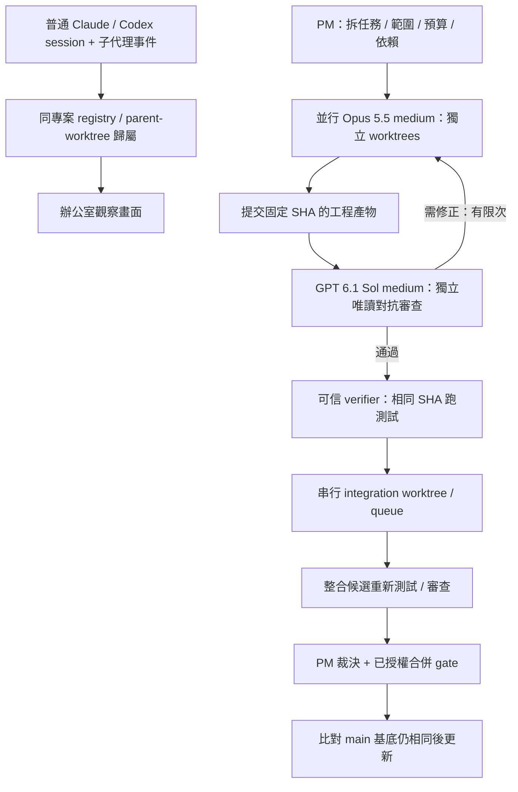

# 27 個 repo：一般 session 自動接入與混合代理開發評估

查核日期：2026-10-01；每個 repo 的公開 HEAD、README 與可取得授權已固定在 matrix.json。結論是比較推論，不是實測速度排行。

**主選 Orca；PM／合併佇列完整性選 GasTown；只要先自動看見 session 選 agents-observe。沒有任何一個在本次證據中已證明可原封不動滿足全部需求。**

這裡的「最快」指現有模組最接近需求、預期接線最少。沒有部署全部 27 個產品、沒有啟動真付費 Claude／Codex、沒有量測端到端工時，不能承諾幾天完成。

## 先釐清自動接入的邊界

- 一次設定 hooks 後，維持平常 `claude`／`codex` 的啟動方式，session 與子代理自動顯示：可透過 hook 事件與 session registry 達成，仍須實際版本相容驗收。既有 session 的歷史匯入不能當作接管正在執行的 terminal。
- 一般外部 session 的「看見／歸屬」與 PM 管理的「派工／限權／停止／驗證／合併」分開。自動觀察不應默默升級為任意遠端控制權。
- 同專案需以 canonical Git common directory 識別；不同 worktree 保留自己的 worktree identity，子代理保留 parent identity。不能僅拿 cwd 或資料夾名稱比較。
- 零設定、任意普通終端、兩 provider 所有子代理、可靠控制與 gated merge 全部成立：本次沒有找到可直接採用且有完整證據的 repo。

## 為什麼主選 Orca

它已把 Claude／Codex、worktree、原生子代理投影、session history 與 Run／Task DAG／持久 FIFO inbox／gate 放在同一套桌面產品。launch 的 model／effort 可設定，還有 requested／effective 回條。相較從 office 視覺 repo 補所有控制面，這條路預期改造較少。

但有三個必要缺口：外部普通 CLI 的 live session hook bridge；安全啟動預設；固定 commit 的 review／可信 verifier／整合候選驗證與串行 main 更新。Orca 現行文件明載 Claude `--dangerously-skip-permissions`、Codex `--dangerously-bypass-approvals-and-sandbox`。Git worktree 只是檔案與分支隔離，不是 OS sandbox；本專案不能直接啟用那些預設。Orchestration 目前須開 experimental。

推薦只選一個協調核心。採 Orca 就先用它的 registry／DAG／inbox；agents-observe 可參考 hook 映射，hcom 可當不同路線的通訊核心，不能把三個獨立控制面疊成多個真實來源。

## 其他四個值得保留的選項

1. **GasTown**：Mayor／Witness／Refinery 與 verification gates、bisecting merge queue 最完整。若優先要 PM→並行工程→串行合流，且願意接受 Beads／Dolt／tmux 的運作方式，可優先於 Orca。它仍不保證任意外部 session 自動接入，預設會涉及 remote push，須改成本專案明確授權範圍。
2. **Agent Deck**：若願意統一使用 tmux，Conductor＋worktree 是較輕候選。discovery 侷限 tmux；現有 merge primitive 不等於 commit-bound 審查、整合測試與 main compare-and-swap gate。
3. **Agent Teams AI**：團隊、review、mixed providers、成員 worktree 接近現成 UI。但 AGPL 義務、orchestrator runtime 與外部 Codex／所有子代理接入需確認。未證明安全串行合併，不因功能表就升為主選。
4. **hcom**：跨 provider 訊息／spawn 可用模組最直接，但 README 明載 hooks 僅在 hcom 前綴啟動時生效。若你堅持普通 `claude`／`codex` 啟動，它不是開箱即滿足。

## 模型角色與你要的流程

實作：Claude Opus 5.5，model `claude-opus-5-5`，effort `medium`。對抗式審查：GPT 6.1 Sol，model `gpt-6.1-sol`，reasoning `medium`。官方 model 文件已查核；本帳號、訂閱／CLI 版本與 orchestration launch 的實際 effective 設定未做付費實跑。不可拿 API model ID 存在當成某 CLI 已驗收。

官方來源：[Opus 5.5](https://platform.claude.com/docs/en/models/opus-5-5/overview)、[GPT 6.1 Sol](https://developers.openai.com/api/docs/models/gpt-6.1-sol)、[Codex hooks](https://learn.chatgpt.com/docs/hooks)、[Claude Code hooks](https://code.claude.com/docs/en/hooks)。

PM 可以協調並裁決，但「模型說通過」不構成 Git／測試真實證據。工程 SHA 改動就失效重審；main 改動就重建整合候選。衝突回派修正，不能盲目 ours／theirs。合併權限必須來自使用者明確授權或既有明確政策，本次沒有執行合併。

## 最短驗收順序

1. 固定 Orca SHA，先修 permission bypass 啟動預設；以假 provider／fixture 檢查 argv 與權限，不跑付費模型。
2. 一次授權 hooks 安裝後，從兩個普通 CLI 開 session；同 repo 的另一 worktree、兩 provider 的 child、不同 repo 都測歸屬。停止／重啟／duplicate／漏事件都要檢查，不讓舊 working 留住。
3. 工程與審查各獨立 worktree：requested／effective model+effort 一致、審查不能寫工程 workspace、固定 head 改動拒絕舊 verdict。
4. 用真 Git＋合成 worker 跑兩平行任務：單支都綠但整合後紅、main 基底移動、衝突、worker 斷線與 reviewer crash 都阻擋合併；修復後僅序列接受可驗證候選。
5. 以上離線驗收過，再在明確授權的小額真模型 smoke 中驗證兩 provider 實際啟動與事件。未做前只稱 source／fixture 證據。

先做到 session 自動歸屬與辦公室顯示，再驗受管混合工作流與 merge queue。避免同時改三個核心與整套美術。

## 全部 27 個比較

「原生／有」只表示本次固定版本的文件或選定程式碼有實作材料；不表示已跑通。「未驗」表示證據缺口，不宣稱功能不存在。README-only 的列沒有完整程式碼審查。授權摘要是選型提醒，實際重用仍以所引 LICENSE 及目錄例外為準。

| # | Repo／定位 | 普通 session 自動接入 | 子代理 | Worktree | PM／協作 | 串行合流 | 授權／深度 | 判定 |
|---|---|---|---|---|---|---|---|---|
| 1 | [stablyai/orca](https://github.com/stablyai/orca/blob/0b812bd69856f9f2337dd54d7f3b9ceedff24cc9/README.md)／主選 | 歷史可掃描；外部即時接管須補 | Claude/Codex 子代理有選定原始碼證據 | 原生 | Run／DAG／持久 inbox／gate；experimental | 需補固定 SHA 與整合後驗證 | MIT／選定原始碼 | 最接近一套完成；先移除預設 permission bypass。 |
| 2 | [gastownhall/gascity](https://github.com/gastownhall/gascity/blob/4b26deb7c2b92138133a6b894048432fccda6c16/README.md)／框架 | 由設定的執行器啟動 | 未驗完整跨 provider 子代理接入 | 可設定工作區 | 可組裝 supervisor／formula／orders | 需組裝 | MIT／文件 | GasTown 下層建構材料；不是最快現成產品。 |
| 3 | [gastownhall/gastown](https://github.com/gastownhall/gastown/blob/649b832b7672bc7a2dbef26f5983aba6198b819b/README.md)／完整 PM 備選 | 受管 tmux／工作區；普通外部 session 須補 | 受管角色；原生子代理自動歸屬未驗 | 原生 | Mayor／Witness／Refinery | 有 gate／bisect queue 選定原始碼 | MIT／選定原始碼 | 最完整 PM→合流架構；Beads／Dolt／tmux 維運較重，現成流程含 push，須改本機授權邊界。 |
| 4 | [aannoo/hcom](https://github.com/aannoo/hcom/blob/2c5f343b2f9ec4bf2acf49c0431860e7c2ae578b/README.md)／通訊備選 | 需 hcom claude／hcom codex 前綴 | 有 parent／child 與 hook 選定原始碼 | 可配合；共同專案歸屬須設定 | 訊息／spawn／debate recipes | 需補 | MIT／選定原始碼 | 跨 Claude／Codex 通訊強；不符合完全維持普通啟動方式。 |
| 5 | [Dicklesworthstone/mcp_agent_mail](https://github.com/Dicklesworthstone/mcp_agent_mail/blob/3fad5ec672869f81d2ca0a4c525dde004ac96f45/README.md)／排除重用 | MCP 身分註冊 | 須顯式協作註冊 | advisory leases | 郵件／身分／協作 | 無完整管線證據 | MIT + provider rider／README／授權 | 授權另附 OpenAI／Anthropic 限制；依既有專案決策排除重用。 |
| 6 | [23blocks-OS/ai-maestro](https://github.com/23blocks-OS/ai-maestro/blob/bc4969cfd43fc81a9a5599932e0f88b19d1c9b22/README.md)／tmux 管理 | 文件稱發現既有 tmux | 原生子代理完整歸屬未驗 | 多機以 clone 為主 | 身分／AMP messaging | 需補 | MIT／選定原始碼 | 適合常駐多機 agent 管理；與共享 repo 多 worktree 的目標仍有接線。 |
| 7 | [AgentSystemLabs/agent-office](https://github.com/AgentSystemLabs/agent-office/blob/1bc3028472d38b161e85117bf621bb6bc12700e5/README.md)／視覺材料 | 由 UI／PTY 啟動 | 完整雙 provider 子代理接入未驗 | 完整管線未驗 | 辦公室／終端 UI | 需補 | MIT／README＋現行 AETHER 原始碼 | 保留美術與投影；沿用目前 AETHER 補完整控制面不是最短路。 |
| 8 | [pixel-agents-hq/pixel-agents](https://github.com/pixel-agents-hq/pixel-agents/blob/3537e140c2094761beae748592aeb92ece8edfdd/README.md)／視覺材料 | Claude hook／transcript 投影 | Claude 有相關事件；Codex 完整鏈未驗 | 非核心 | 像素辦公室投影 | 非核心 | MIT／README／選定文件 | 可借觀察與角色映射；不作 PM 核心。 |
| 9 | [777genius/agent-teams-ai](https://github.com/777genius/agent-teams-ai/blob/f936527bdf7ee7e147b6d3d06e51b9c01ccf491b/README.md)／團隊 UI 備選 | 有掃描；任意外部 Codex 即時接入未驗 | mixed team 文件；完整原生子代理歸屬未驗 | 原生團隊工作區 | 團隊／review／budget；orchestrator runtime | 固定 SHA 串行 gate 未驗 | AGPL-3.0／選定原始碼 | 最接近現成團隊 UI 之一；接受 AGPL 義務與 backend 接線才考慮。 |
| 10 | [nimbalyst/nimbalyst](https://github.com/nimbalyst/nimbalyst/blob/9f13b2794d6d37ab005af6302cfe2a8540cfcdb6/README.md)／桌面管理 | 由產品管理／啟動 | 完整外部子代理接入未驗 | 文件有平行 worktree | 異質 agents／視覺 diff | PM 固定 SHA queue 未驗 | MIT／README | 適合人工管理多 agent 開發，尚不足整套自動 PM。 |
| 11 | [agent-of-empires/agent-of-empires](https://github.com/agent-of-empires/agent-of-empires/blob/f7a23121886c2f273ee239c37ccc65b20647badc/README.md)／工作階段管理 | 受管 tmux | 跨 provider 子代理完整接入未驗 | 原生 | TUI／Web／container／diff | 需補 | MIT／README | 平行 worktree 啟動好用；尚需 PM 與 merge policy。 |
| 12 | [asheshgoplani/agent-deck](https://github.com/asheshgoplani/agent-deck/blob/035fd602eda5e3ed7e95edb63b6418fbe285f74d/README.md)／輕量 PM 備選 | 可發現／匯入 tmux；非任意終端 | 受管 children；通用原生 parent 歸屬須補 | 原生 | Claude Conductor／policy／state／watcher | 有 merge primitive；完整 gate 須補 | MIT／選定原始碼 | 若願意統一 tmux 習慣，輕量候選；project grouping 與 main CAS 須補。 |
| 13 | [smtg-ai/claude-squad](https://github.com/smtg-ai/claude-squad/blob/ce1ffb4392b01f38e2c4599c7c84d2a93973b138/README.md)／工作階段管理 | 由 squad 管理啟動 | 完整子代理接入未驗 | 原生 | 平行 CLI／tmux | 完整 PM gate 未驗 | AGPL-3.0／README | 適合終端平行；experimental autoyes 不等於合併品質 gate。 |
| 14 | [awslabs/cli-agent-orchestrator](https://github.com/awslabs/cli-agent-orchestrator/blob/a1c3d138c38e58d1df04f9850b828e0b3df513e6/README.md)／委派執行器 | 受管 tmux CLI | 受管委派；任意外部子代理未驗 | recipes／設定 | supervisor／handoff／send message | 完整 queue 未驗 | Apache-2.0／README | 能做多 CLI 委派；補外部接入與 merge 層。 |
| 15 | [OpenHands/OpenHands](https://github.com/OpenHands/OpenHands/blob/a8c05584ec6bb063a0857460b9cbff48e136919f/README.md)／大型平台 | Canvas／ACP 管理的新 session | 舊 session 自動轉入未成立 | 受管 workspace／sandbox | 大型執行平台 | 本需求完整 queue 未驗 | MIT 核心；另看各目錄授權／README | 新平台支援 Claude／Codex 不代表可接管既有 CLI；改造面較大。 |
| 16 | [openai/symphony](https://github.com/openai/symphony/blob/be10a1b79df723d6d7612b5651c8522704dafb2e/README.md)／Issue 驅動 | issue→受管 Codex workspace | 非普通 CLI 子代理收納 | 隔離工作區 | issue lifecycle／proof | 須配合外部 review／merge policy | Apache-2.0／README | 偏 Codex＋issue 自動開發；混合原生 Claude 協作須擴充。 |
| 17 | [microsoft/agent-framework](https://github.com/microsoft/agent-framework/blob/f1fb145c4d80191aa86b3480d12112d828233763/README.md)／SDK | 需應用整合 | API agents／handoff | 須自建 | Python／.NET workflow／checkpoint | 須自建 | MIT／README | 流程 SDK，沒有現成原生 CLI 接入與 Git 控制面。 |
| 18 | [ruvnet/ruflo](https://github.com/ruvnet/ruflo/blob/6cfd88654f2c571940f32704d79a2a1892de4392/README.md)／廣泛 swarm | Claude／Codex plugin／hooks 文件 | 完整 runtime 未驗 | 文件有相關能力 | 大量 swarm／工具／roles | 固定 SHA queue 未驗 | MIT／README | 覆蓋宣稱廣；不以宣傳數字視為交付，驗證與裁剪成本高。 |
| 19 | [simple10/agents-observe](https://github.com/simple10/agents-observe/blob/b3a7238b3913976c10da052f75c73e29ad084c61/README.md)／觀察首選 | Claude plugin hooks；Codex adapter 須修配置 | Claude 有 hooks；Codex 範例缺 SubagentStart | 僅觀察，不管理 worktree | 觀察 dashboard／事件投影 | 無 | MIT／選定原始碼＋8 個合成斷言 | 最快先做到看見；不是 PM。Codex 範例 hook 路徑綁目前 repo，不能直接通用安裝。 |
| 20 | [zetbrush/multiagents](https://github.com/zetbrush/multiagents/blob/03fcf6e875804a21650ed4e45eb9b6624460f7fb/README.md)／通訊原型 | broker／MCP／driver 啟動 | 受管 slots；外部任意接入未驗 | workspace ownership | 多 CLI／角色／broker | 完整 gate 未驗 | README 宣告 MIT；未取得 LICENSE／README | 可參考訊息機制；授權文件與整套驗收仍缺。 |
| 21 | [agent-room-alkl/agent-room](https://github.com/agent-room-alkl/agent-room/blob/080b13d2bf927a1ee3e66981dece0d2eee698d37/README.md)／通訊服務 | MCP／REST 顯式註冊 | 非原生 session 發現 | 不管理 | Redis rooms／peer review 範例 | 合併角色範例，非受信 queue | MIT／README | 有協作通道；還缺程序、Git、排程與授權 gate。 |
| 22 | [BloopAI/vibe-kanban](https://github.com/BloopAI/vibe-kanban/blob/d5cbb5380fa0b32e98ef9b8d987f63decce4be3a/README.md)／不作新核心 | 由產品管理啟動 | 完整外部 child 接入未驗 | 原生 | Kanban／review／Git UI | 本需求 gate 未验 | Apache-2.0／README | README 已公告 sunset；沒有維護接手計畫不選作新基底。 |
| 23 | [ajsahni/agents-office](https://github.com/ajsahni/agents-office/blob/2d4700189ee0900060a97ff3ab79f9eb0386ca23/README.md)／排除重用 | Claude headless | 非完整 Codex／Claude 混合接入 | 完整管線未驗 | 3D UI | 完整 queue 未驗 | PolyForm Noncommercial + 附加條款／README／授權 | 不符合本專案 MIT 開源基底方向；不重用其程式碼。 |
| 24 | [agentclientprotocol/agent-client-protocol](https://github.com/agentclientprotocol/agent-client-protocol/blob/9e032156545412be9bba5e092f12d0080c499b6d/README.md)／協定 | editor↔agent 協定；非自動發現 | 依能力協商 | 不管理 | 不是 PM engine | 不管理 | Apache-2.0／README | 可作 adapter 邊界；不能獨立完成需求。 |
| 25 | [agentclientprotocol/claude-agent-acp](https://github.com/agentclientprotocol/claude-agent-acp/blob/0c862e29496bb018e7a4400697bd2315dfd5b845/README.md)／Claude adapter | 經 ACP client 啟動 | nested subagents 依 client 能力協商 | 不管理 | 不是協調器 | 不管理 | Apache-2.0／選定文件／原始碼 | 可用於標準化 transport；不接管外部普通 session。 |
| 26 | [zed-industries/codex-acp](https://github.com/zed-industries/codex-acp/blob/296069e841634cd4bb9bc4515602d836e49231ec/README.md)／舊址／adapter | 舊 repo 已移至 agentclientprotocol/codex-acp | 依新版協定／實作；未跑 | 不管理 | 不是協調器 | 不管理 | Apache-2.0／README | 若採 ACP 使用 canonical 新址；舊址不選作基底。 |
| 27 | [a2aproject/A2A](https://github.com/a2aproject/A2A/blob/c0e13ef67ec386ab304acbf60952f09cdc70bd66/README.md)／協定 | agent app 的 card／task protocol | 需應用整合 | 不管理 | 通訊協定 | 不管理 | Apache-2.0／README | 不是 CLI session 發現、worktree scheduler 或 merge engine。 |

## 本次實際驗證與 AETHER 現況

全部 27 的 public HEAD／README 均查核，26 個取得 LICENSE／LICENSE.md，multiagents 只有 README 的 MIT 宣告。13 個候選取得 Git partial clone，選定模組以 source-index.json 固定路徑與 SHA；不等於審查全部檔案。agents-observe 兩個 adapter 與 Codex hook 範例執行 8 個合成斷言，通過；證明 envelope 部分欄位與範例缺少 SubagentStart，沒有證明 HTTP server、真 CLI 或子代理端到端成立。

AETHER 現行 Codex adapter 明確關閉 multi_agent，Claude 禁用 Agent／Task；目前 demo 不能滿足全部原生子代理自動接入。這是產品能力缺口，與本次依使用者要求不委派調研是兩件事。此次沒有改產品執行碼、安裝 hooks、全域設定、付費模型、push 或 merge。

可重現資料：matrix.json、source-index.json、evidence/adapter-assertions.log；原始暫存抓取在 /tmp/aether-repo-evaluation-20261001，可能被作業系統清除，所以所有引用都指向固定 GitHub commit。
