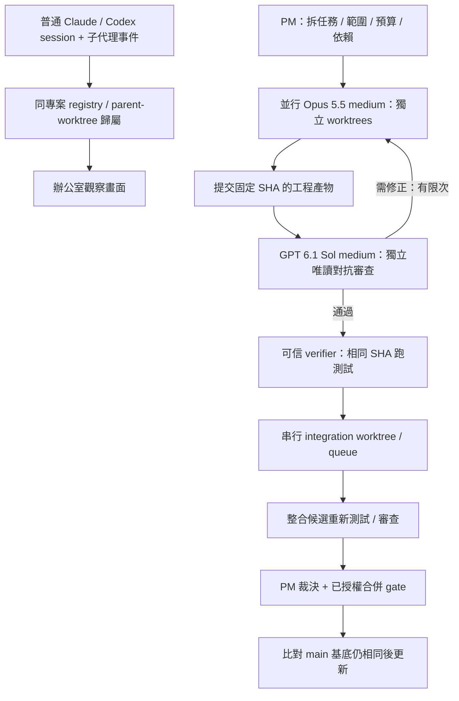

# 27 個 repo：一般 session 自動接入與混合代理開發評估

查核日期：2026-10-01；每個 repo 的公開 HEAD、README 與可取得授權已固定在 matrix.json。結論是比較推論，不是實測速度排行。

**主選 Orca；PM／合併佇列完整性選 GasTown；只要先自動看見 session 選 agents-observe。沒有任何一個在本次證據中已證明可原封不動滿足全部需求。**

這裡的「最快」指現有模組最接近需求、預期接線最少。沒有部署全部 27 個產品、沒有啟動真付費 Claude／Codex、沒有量測端到端工時，不能承諾幾天完成。

## 先釐清自動接入的邊界

- 一次設定 hooks 後，維持平常 `claude`／`codex` 的啟動方式，session 與子代理自動顯示：可透過 hook 事件與 session registry 達成，仍須實際版本相容驗收。既有 session 的歷史匯入不能當作接管正在執行的 terminal。
- 一般外部 session 的「看見／歸屬」與 PM 管理的「派工／限權／停止／驗證／合併」分開。自動觀察不應默默升級為任意遠端控制權。
- 同專案需以 canonical Git common directory 識別；不同 worktree 保留自己的 worktree identity，子代理保留 parent identity。不能僅拿 cwd 或資料夾名稱比較。
- 零設定、任意普通終端、兩 provider 所有子代理、可靠控制與 gated merge 全部成立：本次沒有找到可直接採用且有完整證據的 repo。

## 為什麼主選 Orca

它已把 Claude／Codex、worktree、原生子代理投影、session history 與 Run／Task DAG／持久 FIFO inbox／gate 放在同一套桌面產品。launch 的 model／effort 可設定，還有 requested／effective 回條。相較從 office 視覺 repo 補所有控制面，這條路預期改造較少。

但有三個必要缺口：外部普通 CLI 的 live session hook bridge；安全啟動預設；固定 commit 的 review／可信 verifier／整合候選驗證與串行 main 更新。Orca 現行文件明載 Claude `--dangerously-skip-permissions`、Codex `--dangerously-bypass-approvals-and-sandbox`。Git worktree 只是檔案與分支隔離，不是 OS sandbox；本專案不能直接啟用那些預設。Orchestration 目前須開 experimental。

推薦只選一個協調核心。採 Orca 就先用它的 registry／DAG／inbox；agents-observe 可參考 hook 映射，hcom 可當不同路線的通訊核心，不能把三個獨立控制面疊成多個真實來源。

## 其他四個值得保留的選項

1. **GasTown**：Mayor／Witness／Refinery 與 verification gates、bisecting merge queue 最完整。若優先要 PM→並行工程→串行合流，且願意接受 Beads／Dolt／tmux 的運作方式，可優先於 Orca。它仍不保證任意外部 session 自動接入，預設會涉及 remote push，須改成本專案明確授權範圍。
2. **Agent Deck**：若願意統一使用 tmux，Conductor＋worktree 是較輕候選。discovery 侷限 tmux；現有 merge primitive 不等於 commit-bound 審查、整合測試與 main compare-and-swap gate。
3. **Agent Teams AI**：團隊、review、mixed providers、成員 worktree 接近現成 UI。但 AGPL 義務、orchestrator runtime 與外部 Codex／所有子代理接入需確認。未證明安全串行合併，不因功能表就升為主選。
4. **hcom**：跨 provider 訊息／spawn 可用模組最直接，但 README 明載 hooks 僅在 hcom 前綴啟動時生效。若你堅持普通 `claude`／`codex` 啟動，它不是開箱即滿足。

## 模型角色與你要的流程

實作：Claude Opus 5.5，model `claude-opus-5-5`，effort `medium`。對抗式審查：GPT 6.1 Sol，model `gpt-6.1-sol`，reasoning `medium`。官方 model 文件已查核；本帳號、訂閱／CLI 版本與 orchestration launch 的實際 effective 設定未做付費實跑。不可拿 API model ID 存在當成某 CLI 已驗收。

官方來源：[Opus 5.5](https://platform.claude.com/docs/en/models/opus-5-5/overview)、[GPT 6.1 Sol](https://developers.openai.com/api/docs/models/gpt-6.1-sol)、[Codex hooks](https://learn.chatgpt.com/docs/hooks)、[Claude Code hooks](https://code.claude.com/docs/en/hooks)。

PM 可以協調並裁決，但「模型說通過」不構成 Git／測試真實證據。工程 SHA 改動就失效重審；main 改動就重建整合候選。衝突回派修正，不能盲目 ours／theirs。合併權限必須來自使用者明確授權或既有明確政策，本次沒有執行合併。

## 最短驗收順序

1. 固定 Orca SHA，先修 permission bypass 啟動預設；以假 provider／fixture 檢查 argv 與權限，不跑付費模型。
2. 一次授權 hooks 安裝後，從兩個普通 CLI 開 session；同 repo 的另一 worktree、兩 provider 的 child、不同 repo 都測歸屬。停止／重啟／duplicate／漏事件都要檢查，不讓舊 working 留住。
3. 工程與審查各獨立 worktree：requested／effective model+effort 一致、審查不能寫工程 workspace、固定 head 改動拒絕舊 verdict。
4. 用真 Git＋合成 worker 跑兩平行任務：單支都綠但整合後紅、main 基底移動、衝突、worker 斷線與 reviewer crash 都阻擋合併；修復後僅序列接受可驗證候選。
5. 以上離線驗收過，再在明確授權的小額真模型 smoke 中驗證兩 provider 實際啟動與事件。未做前只稱 source／fixture 證據。

先做到 session 自動歸屬與辦公室顯示，再驗受管混合工作流與 merge queue。避免同時改三個核心與整套美術。

## 全部 27 個比較

「原生／有」只表示本次固定版本的文件或選定程式碼有實作材料；不表示已跑通。「未驗」表示證據缺口，不宣稱功能不存在。README-only 的列沒有完整程式碼審查。授權摘要是選型提醒，實際重用仍以所引 LICENSE 及目錄例外為準。

| # | Repo／定位 | 普通 session 自動接入 | 子代理 | Worktree | PM／協作 | 串行合流 | 授權／深度 | 判定 |
|---|---|---|---|---|---|---|---|---|
| 1 | [stablyai/orca](https://github.com/stablyai/orca/blob/0b812bd69856f9f2337dd54d7f3b9ceedff24cc9/README.md)／主選 | 歷史可掃描；外部即時接管須補 | Claude/Codex 子代理有選定原始碼證據 | 原生 | Run／DAG／持久 inbox／gate；experimental | 需補固定 SHA 與整合後驗證 | MIT／選定原始碼 | 最接近一套完成；先移除預設 permission bypass。 |
| 2 | [gastownhall/gascity](https://github.com/gastownhall/gascity/blob/4b26deb7c2b92138133a6b894048432fccda6c16/README.md)／框架 | 由設定的執行器啟動 | 未驗完整跨 provider 子代理接入 | 可設定工作區 | 可組裝 supervisor／formula／orders | 需組裝 | MIT／文件 | GasTown 下層建構材料；不是最快現成產品。 |
| 3 | [gastownhall/gastown](https://github.com/gastownhall/gastown/blob/649b832b7672bc7a2dbef26f5983aba6198b819b/README.md)／完整 PM 備選 | 受管 tmux／工作區；普通外部 session 須補 | 受管角色；原生子代理自動歸屬未驗 | 原生 | Mayor／Witness／Refinery | 有 gate／bisect queue 選定原始碼 | MIT／選定原始碼 | 最完整 PM→合流架構；Beads／Dolt／tmux 維運較重，現成流程含 push，須改本機授權邊界。 |
| 4 | [aannoo/hcom](https://github.com/aannoo/hcom/blob/2c5f343b2f9ec4bf2acf49c0431860e7c2ae578b/README.md)／通訊備選 | 需 hcom claude／hcom codex 前綴 | 有 parent／child 與 hook 選定原始碼 | 可配合；共同專案歸屬須設定 | 訊息／spawn／debate recipes | 需補 | MIT／選定原始碼 | 跨 Claude／Codex 通訊強；不符合完全維持普通啟動方式。 |
| 5 | [Dicklesworthstone/mcp_agent_mail](https://github.com/Dicklesworthstone/mcp_agent_mail/blob/3fad5ec672869f81d2ca0a4c525dde004ac96f45/README.md)／排除重用 | MCP 身分註冊 | 須顯式協作註冊 | advisory leases | 郵件／身分／協作 | 無完整管線證據 | MIT + provider rider／README／授權 | 授權另附 OpenAI／Anthropic 限制；依既有專案決策排除重用。 |
| 6 | [23blocks-OS/ai-maestro](https://github.com/23blocks-OS/ai-maestro/blob/bc4969cfd43fc81a9a5599932e0f88b19d1c9b22/README.md)／tmux 管理 | 文件稱發現既有 tmux | 原生子代理完整歸屬未驗 | 多機以 clone 為主 | 身分／AMP messaging | 需補 | MIT／選定原始碼 | 適合常駐多機 agent 管理；與共享 repo 多 worktree 的目標仍有接線。 |
| 7 | [AgentSystemLabs/agent-office](https://github.com/AgentSystemLabs/agent-office/blob/1bc3028472d38b161e85117bf621bb6bc12700e5/README.md)／視覺材料 | 由 UI／PTY 啟動 | 完整雙 provider 子代理接入未驗 | 完整管線未驗 | 辦公室／終端 UI | 需補 | MIT／README＋現行 AETHER 原始碼 | 保留美術與投影；沿用目前 AETHER 補完整控制面不是最短路。 |
| 8 | [pixel-agents-hq/pixel-agents](https://github.com/pixel-agents-hq/pixel-agents/blob/3537e140c2094761beae748592aeb92ece8edfdd/README.md)／視覺材料 | Claude hook／transcript 投影 | Claude 有相關事件；Codex 完整鏈未驗 | 非核心 | 像素辦公室投影 | 非核心 | MIT／README／選定文件 | 可借觀察與角色映射；不作 PM 核心。 |
| 9 | [777genius/agent-teams-ai](https://github.com/777genius/agent-teams-ai/blob/f936527bdf7ee7e147b6d3d06e51b9c01ccf491b/README.md)／團隊 UI 備選 | 有掃描；任意外部 Codex 即時接入未驗 | mixed team 文件；完整原生子代理歸屬未驗 | 原生團隊工作區 | 團隊／review／budget；orchestrator runtime | 固定 SHA 串行 gate 未驗 | AGPL-3.0／選定原始碼 | 最接近現成團隊 UI 之一；接受 AGPL 義務與 backend 接線才考慮。 |
| 10 | [nimbalyst/nimbalyst](https://github.com/nimbalyst/nimbalyst/blob/9f13b2794d6d37ab005af6302cfe2a8540cfcdb6/README.md)／桌面管理 | 由產品管理／啟動 | 完整外部子代理接入未驗 | 文件有平行 worktree | 異質 agents／視覺 diff | PM 固定 SHA queue 未驗 | MIT／README | 適合人工管理多 agent 開發，尚不足整套自動 PM。 |
| 11 | [agent-of-empires/agent-of-empires](https://github.com/agent-of-empires/agent-of-empires/blob/f7a23121886c2f273ee239c37ccc65b20647badc/README.md)／工作階段管理 | 受管 tmux | 跨 provider 子代理完整接入未驗 | 原生 | TUI／Web／container／diff | 需補 | MIT／README | 平行 worktree 啟動好用；尚需 PM 與 merge policy。 |
| 12 | [asheshgoplani/agent-deck](https://github.com/asheshgoplani/agent-deck/blob/035fd602eda5e3ed7e95edb63b6418fbe285f74d/README.md)／輕量 PM 備選 | 可發現／匯入 tmux；非任意終端 | 受管 children；通用原生 parent 歸屬須補 | 原生 | Claude Conductor／policy／state／watcher | 有 merge primitive；完整 gate 須補 | MIT／選定原始碼 | 若願意統一 tmux 習慣，輕量候選；project grouping 與 main CAS 須補。 |
| 13 | [smtg-ai/claude-squad](https://github.com/smtg-ai/claude-squad/blob/ce1ffb4392b01f38e2c4599c7c84d2a93973b138/README.md)／工作階段管理 | 由 squad 管理啟動 | 完整子代理接入未驗 | 原生 | 平行 CLI／tmux | 完整 PM gate 未驗 | AGPL-3.0／README | 適合終端平行；experimental autoyes 不等於合併品質 gate。 |
| 14 | [awslabs/cli-agent-orchestrator](https://github.com/awslabs/cli-agent-orchestrator/blob/a1c3d138c38e58d1df04f9850b828e0b3df513e6/README.md)／委派執行器 | 受管 tmux CLI | 受管委派；任意外部子代理未驗 | recipes／設定 | supervisor／handoff／send message | 完整 queue 未驗 | Apache-2.0／README | 能做多 CLI 委派；補外部接入與 merge 層。 |
| 15 | [OpenHands/OpenHands](https://github.com/OpenHands/OpenHands/blob/a8c05584ec6bb063a0857460b9cbff48e136919f/README.md)／大型平台 | Canvas／ACP 管理的新 session | 舊 session 自動轉入未成立 | 受管 workspace／sandbox | 大型執行平台 | 本需求完整 queue 未驗 | MIT 核心；另看各目錄授權／README | 新平台支援 Claude／Codex 不代表可接管既有 CLI；改造面較大。 |
| 16 | [openai/symphony](https://github.com/openai/symphony/blob/be10a1b79df723d6d7612b5651c8522704dafb2e/README.md)／Issue 驅動 | issue→受管 Codex workspace | 非普通 CLI 子代理收納 | 隔離工作區 | issue lifecycle／proof | 須配合外部 review／merge policy | Apache-2.0／README | 偏 Codex＋issue 自動開發；混合原生 Claude 協作須擴充。 |
| 17 | [microsoft/agent-framework](https://github.com/microsoft/agent-framework/blob/f1fb145c4d80191aa86b3480d12112d828233763/README.md)／SDK | 需應用整合 | API agents／handoff | 須自建 | Python／.NET workflow／checkpoint | 須自建 | MIT／README | 流程 SDK，沒有現成原生 CLI 接入與 Git 控制面。 |
| 18 | [ruvnet/ruflo](https://github.com/ruvnet/ruflo/blob/6cfd88654f2c571940f32704d79a2a1892de4392/README.md)／廣泛 swarm | Claude／Codex plugin／hooks 文件 | 完整 runtime 未驗 | 文件有相關能力 | 大量 swarm／工具／roles | 固定 SHA queue 未驗 | MIT／README | 覆蓋宣稱廣；不以宣傳數字視為交付，驗證與裁剪成本高。 |
| 19 | [simple10/agents-observe](https://github.com/simple10/agents-observe/blob/b3a7238b3913976c10da052f75c73e29ad084c61/README.md)／觀察首選 | Claude plugin hooks；Codex adapter 須修配置 | Claude 有 hooks；Codex 範例缺 SubagentStart | 僅觀察，不管理 worktree | 觀察 dashboard／事件投影 | 無 | MIT／選定原始碼＋8 個合成斷言 | 最快先做到看見；不是 PM。Codex 範例 hook 路徑綁目前 repo，不能直接通用安裝。 |
| 20 | [zetbrush/multiagents](https://github.com/zetbrush/multiagents/blob/03fcf6e875804a21650ed4e45eb9b6624460f7fb/README.md)／通訊原型 | broker／MCP／driver 啟動 | 受管 slots；外部任意接入未驗 | workspace ownership | 多 CLI／角色／broker | 完整 gate 未驗 | README 宣告 MIT；未取得 LICENSE／README | 可參考訊息機制；授權文件與整套驗收仍缺。 |
| 21 | [agent-room-alkl/agent-room](https://github.com/agent-room-alkl/agent-room/blob/080b13d2bf927a1ee3e66981dece0d2eee698d37/README.md)／通訊服務 | MCP／REST 顯式註冊 | 非原生 session 發現 | 不管理 | Redis rooms／peer review 範例 | 合併角色範例，非受信 queue | MIT／README | 有協作通道；還缺程序、Git、排程與授權 gate。 |
| 22 | [BloopAI/vibe-kanban](https://github.com/BloopAI/vibe-kanban/blob/d5cbb5380fa0b32e98ef9b8d987f63decce4be3a/README.md)／不作新核心 | 由產品管理啟動 | 完整外部 child 接入未驗 | 原生 | Kanban／review／Git UI | 本需求 gate 未验 | Apache-2.0／README | README 已公告 sunset；沒有維護接手計畫不選作新基底。 |
| 23 | [ajsahni/agents-office](https://github.com/ajsahni/agents-office/blob/2d4700189ee0900060a97ff3ab79f9eb0386ca23/README.md)／排除重用 | Claude headless | 非完整 Codex／Claude 混合接入 | 完整管線未驗 | 3D UI | 完整 queue 未驗 | PolyForm Noncommercial + 附加條款／README／授權 | 不符合本專案 MIT 開源基底方向；不重用其程式碼。 |
| 24 | [agentclientprotocol/agent-client-protocol](https://github.com/agentclientprotocol/agent-client-protocol/blob/9e032156545412be9bba5e092f12d0080c499b6d/README.md)／協定 | editor↔agent 協定；非自動發現 | 依能力協商 | 不管理 | 不是 PM engine | 不管理 | Apache-2.0／README | 可作 adapter 邊界；不能獨立完成需求。 |
| 25 | [agentclientprotocol/claude-agent-acp](https://github.com/agentclientprotocol/claude-agent-acp/blob/0c862e29496bb018e7a4400697bd2315dfd5b845/README.md)／Claude adapter | 經 ACP client 啟動 | nested subagents 依 client 能力協商 | 不管理 | 不是協調器 | 不管理 | Apache-2.0／選定文件／原始碼 | 可用於標準化 transport；不接管外部普通 session。 |
| 26 | [zed-industries/codex-acp](https://github.com/zed-industries/codex-acp/blob/296069e841634cd4bb9bc4515602d836e49231ec/README.md)／舊址／adapter | 舊 repo 已移至 agentclientprotocol/codex-acp | 依新版協定／實作；未跑 | 不管理 | 不是協調器 | 不管理 | Apache-2.0／README | 若採 ACP 使用 canonical 新址；舊址不選作基底。 |
| 27 | [a2aproject/A2A](https://github.com/a2aproject/A2A/blob/c0e13ef67ec386ab304acbf60952f09cdc70bd66/README.md)／協定 | agent app 的 card／task protocol | 需應用整合 | 不管理 | 通訊協定 | 不管理 | Apache-2.0／README | 不是 CLI session 發現、worktree scheduler 或 merge engine。 |

## 本次實際驗證與 AETHER 現況

全部 27 的 public HEAD／README 均查核，26 個取得 LICENSE／LICENSE.md，multiagents 只有 README 的 MIT 宣告。13 個候選取得 Git partial clone，選定模組以 source-index.json 固定路徑與 SHA；不等於審查全部檔案。agents-observe 兩個 adapter 與 Codex hook 範例執行 8 個合成斷言，通過；證明 envelope 部分欄位與範例缺少 SubagentStart，沒有證明 HTTP server、真 CLI 或子代理端到端成立。

AETHER 現行 Codex adapter 明確關閉 multi_agent，Claude 禁用 Agent／Task；目前 demo 不能滿足全部原生子代理自動接入。這是產品能力缺口，與本次依使用者要求不委派調研是兩件事。此次沒有改產品執行碼、安裝 hooks、全域設定、付費模型、push 或 merge。

可重現資料：matrix.json、source-index.json、evidence/adapter-assertions.log；原始暫存抓取在 /tmp/aether-repo-evaluation-20261001，可能被作業系統清除，所以所有引用都指向固定 GitHub commit。

## 2026-10-04 補充：27 個 repo 已全部本機化，原始碼調研與可複製架構

27 個 repo 皆 `--depth 1` 拉到 `.research/`（不進版控），固定 SHA 與逐檔核對的授權寫在 `matrix.json` 的 `localSha`、`licenseVerified`、`reuse`。**複製規則**：`code-with-notice` 可保留版權聲明後重用；`ideas-only`（AGPL-3.0 的 agent-teams-ai、claude-squad，以及沒有 LICENSE 檔的 multiagents）只能參考想法，不得複製程式碼；`excluded`（mcp_agent_mail 的 OpenAI／Anthropic rider、agents-office 的 PolyForm Noncommercial 與禁止嵌入條款）不碰。目前 AETHER 沒有複製任何第三方程式碼。

**實際讀過原始碼的 9 個**（其餘 18 個仍是 README／授權層級，本輪沒有讀程式，不能算調研完成）：

| repo | 讀了什麼 | 值得直接照做的架構 | AETHER 現況 |
|---|---|---|---|
| orca（MIT） | `src/main/agent-hooks`、`codex/` | hook 安裝「installed／partial／not_installed」狀態且容忍手改檔；用 Codex app-server 的唯讀 `hooks/list` 取得每個 hook 的 `trustStatus`；受管 hook 的安裝鎖與擁有者識別；本機 CLI 是否存在偵測 | 已採用前兩項（`pnpm hooks status`，真實回報 9 個 Codex hook 皆 trusted）；安裝鎖與 PATH 還原未做 |
| pixel-agents（MIT） | `timerManager`、`hookEventHandler` | `PermissionRequest` 與 Notification(`permission_prompt`) 合併為「等待批准」，Stop 與 `idle_prompt` 為回合結束 | 已採用 |
| agent-deck（MIT） | `hook_handler.go` | 事件→狀態表；`elicitation_dialog` 也算需人類；hook 狀態要有新鮮度 | 已採用 |
| agents-observe（MIT） | `hooks/scripts/lib/agents` | Codex 與 Claude 的 hook 信封共用 `session_id／agent_id／cwd`；Codex `session_meta.git` 結構 | 已確認一致 |
| agent-of-empires（MIT AND Apache-2.0） | `session/capture/codex.rs` | rollout 掃描上限（深度 4、8192 項、4096 候選）、首行 64KB 上限、檔名 UUID 必須等於 `session_id／id`、支援 `.jsonl.zst` | 掃描上限已採用；此機器沒有 `.zst`，尚未支援 |
| hcom（MIT） | `src/hooks/codex.rs` | **透過 hook 回傳 `hookSpecificOutput.additionalContext` 把待讀訊息注入執行中的 session，且 delivery ack 只在輸出成功寫出後才提交** | 缺口：能力表 `messageInjection` 全為 none，觀察到的 session 也不是訊息收件人 |
| gastown（MIT） | `docs/HOOKS.md`、`estop`、`refinery/batch.go` | Claude `--settings <path>` 以獨立層載入 hook，不改使用者檔案；ESTOP 哨兵檔凍結全部 agent 且 daemon 不重啟；batch-then-bisect 合併佇列 | 停止機制本來就有（關閉專案的 live 執行會取消排隊中的 run、要求執行中的 run 與終端機停止），缺的只是一步到位的入口，已補上 `EmergencyStop`；合併佇列是單一候選序列合併 |
| symphony（Apache-2.0） | `SPEC.md` §7–§10 | 認領狀態機（Unclaimed／Claimed／Running／RetryQueued／Released）、每輪 stall 偵測、失敗指數退避 `min(10000·2^(n-1), max)`、啟動時清終態 workspace、工作目錄必須位於 workspace 根之內 | 缺口：沒有 stall 偵測與啟動清理；重試刻意由人類觸發（有嘗試上限） |
| cli-agent-orchestrator（Apache-2.0） | `CODEBASE.md` | 終端 backend 與 provider adapter 分層；收件匣「即時＋事件驅動＋對帳」三條投遞路徑；`cao.plugins` 事件外掛契約 | 分層與對帳已有；事件外掛契約沒有 |

**直接複製的優先序（依價值與風險）**
1. **緊急停止**（gastown）：已完成。調研時我先判斷「沒有」是錯的：`project.execution.configure` 設 `liveEnabled=false` 已經會取消排隊中的 run、要求執行中的 run 取消並停止終端機；實際補的是頂端列的一步到位按鈕（兩段確認，只有 live 模式的 owner 看得到），沿用同一個指令與授權，沒有新增繞過路徑。仍然只針對單一專案，沒有「全部專案」版本。
2. **hook 回傳注入訊息**（hcom）：把「已持久化」到「已投遞」做成真的，需先決定觀察到的 session 如何成為收件人（綁定 `session_id` 到註冊的 agent），風險較高。
3. **stall 偵測與啟動清理**（symphony）：control 端對沒有事件超過門檻的 run 標記並通知，啟動時回收終態 workspace。
4. **`--settings` 獨立層**（gastown）：僅適用於 AETHER 自己啟動的 Claude session；觀察外部 session 仍需 hook 安裝。

**不採用**：tmux `send-keys` 注入（ai-maestro 等）依賴終端狀態，不可靠；claude-squad 的 autoyes 會繞過批准；AGPL 與 rider 類程式碼一律不複製。

### 補讀其餘 18 個 repo（`matrix.json` 的 `sourceRead` 標出實際深度）

深度分級：`source` 讀了相關原始碼；`docs` 只讀文件；`layout` 只看目錄結構；`docs-only-by-licence` AGPL 或無授權檔，刻意只讀文件；`not-read-by-policy` 授權排除，除 LICENSE 外沒有打開。**這一輪新增 6 個 `source`（gascity、vibe-kanban、nimbalyst、claude-agent-acp、agent-framework、agent-room），累計 15 個。**

| repo | 讀了什麼 | 發現 | AETHER 現況／建議 |
|---|---|---|---|
| gascity（MIT） | `internal/sessionlog`、`transcriptmeta`、`reviewquorum`、`pricing` | 從 Codex rollout 尾端的 `token_count` 與 `turn_context` 取得模型與 context 佔用，只讀計數；`reviewquorum` 把審查拆成多條 lane，每條有 verdict（pass／pass_with_findings／fail／blocked）與失敗分類（transient／hard），湊不齊 lane 時是 `awaiting_reviewers` | 模型與 context 佔用**已採用**（Claude 與 Codex）。多 lane 審查是缺口：我們的審查是單一 lane |
| nimbalyst（MIT） | `ClaudeCodeSessionScanner.ts` | Claude Code 2.1.x 的 transcript 有 `ai-title`（模型產生的會話標題）、`last-prompt`、`slug`；`subagents/` 子目錄是子代理；以 message id 去重 token | 子代理目錄與去重已採用。**會話標題最能回答「這個 session 在做什麼」，但它是內容衍生資料，需你同意才顯示** |
| vibe-kanban（Apache-2.0，已宣告 sunset） | `executors/approvals.rs`、`worktree-manager` | 批准除了工具批准還有「問題批准」（agent 問人類問題並等回答）；worktree 建立有重試、重建、整批清理與疑似孤兒清理 | **缺口已確認**：Codex 的 `item/tool/requestUserInput` 與 `mcpServer/elicitation/request` 我們的 adapter 沒有處理（只處理兩種 requestApproval），遇到會被當成不支援的 server request。worktree 清理我們刻意保守 |
| claude-agent-acp（Apache-2.0） | `src/elicitation.ts`、目錄 | 約 1.1 萬行的 Claude Agent SDK↔ACP 對應，已含原生子代理、elicitation、權限、fork／resume、受管政策 | 我們自己維護 Claude SDK 對應且「禁用 Agent／Task」。**建議把 Claude 路徑改走 ACP 加上這個 adapter**，一次補上子代理與使用者提問；代價是依賴它的版本節奏 |
| agent-framework（MIT） | `orchestrations/` | 五種協作模式：sequential、concurrent、group chat（`max_rounds` 與 `termination_condition`，文件明說兩者都沒設會無限進行）、handoff、magentic | 我們的會議有 `maxRounds` 與期限、工作流是 DAG，已涵蓋；handoff 與 magentic 沒有 |
| agent-room（MIT） | `README`、`api/mcp.*test.ts` | 與 hcom 獨立得到同一結論：Claude Code 不顯示 MCP 推播，所以用 Stop／UserPromptSubmit／SessionStart hook 在回合邊界取新訊息；還有 listen 迴圈與 webhook 喚醒三種在場模型；有「工具說明文字衛生」測試 | 支持 hcom 那條建議（hook 回合邊界注入）。我們的 MCP 已有 `wait_for_message`（listen 型） |
| ai-maestro（MIT） | 通訊架構文件 | 檔案式持久訊息＋tmux 即時通知兩通道；文件自己列出 shell 注入風險 | 不採用 tmux 注入 |
| codex-acp、agent-client-protocol、A2A | 目錄結構 | 協定與 adapter；我們已用 `@agentclientprotocol/sdk` 與 `@a2a-js/sdk` | 無需複製程式碼 |
| OpenHands（MIT） | 目錄結構 | 這個 clone 已經只剩前端（沒有 agent runtime 目錄） | 無可借用的後端，維持不採用 |
| ruflo（MIT） | README | 宣稱多；本輪沒有讀其實作 | 不採用，驗證成本高 |
| ai-maestro 以外的 claude-squad、agent-teams-ai、multiagents | 只讀文件 | multiagents 有 `idle→working→done_pending_review→addressing_feedback→approved→released` 的 agent 任務狀態機，agent 在 release 前不能斷線 | 想法已被我們的 work 狀態機與審查流程涵蓋 |
| mcp_agent_mail、agents-office | 除 LICENSE 外未打開 | 授權排除 | — |

**結論**：兩個獨立 repo（hcom、agent-room）都用「hook 在回合邊界注入訊息」，且 hcom 只在輸出成功寫出後才提交已投遞，這是最成熟、也最值得照做的架構。其次是把 Claude 路徑改走 claude-agent-acp、處理 Codex 的使用者提問、以及多 lane 審查。

## 2026-10-04 補充：尚未納入的功能盤點，以及是否改用 Orca 當底層

### 尚未納入、值得做的功能（依價值排序）

| 優先 | 功能 | 來源 | 為何值得 | 和 AETHER 的接法 |
|---|---|---|---|---|
| 1 | 訂閱額度與用量追蹤（Claude／Codex 剩餘額度、重置時間） | Orca、agent-teams-ai（想法） | 多代理並行最先撞到的是額度 | Codex rollout 的 `token_count` 已帶 `rate_limits`；Claude 從 transcript 用量累計；顯示在遙測列與每層 HUD |
| 2 | 完成／需要你時的通知與未讀狀態 | Orca、agent-deck、pixel-agents | hook 已能判斷「等待批准」與 Stop | 瀏覽器通知＋未讀角標，接現有 hook 狀態 |
| 3 | 即時紀錄與深度 session 分析（工具呼叫、指令、子代理、context 佔用） | agent-teams-ai（想法）、nimbalyst | 回答「每個 session 在做什麼」最直接 | 逐 session 選擇開啟的 transcript 尾端檢視；需要你同意讀內容 |
| 4 | Claude agent team 收件匣與任務視覺化 | Claude Code 官方 | 真實的代理間訊息可畫成 3D 飛行路徑 | 讀 `~/.claude/teams/*/inboxes/*.json` 與 `~/.claude/tasks/*` |
| 5 | 對執行中的 Claude session 傳訊息 | Claude Code 跨 session 訊息、hcom、agent-room | 從 app 指揮外部 session | 本機收件 socket `/tmp/cc-socks/<pid>.sock`；訊息本體格式未公開，需先在拋棄式 session 驗證 |
| 6 | Session fork／從介面續接 | agent-deck | 分支探索不同方案 | `claude --fork-session`、`codex fork` |
| 7 | 開發伺服器預覽與背景程序列表 | vibe-kanban、agent-teams-ai（想法） | 看到代理做出來的東西 | runner 回報 workspace 內 listen 的 port，介面內嵌預覽 |
| 8 | PR 建立（AI 摘要）與合併 | vibe-kanban、Orca | 目前停在「整合候選」 | 接現有 GitHub 整合與 integration job；合併仍須明確授權 |
| 9 | 看板視圖 | vibe-kanban、nimbalyst | 任務多時比 DAG 好讀 | 同一份 work 狀態的另一種檢視 |
| 10 | Token 分析與預算（依成員、任務、部門） | agent-teams-ai（想法）、gascity | INT-07／08 仍 partial | 已有用量去重；補聚合與預算上限 |
| 11 | 多 lane 審查（quorum）與 batch-then-bisect 合併佇列 | gascity、gastown | 審查與合流的成熟做法 | 擴充 review run 與 integration |
| 12 | 容器沙箱（Docker／Podman／Apple Containers） | agent-of-empires | 讓代理在隔離環境內放手做 | runner 新增 container 執行器；是否在容器內關閉批准由你決定 |
| 13 | 更多 provider（Gemini CLI、OpenCode、Copilot、Cursor） | vibe-kanban、agent-deck | 混合團隊 | 走現有 ACP adapter |
| 14 | 行動裝置伴侶（PWA）、搜尋／快速開啟、檔案拖曳附件 | Orca、nimbalyst、agent-teams-ai（想法） | 日常操作效率 | 介面層工作 |
| 15 | Escalation、Witness 式卡住偵測後自動處理 | gastown | 已有停滯偵測，缺升級流程 | 停滯事件 → 通知 → 指派 |

不建議：tmux send-keys 注入（ai-maestro、gastown 的部分做法，脆弱）；AGPL 與 rider 授權的程式碼（只取想法）。

### 是否改用 Orca 當底層

| | Orca | AETHER |
|---|---|---|
| 形態 | Electron 桌面 app，單一使用者，以終端機（TUI）代理為中心 | Web＋control server（SQLite、指令日誌）＋可遠端的 runner |
| 規模 | 約 2.8 萬個 TS 檔、470 萬行、1.15 萬個測試檔，幾乎每天發版 | 約 1,600 個 TS 檔、14 萬行（含上游舊程式），192 個測試檔 |
| 強項 | worktree、終端機分割、行動伴侶、SSH、GitHub／Linear、額度追蹤、通知、Design Mode、Computer Use | 持久訊息與投遞狀態、單次批准、commit 綁定驗證、審查與整合關卡、RBAC、MCP 協作、A2A、遠端 runner、本機 session 觀察與部門分類、3D 辦公室 |
| 代理權限 | 預設以跳過權限的方式啟動 TUI 代理 | 單次批准；跳過權限的模式在本專案被安全分類器拒絕實作 |

**結論：不建議整套替換，建議「保留 AETHER 核心，逐項移植 Orca 的成熟模組」。**

1. 形態不同：換成 Orca 等於放棄 server／遠端 runner／多人權限與 web 3D 介面，或把這些重寫進一個 470 萬行、每天變動的 fork。fork 的合併成本會持續累積。
2. AETHER 的差異化（持久訊息、驗證與審查關卡、部門分類、3D）在 Orca 裡都不存在，搬過去不會比現在少工。
3. Orca 的預設權限做法與本專案的安全邊界衝突，這部分不能直接沿用。
4. 已證實可行的路線：前幾輪已移植 Orca 的 hook 安裝狀態與 Codex `hooks/list` 信任查詢，效果好、風險低。
5. 兩者也能並存：Orca 啟動的代理本身就是一般的 Claude／Codex session，AETHER 已能自動發現、歸屬與分類它們。

建議的移植順序：額度追蹤 → 通知與未讀 → 即時紀錄（需你同意）→ agent team 視覺化 → session fork → 預覽與 PR。

## 2026-10-04 補充：只有 AETHER 有的功能，以第一性原理判斷是否必要

目標拆到最底：①看見本機所有 Claude／Codex 在做什麼並正確歸屬；②讓多個代理像團隊一樣協作；③過程安全、結果可驗證；④用遊戲化的 3D 辦公室呈現。每項功能只問一件事：拿掉它，上述目標會不會壞？

| 只有 AETHER 有（或明顯較完整） | 對應目標 | 判斷 | 建議 |
|---|---|---|---|
| 本機 session 自動發現＋依主 checkout 歸屬＋職位／部門分類 | ① | 必要：沒有它就看不見、分不清 | 保留，持續校正分類 |
| 多層樓 3D 辦公室、職位畫面、Git 光束、近景追蹤 | ④ | 必要：產品辨識度本身 | 保留；效能維持 60fps |
| 持久訊息與逐收件人投遞狀態、request／reply 等待 | ② | 必要：真實互傳已用它證明 | 保留 |
| 單次批准（綁 action hash、session、期限） | ③ | 必要：自主與安全的界線 | 保留 |
| commit 綁定驗證（固定 harness、前後 SHA／index 不變） | ③ | 必要：「模型說好」不等於好 | 保留 |
| Git 健康與安全清理、提交圖 | ①③ | 必要：worktree 會無限增長（實測 486 個） | 保留 |
| 即時紀錄（遮蔽憑證）、額度、負載、未讀通知 | ① | 必要 | 保留 |
| 緊急停止、停滯偵測 | ③ | 必要 | 保留 |
| 功能台帳與自動產生的驗證報告 | ③ | 必要：防止把「建好」當成「驗證過」 | 保留 |
| A2A gateway（讓外部代理送工作進來） | ② | 目前沒有任何使用者：非必要 | 維持預設關閉，不再擴充 |
| 遠端 runner、邀請碼、多機器 | ② | 目前只有一台機器：暫非必要 | 保留，不再擴充 |
| 會議室（rooms）＋會議（meetings）＋工作流程範本 | ② | 與「訊息＋任務 DAG」重疊 | 建議收斂成一個「協作」入口，避免三套概念 |
| 知識庫審核、技能、排程 | ② | 有用但非核心 | 保留，低優先 |
| GitHub／Linear 同步 | ② | 未以真實憑證驗證 | 等有憑證再驗證 |

結論：核心（①③④）全部必要；需要收斂的是協作層的重複概念（rooms／meetings／workflows），以及暫停擴充 A2A 與多機器。
