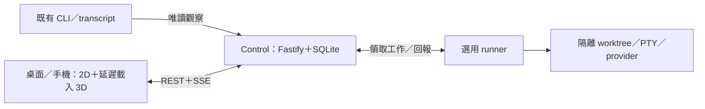

# AETHER OFFICE：第一性原理 CTO 評估

> 歷史快照，歸檔於 2026-10-19。以下「目前」「本次」及行號均指 2026-10-15 的基準版本，不代表現行缺陷、待辦優先序或發布判定。遷移歷史修復已由 [PR #12](https://github.com/haotool/aether-office/pull/12) 整合；目前實作與驗證以[功能台帳](../docs/verification/report.md)為準。其他觀察保留原文，未在此次歸檔重新驗證。

評估日期：2026-10-15。對象：本機單一可信任操作者的 AETHER OFFICE；這是依目前 README 採用的工作假設，尚未用訪談或留存資料驗證產品定位。

## 判斷

**保留現有本機架構，縮小下一輪交付範圍。先修可信度與長期運行問題，再決定是否擴大代理協作平台。**

目前不是缺 PostgreSQL、Redis、queue、微服務或 Kubernetes。已存在的 REST／SSE、單一 SQLite writer、選用 runner、3D 延遲載入與 2D 備援符合目前使用邊界。主要風險是核心觀察路徑的內容邊界、verifier 收尾、runner 歷史成長、證據新鮮度，以及驗證範圍超過目前能證明的環境。

本次另確認日常使用的 4310 服務不可連線，啟動日誌由 migration 17 checksum guard 拒絕啟動；這是當前實際使用阻塞。服務的 Node 26 漂移另行列為運行風險，不能與 migration 錯誤混成同一原因。詳見 F12。

## 範圍與證據

- 基準 HEAD：`46a323f34d760796876cb08d32ba049f9b38c613`，分支 `main`。
- 一個已註冊 worktree。HEAD 與本機 `origin/main` ref 相同；本次沒有 fetch，這不是遠端即時狀態聲明。
- 開始時有 13 個已追蹤檔案修改，以及一個未追蹤 hero 圖片。保留原狀；本報告另行新增，不修改產品原始碼。
- 已閱讀三個 app、四個共享 package 的入口、關鍵路徑、相關測試、架構決策與發布檢查。這是按風險追查，不宣稱逐行完整資安稽核。
- `CONFIRMED`：程式路徑或本次測試已確認。`HYPOTHESIS`：有根據的產品／效能假設，尚待使用或量測。`NOT_VERIFIED`：本次未驗證。
- S／M／L 表示局部修正／跨數個呼叫端與測試／跨流程或遷移的相對工作量，不是工期承諾。

| 量測／記錄                            | 本次確認                                                   | 解讀限制                                                                  |
| ------------------------------------- | ---------------------------------------------------------- | ------------------------------------------------------------------------- |
| 功能台帳                              | 175 項；145 implemented、30 partial；92 passed、83 partial | 92 項同時 implemented＋passed。各項權重不同，不能當產品成功率             |
| 已提交一般品質分數                    | 97.5                                                       | 歷史報表值，不是本次重新量測，也不是發布就緒百分比                        |
| 既有 WIP 一般品質分數                 | 97.6                                                       | fan-in 量測邊界修正；不能稱為功能或穩定性提升                             |
| 現存手機效能記錄                      | Apple M4，111 draw calls；預算 100                         | 2026-10-13 記錄，非真手機實測；超過自訂預算不等於已證實卡頓               |
| UX／perf／stability 的 subtree stamps | 皆吻合 committed HEAD                                      | 未提交的 kernel／test 修改不在 HEAD stamp 內，不能當成本次 WIP 的完整證明 |

來源：`docs/verification/features.json`、`docs/quality/scorecard.json`、`docs/verification/{stability,ux-matrix,perf-mobile}.json`、`scripts/quality/release/measure-perf.mjs:6`。

## 第一階段：需求拆解

### 使用者真正需要完成的工作

候選核心需求是：「同時開著數個 coding session 時，知道誰在工作、誰在等我，看到可公開顯示的對話與工具活動，及時處理批准或故障。」3D 是讓這些訊號容易被注意及理解的產品表現方式。

這項價值尚未由本次使用者研究證明。應用少量真實使用者驗證：有沒有減少切換終端機、有沒有更快發現等待／失敗、有沒有重複使用，而不是用畫面豐富度代替價值。

### 下一版最小可用範圍

1. 自動發現已存在的 Claude Code／Codex session，清楚區分 observed 與 AETHER-managed。
2. 可靠顯示執行、等待、失敗與未知狀態，不把推測顯示成已完成。
3. 對話、工具活動與實際可取得的用量；保持內容遮蔽與可見頻道邊界。
4. 保留精簡 3D 辦公室，以及可完成相同核心工作的 2D／手機入口。
5. Claude 遠端批准維持明確 opt-in；權限與傳輸條件照現有安全模型處理。

以上多數能力已存在。MVP 的工作是補可靠性與驗證缺口，不是重寫一份縮小版產品。

### 現在暫停擴寫

- 新會議系統、workflow 範本、知識庫平台、更多第三方整合與通用 provider plugin 系統。
- 增加裝飾動畫、角色種類、場景效果及版面功能，直到核心使用與真機成本有證據。
- 自動合併、複雜任務自動化與跨機器治理，直到可重複的人工流程與需求已確立。

現有進階頁面已收在 Advanced 之後：`apps/web/src/lib/navigation/nav.ts:40`。凍結新增範圍即可；未調查使用情況前，不直接刪持久化資料、公開 API 或既有工作流程。

人工仍可先處理派工、PR、審查、整合設定與少量用戶回饋整理。安全檢查、資料驗證、去重與恢復不適合以「先人工」取代。

## 第二階段：極簡架構

- **保留 SQLite。** 單一 control 擁有寫入權，runner 不直接開 DB，這是避免資料分裂與縮小副作用的實際邊界。ADR：`docs/adr/0003-single-sqlite-control-plane.md:15`。SQLite 官方也將裝置本機、低寫入並行列為適用情境：[Appropriate Uses for SQLite](https://www.sqlite.org/whentouse.html)。
- **保留 runner 邊界。** 三個 app／四個 package 是程式與信任邊界，不能直接等同分散式微服務過度設計。把程序執行塞回 API 並不會自動更簡單。
- **保留 REST／SSE。** 共用 scanner 與 in-flight 合併已存在：`apps/control/src/services/runtime/local-sessions.ts:129`、`apps/control/src/services/sessions/session-changes.ts:66`。先修實際讀取成本，不增加 Redis、queue 或 watcher service。
- **保留本機原生啟動。** 此產品觀察主機 CLI、檔案、程序與 PTY；目前沒有證據顯示為此增加容器掛載與主機橋接值得。未來確有遠端單機部署需求時，可再評估 Compose；它不是現在必做的前置條件。[Docker 單機部署文件](https://docs.docker.com/compose/how-tos/production/)。
- **保留場景與純資料模型分離。** 現成 lazy load、2D fallback 與 WebGL recovery 在 `apps/web/src/features/office/SceneView.tsx:14`。不要為了「極簡」刪掉產品主要視覺差異，也不要為維持差異持續堆效果。

## 第三階段：已確認問題與最小修正方向

### F01／P1：Codex 非顯示頻道會進入 transcript 與 speech

- 狀態：**CONFIRMED**；修正量 S；修正風險低。
- 證據：`apps/control/src/services/sessions/session-transcript.ts:147` 的 `codexEntries` 未檢查 message channel；`apps/control/src/services/sessions/session-speech.ts:30` 與 `apps/control/src/routes/local.ts:113` 使用同一 parser。runner 的 `apps/runner/src/observer-codex-lines.ts:118` 已有 final／commentary allowlist。
- 觸發：合成 assistant message 帶明確 `analysis` channel，仍輸出一筆可顯示 entry；本次純記憶體案例已確認，未讀私人 transcript。
- 影響：不應顯示的內容可能出現在授權使用者的對話／氣泡；本次沒有證明未登入者可存取，也沒有證明真實資料已外洩。
- 最小方向：在 control 共用 parser 沿用既有可見 channel 規則，保留缺省 channel 的既有相容行為。新增 analysis／final／commentary／缺省四類回歸；不建立新 adapter 架構。

### F02／P1：verifier 正常結束不代表背景子程序已停止

- 狀態：**CONFIRMED**；修正量 S–M；修正風險中。
- 證據：`apps/runner/src/harness-run.ts:50` 只清 timer 並 cancel stopper；`apps/runner/src/workspaces.ts:311` 等待後立即取 after snapshot。
- 觸發：合成 verifier 啟動 stdio 不連接主程序的背景子程序並以 0 結束，返回後子程序仍存活；測試程序已清理。
- 影響：可繼續占 CPU／port，或在「驗證完成」後改動工作目錄。現有 verifier 已檢查執行前後內容、base 與 harness 身分；缺口是背景程序仍可在 after snapshot 後繼續動作。已證實程序收尾缺陷，未聲稱已發生錯誤 merge。
- 最小方向：明確以 owned process group 的收尾完成作為返回條件，涵蓋主程序已退出及忽略 TERM 的情況，保持 PID／group 安全；增加真程序回歸。沿用 `packages/providers/src/process-control.ts`，不加入新 supervisor 服務。

### F03／P2：runner 已完成歷史會把 8 MiB journal 填滿

- 狀態：**CONFIRMED**；修正量 M；修正風險中。
- 證據：`apps/runner/src/journal.ts:47` 保留完整 RunCommand；`:79` 全檔上限 8 MiB；`:107` acknowledge 只刪 pending event；`apps/runner/src/runner.ts:202` 只標 finished；`apps/runner/src/terminals.ts:148` 清記憶體 session，未清 journal snapshot。
- 觸發：純記憶體案例以 260 個已完成、每個 32 KiB prompt 的 run 得到 8,541,663 bytes，pending=0 仍觸發 `RUNNER_SPOOL_FULL`；在任何寫檔前拒絕。
- 影響：正常長期使用也會累積歷史；每次 save 同步序列化與 fsync 全檔，達上限後無法正常持續保存與接單。實際多久到上限未量測。
- 最小方向：control 確認且無未送事件後，把完整 run 壓成小型完成／去重記錄；清除已確認 terminal 的大塊輸出。保留重啟與重複 claim 安全，測試累積完成、重啟、重複 claim。不要直接刪 run ID，也不要只提高上限。

### F04／P2：snapshot 先讀所有訊息再取 100 筆，另逐筆查 deliveries

- 狀態：讀取模式 **CONFIRMED**；當前卡頓 **NOT_VERIFIED**；修正量 M；修正風險中。
- 證據：`apps/control/src/services/domain/snapshot.ts:22` 全量讀訊息後 filter／slice；`:33` 每筆查 deliveries；`:77` 全量 agents／work／dependencies；`apps/web/src/lib/app/app-hooks.ts:110` 每次 domain event 使全 snapshot 失效。
- 影響：成本會隨歷史成長；owner 路徑最多另查 100 次 deliveries，agent 路徑還會在截取前逐筆查歷史訊息可見性。recent 沒有 SQL 排序保證。這是已確認成長路徑，尚非已確認目前的效能事故。
- 最小方向：把 actor 可見性、明確排序與 100 筆限制推入 SQL，批次讀 deliveries；用大型 fixture 比較資料列、查詢數、延遲。只有證明全量 work 過慢，才拆 overview／history；先不加快取服務或 CQRS。

### F05／P2：零專案時，全域設定被 FirstRun 截走

- 狀態：靜態流程 **CONFIRMED**；瀏覽器案例 **NOT_VERIFIED**；修正量 M；修正風險中。
- 證據：`apps/web/src/features/shell-chrome/AppContent.tsx:77` 沒有 projectId 就回傳 FirstRun，不區分設定路由；`apps/web/src/features/settings/SectionBody.tsx:17` 多個全域區塊本身不需要 project。
- 影響：新用戶未有專案時無法進完整設定；QuickPrefs 仍可調部分偏好，因此不能說所有設定皆不可用。
- 最小方向：讓全域設定在零專案時可用；Models／Advanced 的專案設定維持必要限制。補「零專案→Settings→General／Connections」一個回歸，無須重做 onboarding。

### F06／P2：coverage 缺少版本身分，歷史數字可能持續顯示為目前測量

- 狀態：**CONFIRMED**；修正量 M；修正風險低。
- 證據：`scripts/quality/areas/tests.mjs:69` 只讀 coverage JSON；`scripts/quality/release/measure-extended.mjs:18` 同樣未核對版本；`scripts/quality/floors.mjs:51` 任一方 skipped 就不比；`.github/workflows/ci.yml:50` 跑 test 而非 coverage。
- 本次 checkout 無 `coverage/coverage-summary.json`，保存的 scorecard 仍有 coverage 數字與 Tests 100% measured。舊提交確有測量紀錄，不能說是假造；缺口在目前重現性與身分追溯。
- 最小方向：coverage 附 source／tests／config／lockfile 身分並核對。需要 coverage 的 CI job 用 coverage run 取代同次普通 test，不額外跑兩次全套；缺測明示缺測。

### F07／P2：獨立證據新鮮度只看 HEAD，忽略未提交修改

- 狀態：**CONFIRMED**；修正量 S；修正風險低。
- 證據：`scripts/ux-matrix-summary.mjs:64`、`scripts/quality/release/stability.mjs:15` 以 HEAD subtree 作身分；`scripts/mobile-perf/record.mjs:16` 也會給當次結果配 HEAD stamp。
- 影響：dirty 工作目錄結果可能被標成 HEAD 證據，或 dirty 修改後既有證據仍被視為 fresh。**不是已證實的穩定發布閘門繞過**：`scripts/quality/release/gates-evidence.mjs:40`、`:47` 另行拒絕 dirty tree。
- 最小方向：各證據生成與接受時，檢查涵蓋路徑的 staged／unstaged／untracked 修改；局部拒絕 current 聲明即可，排除證據輸出本身。不要新建證據平台。

### F08／流程：發布閘門重複跑相同工作

- 狀態：**CONFIRMED**；修正量 S；修正風險低。
- 證據：`scripts/quality/release/gates.mjs:24`／`:25` 等效 quality check；`:27`／`:33`／`:34` 三次 OSS check；`:20`／`:28` 各做一次 clean-room，後者再加 E2E。
- 影響：確有重複啟動、install／build／test；本次未計時完整 release gates，不宣稱節省特定分鐘或百分比。
- 最小方向：同一候選內容、相同環境與命令共用 receipt，仍各自留下 criterion 結果。符合相同條件的 clean-room＋E2E 成功可支撐一般 clean-room；不能沿用來源不明或不同版本結果。

### F09／治理：絕對「只能減行」與小而聚焦的安全修正有衝突

- 狀態：政策後果 **CONFIRMED**；歷史實際損失 **HYPOTHESIS**；調整量 S；治理風險中。
- 證據：`.github/CONTRIBUTING.md:69` 要求新增行必須刪別處；`scripts/quality/areas/structure.mjs:14`、`:21` 同時計入產品、測試與工具行數。
- 判斷：小型修正可能因此需要搭配不相關刪除，增加審查面；未找到證據顯示已有人因此刪掉特定安全檢查。這是現行明文決策，調整需由 maintainer 裁決，本次不改規則。
- 建議：保留重複、死碼、複雜度與 focused-diff review；總行數改成趨勢，至少允許必要安全分支與回歸測試合理增加。程式碼少應是結果，而非凌駕正確性的硬目標。

### F10／治理：不要為 fan-in 數字拆散安全與翻譯共用入口

- 狀態：**CONFIRMED**；維持現況零成本；如需對齊量測則 S；風險低。
- 證據：`docs/adr/0011-high-fan-in-composition-points.md:15` 明確保留 server／API wrapper／useT；release scorer 尊重 allowlist，area scorer 仍產生部分 fan-in penalty。
- 建議：共享 CSRF／語言／route registry 保持集中。既有 WIP 排除測試 importer 是有效的量測修正；不要把 97.5→97.6 宣稱為產品收益，也不要為再多得分重複這些入口。

### F11／驗證：場景先補真機證據，再增加裝飾

- 狀態：歷史紀錄與缺口 **CONFIRMED**；真手機表現 **NOT_VERIFIED**；驗證量 S–M；暫停新增效果風險低。
- 證據：`docs/verification/perf-mobile.json:8` 的 111 draw calls 超過 budget 100；`docs/verification/features.json:3308` 明列 iPhone／Android、Safari、其他 GPU 與持續五分鐘散熱／frame time 未驗證。
- 建議：保留 3D 差異，先以真機確認冷啟動、持續操作、背景恢復與狀態辨識。定位成本後優先關閉不必要效果或局部批次化，不能只為 111→100 發起場景重寫，也不能直接放寬門檻掩蓋記錄。

### F12／本機運行 P1：migration 17 校驗不符阻止啟動，另有 Node 漂移

- 狀態：當次服務失敗、migration guard 錯誤與 runtime 漂移 **CONFIRMED**；migration 原文為何不同 **NOT_VERIFIED**；處理量 S–M，視原始遷移與 schema 差異而定；涉及 live service／資料的變更風險中至高。
- 證據：本次 `launchctl print` 顯示登入啟動服務為 `spawn scheduled`、last exit code 1，無服務 PID；對 `http://127.0.0.1:4310/` 的 HTTP 檢查連線失敗。這是當次快照，未宣稱持續故障時間。
- 日誌最後修改時間為 2026-10-15 05:27:16 UTC，末段持續出現 migration 17 的 `SCHEMA_VERSION_OR_CHECKSUM_MISMATCH`，訊息指向已套用遷移的原文被改動。`apps/control/src/db/connection.ts:48` 在 checksum 不合時拒絕啟動。檢查只輸出固定錯誤類型與遷移編號，未輸出原始日誌或憑證。
- 服務的 Node 路徑是 Homebrew 通用 symlink，目前解析到 v26.11.1；專案 `.nvmrc`／`package.json` 宣告 24.21.0／`>=24.21.0 <25`。本次 source checks 與 build 則在指定 Node 24 執行，兩者不等同。
- Node 差異是獨立運行風險；目前已觀察到的啟動失敗由 migration guard 回報，不把兩者混為同一因果。尚未比對 live DB metadata、原始 migration、歷史來源或 schema 差異，不能判定是誰何時修改，也不能推論資料已毀損。
- 最小方向：備份 `.data/live` 與必要憑證，找回當初已套用的 migration 17 原文並比對 schema，在受控副本驗證修復；需要變更的 schema 放新編號 migration。不可直接改 `schema_migrations` checksum、停用 guard 或刪 DB。service 另應使用專案支援的 Node，完成後驗證 launchd running PID 與 4310 HTTP 200。不要增加 Docker 或第二套 daemon 來繞過現有服務。
- 本次未修改 LaunchAgent、全域設定或重啟 live service；現行 AGENTS 要求此類全域設定修改先取得 maintainer 明確授權。

## 實作順序與 feedback loop

1. F12：先完成 migration 17 差異調查與安全恢復方案；修服務／資料須另有明確授權，不能以綠色測試取代實際可連線。
2. F01：先寫可見 channel 回歸，再修共同 parser；這是小改動、高回報。
3. 使用 runner 前優先 F02、F03：程序收尾與 journal 的不變量先測清楚，避免用自動化放大錯誤。
4. F05：用單一零專案瀏覽器案例確認路由邊界並修復。
5. F06、F07：讓「這次測到什麼」可信。F08 可接著減少重複工作。
6. F04：先量測大型 fixture，必要時修 SQL；F11 先收真機證據。
7. F09、F10：作一次治理裁決，避免長期為指標產生無產品收益的改動。

開發內圈直接跑對應 Vitest 檔案、typecheck 與 lint；提交與發布依現行 AGENTS／CONTRIBUTING 跑必要全套。若要調整規範，另作明確政策變更，不能自行略過。

Debug 沿既有邊界追查：provider fixture→parser→API／SSE→同一 UI model→顯示；runner 則看 command／run 身分、journal pending、process group、固定 SHA verifier receipt。不要另建 logging 平台，且保持內容遮蔽。

產品回饋先人工：邀請約 3–5 位目標使用者使用一週，記錄啟用耗時、誤判狀態、漏掉批准、回到終端機的原因與重複使用情況。這是建議實驗規模，非現有用戶或量測結果；不要先建完整 analytics pipeline。

## 漸進擴充觸發條件

| 額外複雜度        | 何時才值得評估                                                                        |
| ----------------- | ------------------------------------------------------------------------------------- |
| PostgreSQL        | 多個 control writer／多主機共用狀態成為明確需求，或量測到寫入競爭無法以短交易解決     |
| 共享 cache／Redis | 已量到重複昂貴跨程序計算，現有 cache／SQL／批次化無法達到使用需求                     |
| 外部 queue        | 已有需要持久派發、獨立消費者與重試治理的具體工作；先比較現有 journal／outbox 是否足夠 |
| 遠端部署／Compose | 已確定主機資料存取、身分、TLS、升級與備份責任，且確有遠端安裝需求                     |
| 多使用者／多租戶  | 真實共同操作者需要隔離與管理；目前單一可信任操作者模型不能直接拿去公開當 SaaS         |
| 更多整合／協作    | 相同人工步驟在目標用戶間反覆出現，且能定義成功／失敗、權限與資料契約                  |

觸發依據應是使用需求與量測，不以註冊人數或流量單一數字替代資料與信任邊界。

## 已考慮而不建議做的事

- 不因三個 app 就合併所有程序；runner 副作用隔離有用途。
- 不因偏好 PostgreSQL 就搬 DB；SQLite 是已明確決策的本機儲存。
- 不因 UI 是 3D 就全砍；先驗證使用價值與裝置成本。
- 不照搬舊成熟度報告的 onboarding 缺陷：目前 `FirstRun.tsx:13` 已有 CLI／hooks／doctor 引導；該舊文件亦標明歷史性。
- 不放寬未知 provider 版本：`packages/providers/src/compat.ts:10` 的相容性邊界避免協定漂移默默改變權限／事件意義。
- 不用一般分數當完成度；穩定發布另需 `scripts/quality/release/compute.mjs:48` 的全部 gates 與未量測條件。

## 本次執行的檢查

使用專案指定的 Node 24.21.0、pnpm 12.8.1；未使用預設 PATH 上的 Node 26 執行專案驗證。

| 檢查                | 結果                                                                                        |
| ------------------- | ------------------------------------------------------------------------------------------- |
| `pnpm typecheck`    | 通過                                                                                        |
| `pnpm lint`         | 通過                                                                                        |
| `pnpm format:check` | 通過；執行於新增本報告之前                                                                  |
| `pnpm test`         | 332 files passed、1 skipped；2,820 tests passed、3 skipped；43.40 秒                        |
| `pnpm build`        | 通過；產出 ignored dist。大型 chunk 警告本身不等於預算失敗                                  |
| `pnpm audit:gate`   | 通過：無未豁免的 high／critical advisory；不是完整資安無缺陷聲明                            |
| Playwright 全套     | 278 passed、4 skipped；19.9 分鐘，零失敗、零重試；使用獨立 4680／4690 與 fixture home       |
| 合成缺陷自測        | parser 頻道、verifier 背景子程序、journal 容量案例確認；未碰真實 provider 或私人 transcript |

本次未重新執行 coverage、三輪 stability、完整 UX matrix、真機 GPU／散熱／Safari／screen reader、live provider 工作或完整 stable-release gate。既有測量屬歷史記錄，不當成本次新測量。

另外通過 `pnpm verification:check` 與 `node scripts/check-bundle-size.mjs`：web JavaScript 852 KB gzip（72 files），最大 chunk 380 KB。新增報告另通過單檔 Prettier 檢查。

瀏覽器命令為 `AETHER_E2E_PORT=4680 AETHER_E2E_NATIVE_PORT=4690 AETHER_E2E_RETRIES=0 pnpm exec playwright test --reporter=line --output=evidence/cto-audit-20261015/test-results`，在上述 Node 24 環境執行。此 run 沒有重試；合成 provider 流程不等同真實 provider 端到端工作。

四項略過為三項需 `PERF_GPU=1` 的選用 GPU 量測，以及一項需 `FIELD_PERF_EVIDENCE_DIR` 的選用效能截圖；沒有把這些項目算成通過。

## 工程審查

### 過度工程化警告

產品同時涵蓋觀察工具與代理工作管理平台；後者有顯著相容性、權限、資料模型與驗證成本。先暫停擴寫，避免把未被證明的需求變成永久維護面。

### 技術債風險

優先處理 migration 差異與安全恢復、內容可見性、程序收尾、journal 成長與證據身分。這些影響信任與持續使用；檔名、目錄數、函式長度與總行數的漂亮數字不能替代它們。

### 維護成本分析

相對高成本：provider 協定與主機差異、managed execution／復原、3D 裝置矩陣及同時擴張的產品範圍。相對低成本且已適配：單一 SQLite、REST／SSE、本機啟動。此為依接觸面作的定性分析，沒有維護工時或費用實測。

### 真正瓶頸預測

當次已確認的使用阻塞是 migration 17 校驗不符使本機服務無法啟動。修復後，近期較可能是 CLI 相容性、狀態／內容可信度、長期恢復及新用戶能否得到價值；持續累積後才是 journal／snapshot 的歷史成本；手機另受 GPU／散熱限制。除已確認機制外，這些排序仍須量測驗證，沒有證據支持現在是資料庫容量或橫向擴展瓶頸。

### 未來擴充建議

每次增加一項能力，都先定義使用者問題、人工替代方式、最小交付與升級觸發條件，再沿現有邊界擴充。

**哪些東西現在做是在浪費時間：** 搬 PostgreSQL、上 Redis／queue／Kubernetes、建通用 plugin／workflow 平台、為分數拆散安全共用入口、為減行配不相關刪除、在真機與核心價值未驗證前繼續增加裝飾，以及另建完整評分／分析平台。
